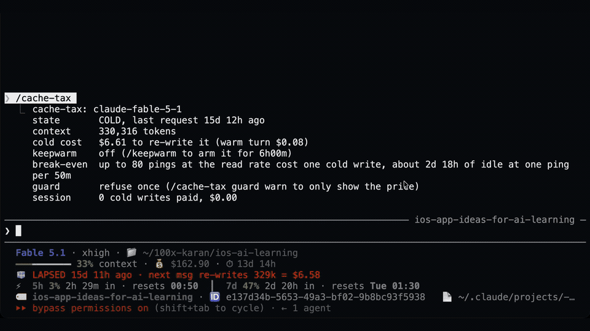
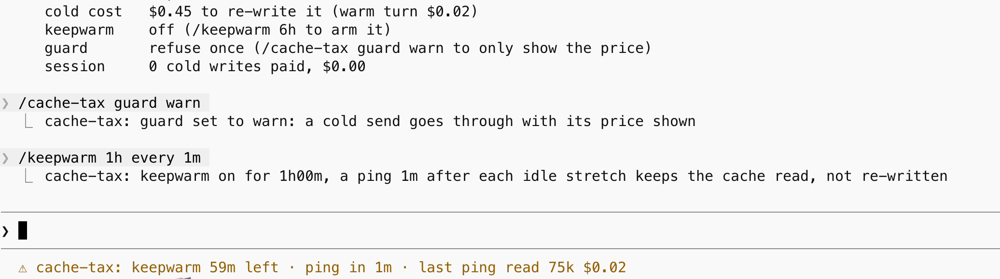

<picture>
  <source media="(prefers-color-scheme: dark)" srcset="site/assets/cache-tax-dark.svg">
  
</picture>

# Cache Tax para o Claude Code

**Mantenha o cache de prompt do Claude Code aquecido durante pausas.**

O Cache Tax é um mod do Claude Code que atualiza seu cache de prompt enquanto você se ausenta e mostra o custo estimado de reescrita antes de um envio com cache frio. Execute `/keepwarm 90m` antes de uma pausa. Os pings custam tokens; escolha uma janela na qual você espera voltar.

**[Instalação](#instalação)** · [Site](https://cachetax.aidojo.si/) · [Como funciona](#como-funciona) · [Custos e limites](#custo-e-a-questão-do-limite-do-plano) · [Comandos](#comandos)



Um resumo de duas linhas numa sessão de 330k tokens gerou uma **estimativa de US$ 6,61**. Após reenviar, a escrita de cache informada foi de **US$ 6,28**. Gravado na 2.1.1; a redação atual diz "até" a contagem estimada de tokens. São custos equivalentes de API, não cobranças extras de assinatura.

## Instalação

Precisa do [Claude Code 2.1.287 ou mais recente](https://code.claude.com/docs/en/plugins/mods/overview#turn-mods-on-or-off), de um cache de uma hora e do Claude Code rodando. Mods vêm ligados por padrão. Pings custam tokens, inclusive saída sem limite.

```sh
claude plugin marketplace add karanb192/claude-code-mods
claude plugin install cache-tax@claude-code-mods
```

Reinicie o Claude Code ou execute `/reload-plugins` numa sessão aberta. Não precisa de flag de acesso antecipado. Se você definiu `CLAUDE_CODE_ENABLE_FUNCTION_HOOKS` anteriormente, remova-a; o Claude Code atual a ignora.

Numa sessão aquecida, execute `/keepwarm` para armar seis horas. Use `/keepwarm 90m` para uma janela mais curta ou `/keepwarm off` para parar.

**Confira a duração do cache principal.** O uso incluído na assinatura tem uma hora por padrão. Sessões com chave de API, créditos de uso e provedores de nuvem têm cinco minutos por padrão, então defina [`promptCacheTtl`](https://code.claude.com/docs/en/prompt-caching#choose-the-ttl-yourself) como `"1h"` para essas formas de cobrança. Um timer de 50 minutos não protege um cache principal de cinco minutos. Veja [Limites](#limites) para as evidências do fork.

**Prefere um hook de configuração?** A [versão hook](https://github.com/karanb192/claude-code-hooks/tree/main/plugins/cache-tax) avisa por padrão, recusa uma vez com `CACHE_TAX_BLOCK=1` e oferece uma contagem regressiva independente na linha de status. O aquecimento faz parte deste mod.

Criado por [Karan Bansal](https://karanbansal.in/). Leia [a história do Cache Tax e os custos de cache gravados](https://karanbansal.in/blog/cache-tax/).

## Opções

Em `/config`, sob cache-tax:

    Auto keepwarm:    on | off
    Display:          band | status
    Ping floor:       2 (um número, 0 ou mais)
    Headless prompts: guard | send

`on` (o padrão) mantém o comportamento atual: depois que você paga uma escrita de cache frio, o keepwarm se arma por três horas. `off` deixa o keepwarm quieto até você armá-lo com `/keepwarm`; a redação da guarda então diz que o keepwarm fica desligado, ou nomeia o tempo restante de uma janela que você armou. `/keepwarm always` ainda o arma de qualquer forma.

O piso de ping divide o custo estimado de reescrita com cache frio num orçamento para pausas ociosas: 2 permite que o gasto estimado com pings fique abaixo da metade de uma reescrita; 0 desliga o limite. Antes de um ping, o gasto já observado nesta pausa mais a estimativa do próximo ping precisam ficar abaixo daquele orçamento. A estimativa usa o mais barato dos cinco recibos aquecidos mais recentes, recalculado para o modelo e contexto atuais, inclusive sua faixa de prompt. Um novo turno principal zera o gasto; estender ou parar e rearmar uma janela não. Um ping ignorado deixa o cache esfriar. O log e o status dizem por quê, e `$.cacheTax.status()` expõe `pingSkipped` e `idlePingUsd`.

O primeiro ping não tem recibo, então é enviado. Uma resposta posterior pode custar mais que o estimado, então este é um limite baseado em estimativa, não uma garantia de fatura máxima. Sem preço de modelo, contexto ou recibos com preço, não há como comparar. Recibos e gasto ficam em memória: um reinício ou nova conversa os limpa. Os pings podem terminar antes da janela de aquecimento pedida.

Display escolhe onde o estado aparece enquanto o keepwarm está armado. `band` (o padrão) é a linha acima do prompt, com ícone de texto em terminais e o cubo no Desktop. `status` coloca o mesmo texto na entrada de status abaixo do prompt e não desenha linha: use quando outro mod for dono do espaço acima do prompt. Não há configuração que esconda isso: pings custam tokens, então a tela sempre diz quando eles rodam.

## Como funciona

**Antes de uma pausa:** `/keepwarm` arma uma janela limitada. Após 50 minutos ociosos, um timer dentro do Claude Code envia um fork sem ferramentas sobre a transcrição da sessão. Ele lê o uso após cada ping e para se as leituras forem zero ou as escritas chegarem a 10% das leituras. O limite de gasto ocioso pode pular pings posteriores antes da janela terminar. Não há loop de polling de transcrição em segundo plano.

**Quando você volta com o cache frio:** para um contexto de pelo menos 50.000 tokens, a guarda pergunta antes de sua mensagem comum sair quando seu relógio de uma hora diz que está frio. A pergunta mostra o custo estimado de reescrita e orientações de aquecimento. **Enviar mesmo assim** envia a mensagem; **Não enviar** a descarta. Se a caixa for dispensada ou o host não puder respondê-la, a guarda recusa uma vez e o reenvio segue em frente. Hosts SDK que conseguem responder à caixa mantêm essa escolha. `/cache-tax guard refuse 5` pergunta a partir de US$ 5, incluindo um modelo sem linha de preço; envios mais baratos registram o preço e prosseguem.

`Headless prompts: send` faz com que prompts `sdk` não interativos optem por envio imediato na configuração padrão da guarda. O Claude Code usa os mesmos campos tanto para turnos `claude -p` quanto para o Agent SDK, então a opção cobre os dois; ela não consegue distinguir a CLI de um host SDK. O padrão, `guard`, continua perguntando, ou recusa uma vez onde ninguém pode responder. Um `/cache-tax guard refuse` explícito, com ou sem piso em dólares, ainda se aplica com `send`; `/cache-tax guard default` limpa essa preferência explícita. Mensagens humanas remotas (`composer`, `bridge`, `unclassified` e origens de canais) mantêm a guarda, mesmo em host não interativo. Notificações em segundo plano e prompts agendados são enviados com o preço registrado porque ninguém pode reenvì-los.

Uma recusa headless devolve seu motivo e o registra na transcrição/log de depuração. Use `--debug-file` do Claude Code ao diagnosticar um script. A API de mods não consegue definir o código de saída do processo nem escrever uma recusa no stderr; uma recusa não precisa gerar saída diferente de zero nem motivo no stdout. Uma execução opt-in que atinge um piso em dólares ainda precisa ser tentada deliberadamente.

Por padrão, uma escrita fria detectada arma automaticamente pelo menos três horas de keepwarm, a janela always (seis horas, a menos que você defina outra) com `always` ligado, e imprime o que custou; a [opção](#opções) Auto keepwarm desliga a parte automática. `/cache-tax` mostra a estimativa atual de cache, a janela de aquecimento e a contagem de escritas frias desta sessão.

A contagem acompanha recibos de cache. Para cada requisição, estima o contexto antigo reescrito como o menor valor entre a escrita informada e o contexto anterior menos a leitura informada. Uma cauda ausente menor que 10% da leitura é tratada como cache hit. Novo conteúdo num hit não conta nem arma o keepwarm; uma reescrita parcial substancial ainda pode. Cada reescrita usa o modelo e a faixa de preço daquela requisição.

Se o host informa só o uso somado do turno, a estimativa pode perder uma reescrita escondida por leituras de cache posteriores, e um turno que compactou fica sem pontuação sem recibos por requisição.

Quando um envio permitido pela guarda não tem reescrita detectada, uma nota de conclusão explica que nenhuma janela automática de escrita fria foi aberta, ou nomeia o estado de aquecimento existente. Isso não confirma o estado de cache do servidor a partir do uso somado. Uma conclusão de escrita fria interrompida por `/clear` não pode abrir sua janela automática na conversa substituta.

Preparar ou pular uma compactação deixa o aquecimento quieto. Uma compactação aplicada o pausa até que uma requisição principal leia ou escreva o novo prefixo. Uma janela armada pode então voltar a fazer pings enquanto o turno espera por uma ferramenta ou resposta do usuário. Escritas de resumo ficam fora da contagem; uma reescrita paga antes da compactação mantém seu contexto e preço originais.

Janelas pertencem a sessões individuais. Uma sessão já fria espera seu próximo turno antes de fazer pings, e o mesmo vale para uma janela restaurada após reinício do Claude Code, até que o novo processo tenha um turno para fazer fork. Se um ping não encontrar nada para fork, uma nota de uma linha diz isso uma vez e os pings começam após sua próxima mensagem. Um ping recusado por API ocupada (429, 529, 5xx) é tentado de novo após 1, 2 e 4 minutos enquanto ainda pode chegar antes de o cache esfriar. Com `always` ligado, cada um de seus turnos que alcança o cache deixa pelo menos a janela always (seis horas por padrão) no período padrão, sujeito ao limite de gasto ocioso e a uma leitura de aquecimento bem-sucedida. `/keepwarm always 24h` passa esse piso para 24 horas em todas as sessões (1h a 168h; `/keepwarm always` sem valor volta para seis). O mesmo turno traz de volta uma janela que parou, estende uma mais curta até a janela always e redefine um período de teste; uma janela mais longa que você definiu permanece. `/keepwarm off` em qualquer sessão para todas as sessões a partir do próximo turno. Uma janela termina em seu prazo; `/keepwarm off` também a cancela e limpa a configuração always.

### Um ping de aquecimento gravado



Sonnet 5, 16 de setembro de 2026: o status informou **75k tokens lidos por US$ 0,02**. Nada apareceu na conversa durante a execução ao vivo. Esta captura usou o intervalo de teste de um minuto na 2.0.0; a estimativa de reescrita de US$ 0,45 do cartão usava uma linha de preço mais antiga do Sonnet, contra US$ 0,30 para o mesmo contexto na linha atual. O ping de dois centavos é um recibo daquela sessão, não um preço fixo.

## Por que uma mensagem curta pode custar tanto

Quando o prefixo em cache expira, até "me faça um resumo" pode disparar uma reescrita do contexto antigo antes da resposta. A linha de preço do Fable 5.1 do Cache Tax compara uma escrita de uma hora a US$ 20 com uma leitura de cache a US$ 0,25 por milhão de tokens: 80x por token, não 80x de economia total. Veja as [suposições de preço](#custo-e-a-questão-do-limite-do-plano) e [a tabela de preços da Anthropic](https://platform.claude.com/docs/en/about-claude/pricing).

[Assista à visão geral de 23 segundos](docs/assets/cache-cost-explainer.mp4). Suas cenas desenhadas rotulam os preços de tabela do Fable 5.1; cada pixel de terminal e linha de status vem da gravação real da recusa e do recibo de aquecimento acima. A recusa foi gravada na 2.1.1 e o recorte do aquecimento na 2.0.0.

Novo em cache? [A Anthropic explica como o Claude Code o usa](https://code.claude.com/docs/en/prompt-caching).

## Comandos

    /keepwarm               mantém aquecido por seis horas
    /keepwarm 90m           mantém aquecido por uma janela sua, de 1m a 168h (também 2h30m, 6h)
    /keepwarm always        mantém toda sessão aquecida até seis horas após seu último turno, lembrado entre sessões
    /keepwarm always 24h    o mesmo, até 24 horas após o último turno (1h a 168h)
    /keepwarm 6h every 2m   ping a cada dois minutos; opção de teste, de 1m a 59m, esquecida após esta janela (com always ligado, no seu próximo turno)
    /keepwarm status        a janela de aquecimento, o próximo ping e o último recibo
    /keepwarm off           para, esquece a janela e desliga always
    /cache-tax              o cartão
    /cache-tax guard warn   mostra o preço e envia (o padrão do hook)
    /cache-tax guard default
                            restaura a guarda padrão e deixa Headless prompts controlar envios SDK não interativos
    /cache-tax guard refuse pede antes de um envio com cache frio, sobrepondo Headless prompts: send
    /cache-tax guard refuse 5
                            pede só a partir de US$ 5; abaixo disso, mostra o preço e envia
    /cache-tax guard test   pede uma vez no próximo prompt que você enviar como se o cache estivesse frio, com preço do contexto desta sessão; o teste não pontua, um envio para um cache realmente frio é pontuado como de costume

`/keepwarm` recusa palavras extras, durações inválidas e janelas fora dos limites sem mudar a janela de aquecimento atual. Também descarta prazos inválidos ou longos demais ao iniciar. Uma janela que termina antes do primeiro ping diz isso em sua resposta.

A pergunta, literalmente, com **Enviar mesmo assim (US$ 4,01)** e **Não enviar** abaixo:

    cache-tax: o cache de prompt esfriou há 2h00m. Enviar isto reescreve até 200.502 tokens a US$ 20/MTok = US$ 4,01 (um turno aquecido teria custado US$ 0,05). Não enviar economiza US$ 4,01; após Enviar mesmo assim, o keepwarm fica armado por até 3h00m. A leitura de cache sozinha custa cerca de US$ 0,05 por ping. Os pings podem parar antes no limite de gasto ocioso, deixando o cache esfriar. Enviar mesmo assim?

Quando a pergunta é dispensada ou uma execução headless guardada não pode mostrá-la, a recusa aparece em vez disso, e o reenvio segue em frente:

    cache-tax: o cache de prompt esfriou há 2h00m. Enviar isto reescreve até 200.502 tokens a US$ 20/MTok = US$ 4,01 (um turno aquecido teria custado US$ 0,05). Envie de novo para pagar, e o keepwarm ficará armado por até 3h00m, mas pode parar antes no limite de gasto ocioso. Ou use /clear e comece a partir de uma nota.

O número é um limite superior. A contagem de contexto que o engine informa para uma sessão retomada soma a entrada, leitura de cache, escrita de cache e saída da última resposta, e o payload de retomada não traz uma contagem de saída separada para subtrair; numa sessão de 15 dias a guarda disse 330.316 tokens e US$ 6,61, e a escrita que se seguiu foi de 314k tokens, US$ 6,28.

Enquanto o keepwarm está armado, o terminal e a aba Code do Desktop mostram uma linha acima do prompt, a menos que Display seja `status`. Terminais usam um ícone de texto `[>]` em negrito com a cor do estado. O Desktop mostra o cubo do Cache Tax, com tampa verde para aquecido, laranja para frio e cinza antes do primeiro turno ou após compactação. O rótulo de estado em negrito combina; o timer e o texto do recibo usam peso normal. Um `NO_COLOR` não vazio seleciona um ícone de texto em negrito nas duas superfícies e tira a cor do estado. As duas opções de exibição dizem `warm`, `cold` ou `unknown`, então cor nunca é o único sinal. Esses estados usam o mesmo relógio de uma hora de `/cache-tax`; são estimativas, não uma verificação ao vivo do cache do servidor.

A linha e o fallback de status simples atualizam uma vez por minuto enquanto o keepwarm está armado, inclusive ocioso. Atualizar só muda a exibição; não envia requisição ao modelo.

A linha inclui a janela de aquecimento, o próximo ping e a última leitura. Um loop parado mostra um símbolo neutro e seu motivo. `/keepwarm off` ou uma janela expirada remove a linha. Pesquisas temporariamente têm prioridade, e conteúdo de outros mods fica na faixa. Display `status` mostra o mesmo texto rotulado na entrada de status; superfícies sem faixa mantêm o texto simples de status quando Display permanece `band`.

O cubo do Desktop e a cor de estado frio do terminal seguem o tema claro ou escuro do Claude. Os SVGs incorporados vêm dos assets oficiais do site; mantenedores podem gerá-los de novo com `python3 tools/generate-status-icons.py`. Nenhum arquivo de imagem é lido ou buscado em runtime.

O mod lê o tema e `NO_COLOR` uma vez, quando a sessão começa. Mudanças de tema aceitas atualizam o ícone na hora; redesenhos comuns não relêem nenhuma das duas configurações. Defina `NO_COLOR` antes de iniciar a sessão.

## Com as duas formas instaladas

O hook e o mod compartilham nome e função, então ter ambos significa duas guardas em cada envio com cache frio. O mod verifica no início da sessão se o comando `/cache-tax:status` do hook existe e informa isso uma vez. Mantenha uma guarda. O hook continua como opção para quem prefere hooks de configuração. Antes de desinstalá-lo, confira sua linha de status: a linha 🧊 ligada a `cache-tax.js` vem dos arquivos do hook. Este mod desenha acima do prompt enquanto o keepwarm está armado; ele não substitui sua linha de status do shell.

## O que ele pode alcançar

Validado no Claude Code 2.1.312:

    ❯ ./register.ts hooks: config.set{key=theme}, ui.render{component=AbovePrompt}, session.start, session.end, classic.SessionStart, command.run{command=keepwarm}, command.run{command=cache-tax}, prompt.submit, turn.step, turn.complete, session.compact
    ❯ ./register.ts calls: $.clock.after (via arm, ping), $.clock.every (via updateStatus), $.clock.now, $.command.list, $.command.register, $.config.list, $.env.get, $.model.fork (via ping), $.session.id (via reseat, seat), $.session.model, $.session.usage, $.store.delete, $.store.get, $.store.set, $.ui.ask (via ask), $.ui.invalidate, $.ui.log, $.ui.resolve, $.ui.status
    ❯ ./register.ts env reads: NO_COLOR

Alcance L2, aciona o Claude. Vê cada prompt que você digita, o tempo de cada requisição ao modelo e as contagens de tokens de cada resposta.

A mesma varredura está em [cache-tax na Awesome Claude Code Mods](https://mods.aidojo.si/mods/karanb192--cache-tax--cache-tax/), que registra o que milhares de outros mods podem alcançar.

    Modelo de ameaça de cache-tax (alcance L2, aciona o Claude)
    1. Lê: de cada prompt, se começa com uma barra e mais nada (o texto é repassado intacto, nunca guardado, nunca registrado); a hora; as contagens de tokens e o id do modelo que o engine já guarda em turn.complete e na resposta do fork; os campos de retomada que o Claude Code calcula para hooks de configuração; a lista de comandos; o id da sessão, o modelo da sessão e a própria figura de contexto do engine e o horário de início, uma vez por conversa em que o processo roda, e o modelo de novo antes de precificar um envio frio e antes de cada ping; o motivo e o id da sessão de uma conversa que termina sob /clear ou retomada no processo; a contagem de mensagens de cada requisição principal; do seu próprio $.store, o prazo do keepwarm e o período de ping por id de sessão, mais a chave global always (e sua janela) e o modo da guarda com seu piso em dólares; ao carregar, as opções Auto keepwarm, Display, Ping floor e Headless prompts; se a sessão começa interativa
    2. Roda: um $.model.fork por trecho ocioso dentro de uma janela keepwarm, um por período de ping (50 minutos salvo se a opção de teste o definir, piso de 1 minuto), nunca fora da janela, nunca sobre um cache que o mod já sabe estar frio, nunca após uma leitura que não leu nada ou escreveu pelo menos um décimo do que leu, quando preços e recibos são conhecidos, só enquanto o gasto ocioso observado mais o próximo ping estimado ficam abaixo do custo de reescrita dividido por Ping floor (0 desliga o limite); uma pergunta na própria caixa de diálogo do Claude Code antes de um envio frio sair, ou no próximo prompt após /cache-tax guard test
    3. Envia: nada sai da máquina exceto o fork, uma requisição de API sobre a transcrição da sessão com um prompt fixo de uma linha
    4. Persiste: em $.store, o prazo do keepwarm e o período de ping sob o id desta sessão (com always ligado, reescrito após cada turno), e a chave always (true, ou sua janela em milissegundos) e o modo da guarda (um piso em dólares é guardado em seu lugar) para toda sessão; após uma recusa, o horário da última resposta sob o id desta sessão, para que um reenvio de um novo processo (claude -p inicia um por turno) passe, excluído por aquele reenvio ou /clear; uma janela terminada é excluída na parada e no próximo início desta sessão, junto com as chaves simples de um store 2.1.0; as chaves de outra sessão nunca são excluídas aqui, porque uma leitura seguida de exclusão não pode ser atômica contra a renovação de janela daquela sessão, então uma sessão que armou keepwarm e nunca voltou deixa duas chaves pequenas; a contagem de escritas frias da sessão, até cinco recibos de ping aquecido e o gasto ocioso com ping vivem em memória e morrem com o processo
    5. Entrada hostil: o único texto que ele analisa é o argumento de seus dois comandos, comparado com regex de duração, valor em dólares e alguns literais; a resposta da caixa é comparada só com seus próprios dois rótulos; do texto do prompt só o primeiro caractere não em branco é inspecionado, para uma barra; resultados de ferramentas e arquivos nunca chegam a um branch; o prompt do fork é constante, então nada criado pode ser enviado por ele; a guarda só descarta a mensagem do próprio usuário: após Não enviar o reenvio é perguntado de novo, e após uma pergunta dispensada ou impossível de responder o reenvio é incondicional; se um hook lançar erro, o engine o pula e a mensagem entra sem guarda, com uma linha fraca

## Custo e a questão do limite do plano

Os preços são a tabela de preços de tabela, na qual o Fable 5.1 lê a US$ 0,25, escreve na faixa de 1h a US$ 20 e responde a US$ 50 por milhão de tokens; Fable 5.2 (US$ 0,20, US$ 16, US$ 40) e Sonnet 5 (US$ 0,20, US$ 4, US$ 10) têm linhas próprias. Só versões listadas têm preço: um modelo mais novo que a tabela mostra `n/a` para dólares e uma linha dizendo que ainda não tem linha de preço, e ele nunca usa a taxa de um modelo mais antigo. Com chave de API, a aritmética é simples. Um ping cobra a leitura de cache, seus poucos tokens não cacheados na taxa base e o que o modelo responde na taxa de saída; o custo de ping exibido conta tudo isso, pois um fork não tem limite de saída e um modelo com esforço alto pode pensar antes de dizer "quente". Uma volta após a expiração é uma escrita. O cartão imprime o limite superior somente leitura para seu modelo, 80 pings no Fable 5.1, com a ociosidade que isso cobre no período atual de ping; um ping real custa um pouco mais que uma leitura, então o verdadeiro ponto de equilíbrio fica abaixo daquele número. Numa assinatura, os dólares são uma régua, não a fatura, e como uma leitura de cache pesa nos limites de 5 horas e semanais não está documentado em lugar algum que eu encontrei. Observe a linha de limite de taxa da sua linha de status durante a primeira janela.

## Limites

- Mods exigem Claude Code 2.1.287+. Vêm ligados por padrão, mas configurações locais, modo seguro ou política da organização podem impedir que carreguem. Veja [controles de mods](https://code.claude.com/docs/en/plugins/mods/overview#turn-mods-on-or-off).
- O agendamento de 50 minutos precisa de cache principal de uma hora. O uso incluído na assinatura o tem por padrão. Outras formas de cobrança precisam de [`promptCacheTtl`](https://code.claude.com/docs/en/prompt-caching#choose-the-ttl-yourself) definido como `"1h"`.
- Uma retornada verificada por transcrição no intervalo padrão, Fable 5.1 em assinatura, 19 de setembro de 2026: `/keepwarm` armado no minuto 42 de uma pausa, o ping disparou no minuto 50 e leu 157k, e a mensagem enviada no minuto 62 leu 156.886 tokens do cache e escreveu 2.255. A contagem regressiva de cache do próprio Claude Code reiniciou para 58 minutos após o ping, então o fork carregou o TTL de uma hora. Uma execução, uma configuração: mostra que o ping manteve aquele cache vivo além da hora, não economia líquida para toda configuração. O Claude Code documenta forks em seu bucket de requisições não principais, normalmente cinco minutos. Nesta execução, o fork ainda leu o prefixo de uma hora da sessão e reiniciou a contagem regressiva nativa. Isto é comportamento observado numa configuração, não prova de que todo provedor trata os buckets de forma idêntica.
- Um ping que lê aquecido prova que o cache estava aquecido então. Mudanças de prefixo podem invalidar o cache independentemente do tempo. O efeito exato depende do modelo e de quando o Claude Code aplica a mudança; veja [comportamento de cache do Claude Code](https://code.claude.com/docs/en/prompt-caching).
- Campos de retomada deixam a guarda verificar o primeiro envio comum após retomar. Se esses campos estiverem ausentes, o primeiro turno inicializa seu relógio e contexto.
- Em contas Team e Enterprise, um plugin gerenciado posicionado acima deste mod lida com os eventos clássicos e a compactação e continua abaixo dele, então eles nunca chegam ao mod. Ele então infere um `/clear` pelo fim da sessão, então o keepwarm para e a nova conversa recebe sua própria janela; o contexto de uma transcrição retomada pelos números do engine, sem horário da última resposta, então a partir de uma hora após o primeiro lançamento daquela transcrição a primeira mensagem registra o que um envio frio custaria em vez de recusar; e uma compactação a partir de uma requisição com menos da metade das mensagens da anterior (um rewind tira algumas, um resumo substitui dezenas), então um ping ou envio entre a compactação e aquela requisição ainda vê o contexto antigo. O resumo escrito após uma compactação nunca é pontuado como escrita fria; uma escrita fria paga no mesmo turno antes dela ainda é, quando o host informa uso por requisição. Uma janela levada por retomada no processo passa para as chaves da nova sessão.
- A contagem de tokens da guarda é um limite superior: é o contexto que o engine informa para a última resposta, que numa retomada inclui a saída daquela resposta, e o mod não tem uma contagem de saída separada para subtrair.
- A contagem de escritas frias é por sessão e em memória; `/clear` a esvazia.
- O tamanho do contexto é a figura ao vivo da janela do engine. O uso de um turno é a soma de suas respostas, o que num turno de dez passos são dez leituras do contexto, então é só o fallback onde o host não informa figura ao vivo.

## Desenvolvimento local

De um checkout local, carregue-o por uma sessão:

    claude --plugin-dir .

Para mantê-lo instalado, use os [comandos de marketplace](#instalação).

Enviando uma mudança? [CONTRIBUTING.md](CONTRIBUTING.md) diz que evidência um PR precisa.

## Comprove na sua própria sessão

Os testes com relógio falso provam o timer, a guarda e a pontuação, não que um fork alcance o cache principal. Um ping prova isso, e custa uma leitura de cache mais a resposta. Em qualquer sessão aquecida:

    > Reply with one word: ready
    > /keepwarm 1h every 1m

Observe a linha acima do prompt após um minuto, ou a entrada de status quando Display é `status` ou a superfície não tem faixa. `last ping read 20k $0.01` informa a leitura do fork. `keepwarm stopped: the ping read ... and wrote ...` significa que a leitura não atingiu o limite de aquecimento; o loop parou. `API busy, ping retry 1 of 3` significa que um 429, 529 ou 5xx está sendo tentado de novo; o loop para se a API ainda estiver ocupada após três tentativas ou um minuto antes de o cache esfriar. `nothing to fork yet` significa que o processo não tem conversa para fork, como após reinício; a janela espera sua próxima mensagem. Qualquer outro erro de API, interrupção ou resposta vazia para o loop com motivo. Engines mais antigos que retornam null mostram uma mensagem combinada de snapshot frio/falha de API. Termine com `/keepwarm off`. Esta verificação curta estabelece uma leitura de cache, não retenção no intervalo padrão de 50 minutos.

## Testes e verificação de tipos

Execute da raiz do repositório:

```sh
claude plugin validate .claude-plugin/plugin.json
claude plugin test .
```

Os [366 testes](tests/register.test.ts) usam relógio e engine falsos. Cobrem:

- **Opção Auto keepwarm:** desligada pontua uma escrita fria paga sem armar keepwarm e diz isso na recusa e na pergunta; uma janela armada manualmente é prometida até seu prazo e continua fazendo pings; always ainda renova por seis horas.
- **Opção Ping floor:** gasto cumulativo interrompe uma pausa longa, um turno principal o zera, rearmar não o zera, um recibo barato recente sobrevive a um pico caro, uma troca de modelo é precificada antes do próximo ping e um comando off durante a leitura do modelo cancela aquele ping. Um ping cobrado através de uma parada ainda conta, um que termina após um turno não, e um turno com erro mantém a omissão. Cobertura existente de omissão, compactação, limpeza, contexto desconhecido e limite desativado permanece.
- **Opção Headless prompts:** opt-in para prompts SDK não interativos, respostas de caixa SDK, guardas SDK interativas e humanas remotas, recusa explícita e pisos em dólares, retorno ao padrão e um prompt chegando enquanto preferências guardadas ainda carregam.
- **Guarda:** a pergunta Enviar mesmo/Não enviar, seu fallback dispensado e o teste da guarda, recusa única e reenvio, inclusive de novo processo e após erro de API sem resposta, modo aviso, piso em dólares (abaixo dele, nele, modelo sem preço, modelo trocado desde o último turno), comandos slash, contextos pequenos, prompts que ninguém digitou, inicialização na retomada e pontuação de escrita fria.
- **Aquecimento:** padrões de comando e janelas/períodos recusados, always/off, always com janela própria e as janelas que recusa, always após `/clear`, always renovando a partir do último turno, reinícios de ociosidade, parada por uso, expiração de janela fria e timers atrasados após suspensão.
- **Estado da sessão:** chaves de store isoladas, janelas restauradas, limpeza legada, reinícios por clear/compactação e isolamento de subagentes. Um clear durante o relógio ou espera de store de uma janela automática não pode armar a próxima conversa nem apagar sua janela manual.
- **Prontidão para compactação:** preparar ou pular um resumo deixa o aquecimento quieto. Após compactação aplicada, uma resposta principal que lê ou escreve cache deixa o aquecimento retomar enquanto o turno espera ferramentas ou resposta do usuário. Escritas de resumo ficam fora da contagem de escritas frias; requisições falhas e respostas obsoletas após clear, parada ou compactação mais nova não podem reiniciar pings.
- **Plugins gerenciados acima do mod:** `/clear`, retomada, janela restaurada e compactação com os eventos clássicos e de compactação continuados abaixo da camada do usuário, os mesmos eventos entregues duas vezes ou fora de ordem sem segunda janela, aviso ou reset, janela e modelo levados por retomada no processo, uma transcrição que fica velha o bastante para esfriar após sua retomada, um rewind distinguido de uma compactação, uma escrita de resumo que não é escrita fria ao lado de uma que é (um envio guardado compactado antes da primeira requisição, duas compactações num turno), um fim da conversa antiga que se sobrepõe ou dura mais que a retomada clássica e um `/keepwarm` executado antes de o host informar o id da próxima conversa.
- **Preço e exibição:** uma linha para cada modelo listado em suas grafias com data, provedor e nome de exibição, nenhuma linha emprestada para versão que a tabela não lista, escrita fria sem linha de preço contada à parte do total em dólares, faixa de prompt longo do Haiku 5.5 precificada por requisição, um turno aquecido longo cujas requisições juntas escrevem metade do contexto mantido à parte de uma escrita fria, cache hits guardados e colagens grandes sem pontuação, reescritas parciais separadas de novo conteúdo, leituras posteriores que não podem esconder uma perda por requisição, recibos antigos descartados através de requisição retida ou leitura de contexto durante clear, Opus 4 e 4.1 separados de Opus 4.5, custos de saída e entrada não cacheada, contagens de contexto, formatação de duração e a figura de equilíbrio somente leitura.
- **Indicador:** ícones de texto no terminal sem elementos de imagem, SVGs no desktop, seleção de tema, transições aquecido/frio, retomada, compactação, limpeza, expiração, pesquisas, conteúdo de outros mods e fallback `NO_COLOR`.
- **Opção de exibição:** `band` desenha a linha; `status` move o texto, inclusive seu rótulo cache-tax e de estado, para a entrada de status em superfícies de terminal e desktop sem linha. Qualquer outro valor, como um `off` antigo, recorre à linha.
- **Preferências:** uma leitura por sessão, atualizações imediatas de tema, mudanças negadas e o tema efetivo devolvido pelo gravador de configurações.
- **Falhas de fork:** API ocupada é tentada de novo enquanto o cache está quente, uma tentativa que acorda tarde demais é descartada, nada para fork espera o próximo turno, um ping por vez, uma resposta que chega após uma requisição, `/clear` ou compactação é descartada e outras falhas e o resultado nulo retornado por versões antigas param sem tentar de novo.

Os testes de renderização verificam a árvore de elementos, não pixels nativos de terminal ou desktop. Não validam retenção de cache no lado do servidor. Veja [a verificação ao vivo](#comprove-na-sua-própria-sessão).

### Verificação de tipos

Carregue este checkout com `claude --plugin-dir .` para gerar declarações ao lado do plugin. Depois, da raiz do repositório:

```sh
npx -p typescript tsc -p .
```

As declarações geradas ficam em `.claude-plugin/types/`. Mantenha-as sem track.

## Lendo o estado de outro mod

o cache-tax acrescenta um `$.cacheTax.status()` somente leitura à API de mods, então uma faixa de status pode mostrar o keepwarm sem analisar `/cache-tax`. É experimental até a 3.0: campos podem mudar numa versão menor. `cold` é a mesma estimativa de uma hora de `/cache-tax`, não uma verificação do cache do servidor. Ele resolve para `{ keepwarm: 'on' | 'off' | 'stopped', leftMs, always, alwaysMs, autoWarm, guard, guardFloorUsd, cold, stopped, coldWrites, pingSkipped, idlePingUsd }`; os tipos estão em `types/index.d.ts`. Onde o cache-tax não está instalado não há `$.cacheTax`, então quem chama envolve a chamada em `try`/`catch`.

## Mais mods do Claude Code

o cache-tax é um dos [mods de cache de prompt para Claude Code](https://mods.aidojo.si/topics/prompt-cache/) listados em [Awesome Claude Code Mods](https://github.com/karanb192/awesome-claude-code-mods). Navegue pelo catálogo completo em [mods.aidojo.si](https://mods.aidojo.si/) para encontrar um mod por tarefa e ver o que ele pode acessar antes de instalá-lo.
