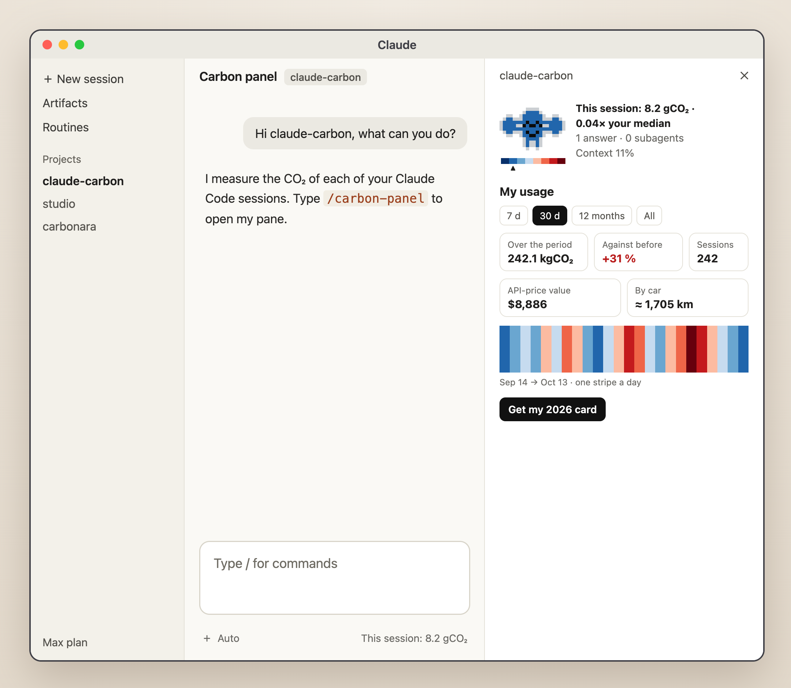
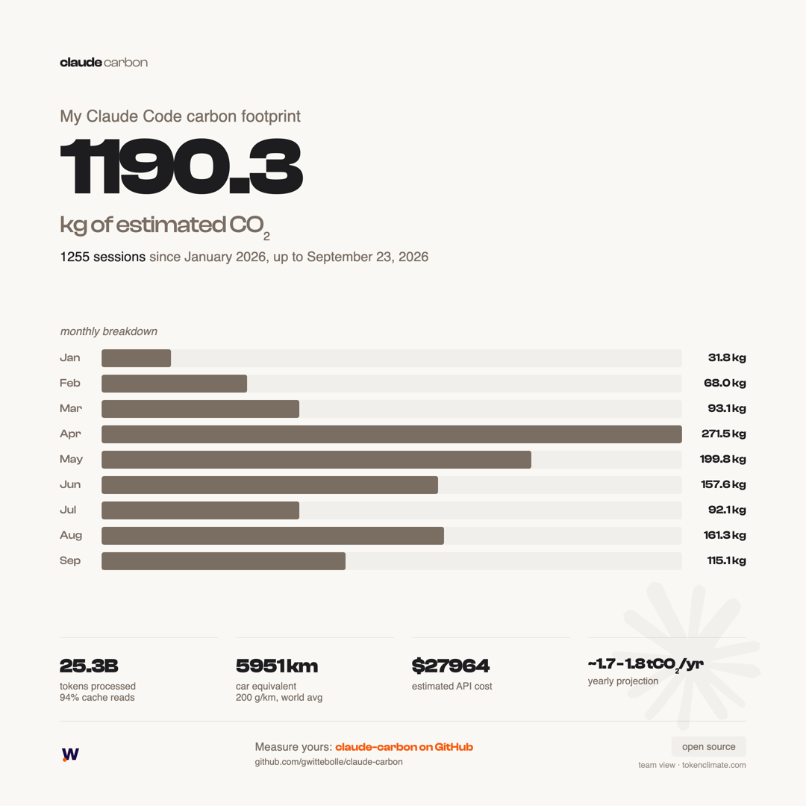
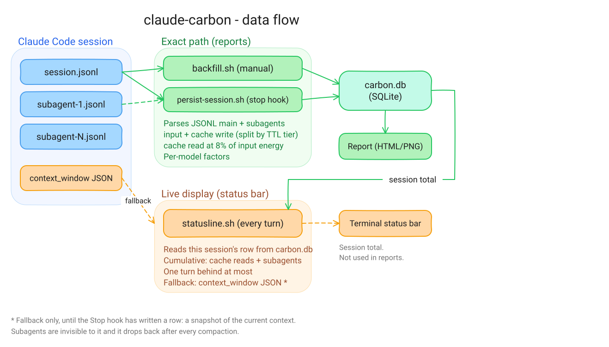

<p></p>

[](https://github.com/gwittebolle/claude-carbon/stargazers)
[](LICENSE)
[](https://github.com/gwittebolle/claude-carbon/releases)
[](https://www.npmjs.com/package/claude-carbon)
[](https://github.com/gwittebolle/claude-carbon/actions/workflows/ci.yml)

O claude-carbon é um plugin de código aberto para o Claude Code que rastreia a pegada de carbono das suas sessões: uma estimativa ao vivo de CO2 calculada localmente a partir do seu uso de tokens, na linha de status do terminal e na aba Code do aplicativo desktop do Claude, ao lado do custo equivalente em API da sessão. No aplicativo desktop, `/carbon-panel` abre um painel com uma molécula de pixels colorida conforme o CO2 desta sessão em relação à mediana das suas sessões passadas, seu uso no período escolhido, as listras de aquecimento daquele período e um botão para o seu cartão anual.

<p align="center"></p>

## O que o claude-carbon faz

- `/carbon-panel`: um painel no aplicativo desktop do Claude com sua molécula de CO2, seu uso e as listras de aquecimento das sessões (no terminal, a sessão na faixa acima do prompt). Veja [o mod](#o-mod-carbon-panel-e-o-co2-de-cada-resposta)
- Acrescenta uma estimativa ao vivo de CO2 à linha de status do Claude Code e o CO2 da sessão abaixo do prompt no aplicativo desktop, cada um ao lado do custo equivalente em API da sessão
- Persiste cada sessão num banco SQLite local, para que o histórico sobreviva à limpeza de transcrições de 30 dias
- Preenche retroativamente dados históricos a partir das transcrições `~/.claude` existentes
- Comandos slash: `/carbon-report` (texto), `/carbon-card` (PNG), `/carbon-pr` (pegada de um pull request)
- Um badge de README com seu total de todos os tempos e uma metodologia pública com todos os fatores referenciados

> **Sobre o valor `$`.** É um equivalente de API: quanto sua sessão custaria nas tabelas de preço avulso da API da Anthropic. Numa assinatura Pro, Max ou Ultra você não paga isso; o valor mostra o que você usou, ao lado do CO2 correspondente. Veja [Como funciona](#como-funciona).

## Instalação

No Claude Code, digite:

```text
/plugin install claude-carbon --marketplace gwittebolle/claude-carbon
```

O Claude Code pede para você confirmar o marketplace, mostra o que o plugin instala e pergunta onde instalá-lo: escolha **Instalar para você**. A mesma linha funciona no macOS, Linux e Windows. Na aba **Code** do aplicativo desktop do Claude, se a linha não estiver disponível, cole esta mensagem e aceite quando o Claude perguntar:

```text
Install the claude-carbon plugin for me: claude plugin install claude-carbon --marketplace gwittebolle/claude-carbon
```

Depois saia completamente do Claude Code, abra-o de novo e inicie uma nova sessão. Seu CO2 agora aparece ao lado do custo da sessão:

- no terminal, na linha de status: `$0.50 · 65gCO₂`
- no aplicativo desktop, abaixo do prompt: `This session: 3.6 gCO₂ · $0.12`

O plugin define essa linha de status uma vez, no primeiro início de sessão, e só quando você não tem nenhuma: a linha de status de outra ferramenta é deixada como está (para acrescentar o CO2 a ela, veja [ccstatusline](#uso-com-ccstatusline)). `/carbon-report` mostra seus totais e `/carbon-panel` abre o painel no aplicativo desktop. O `$` é um custo equivalente de API, não o que sua assinatura cobra. Para atualizar depois, execute `/carbon-update`.

<p align="center"></p>

<details>
<summary><b>Se a instalação parar</b></summary>

- **O macOS abre uma janela sobre "ferramentas de desenvolvedor de linha de comando".** É o `git`, que o Claude Code precisa para buscar o plugin, e um Mac sem ferramentas de desenvolvedor ainda não o tem. Clique em **Instalar**, espere terminar (alguns minutos) e instale de novo.
- **"jq is not installed" ou "sqlite3 is not installed".** Diga ao Claude: "Instale o que falta." e reinicie o Claude Code. Todo Mac tem `sqlite3`, e o macOS 15 ou posterior também tem `jq`. Num Mac mais antigo, o Claude pode instalar `jq` com Homebrew, ou o instalador (em Outras formas de instalar) busca o `jq` oficial e confere seu checksum publicado. No Windows, `/carbon-panel` nomeia o que falta e o Claude pode instalá-lo com `winget`. Se `winget` responder "Access is denied", o software de segurança do PC está bloqueando: libere `winget` nele e tente de novo.
- **O Windows diz que falta o Git Bash.** Instale o [Git for Windows](https://git-scm.com/downloads/win) (o Claude Code precisa dele no Windows de qualquer forma), saia completamente do aplicativo e reabra-o, depois instale de novo numa nova sessão. O Claude Code procura o Git Bash no início da sessão, então uma sessão aberta durante a instalação do Git ainda roda sem ele.
- **Instalado do marketplace da comunidade da Anthropic e o plugin falha ao carregar?** A entrada `co2-tracker@claude-community` está fixada num release de agosto de 2026 que o Claude Code atual rejeita ("Duplicate hooks file detected"). Execute `/plugin uninstall co2-tracker@claude-community` e instale como acima.

</details>

<details>
<summary><b>Outras formas de instalar</b></summary>

- **O instalador**, um script que clona este repositório e configura tudo em `~/.claude/settings.json`. Cole esta mensagem no Claude Code, ou execute você mesmo no terminal o comando depois dos dois-pontos:

  ```text
  Install claude-carbon for me by running this command:
  curl -fsSL https://raw.githubusercontent.com/gwittebolle/claude-carbon/main/install.sh | bash
  ```

  No Windows, no PowerShell (precisa antes de [Git for Windows](https://git-scm.com/downloads/win) e de dois pacotes, veja [Windows](#windows)):

  ```text
  Install claude-carbon for me by running this command in PowerShell:
  irm https://raw.githubusercontent.com/gwittebolle/claude-carbon/main/install.ps1 | iex
  ```

  Se o seletor de modo abaixo do prompt mostrar **Auto**, escolha **Manual** primeiro: o modo automático bloqueia um comando que baixa e executa um script. Você pode ler [install.sh](install.sh) antes de executá-lo.
- **Com Node.js:** `npx claude-carbon` executa o mesmo instalador.

Use só uma forma: o plugin e o instalador juntos fariam cada hook rodar duas vezes. Já instalou com o instalador? Nada a mudar, `/carbon-update` o mantém atualizado.

</details>

Não coberto: as abas de chat e Cowork e o aplicativo web (claude.ai/code). Suas sessões rodam nos servidores da Anthropic, então nada chega à sua máquina para ser contado.

## Exemplo de relatório

<p align="center">
  
</p>

Gere o seu com `/carbon-card` no Claude Code. Os PNGs de resumo e detalhados vão para
`~/Downloads/claude-carbon/` (a pasta Downloads do Windows segue a configuração do sistema, então uma redirecionada para o OneDrive é respeitada) e a pasta abre no seu gerenciador de arquivos, com o
cartão selecionado no macOS. `CLAUDE_CARBON_EXPORT_DIR` escolhe outra pasta;
`CLAUDE_CARBON_NO_OPEN=1` evita a abertura.

Sem Playwright ou Chromium não há PNG e o comando ainda termina: o
cartão de resumo é salvo como página HTML na mesma pasta e abre no seu navegador, ajustado à
janela, e uma captura de tela resolve. A contagem de tokens no cartão é todo token processado pelo Claude, incluindo leituras de cache, como `ccusage` os conta; a linha cinza abaixo informa a parte das leituras de cache. O rodapé do cartão diz onde encontrar a ferramenta, `claude-carbon sur GitHub` / `claude-carbon on GitHub`, com o endereço abaixo.

Do dia 1 ao dia 10 de cada mês, a linha de status termina com `📊 September: 84.2kgCO₂ · /carbon-card`:
 o total do mês recém-encerrado, a barra que o cartão desenha para ele, no mesmo formato do
número da sessão. Isso é lido do carbon.db uma vez por dia enquanto o lembrete aparece e fica em
`~/.claude/claude-carbon/last-month-total`. Um mês com menos de 7 dias de sessões não recebe
lembrete, para que uma instalação nova não seja incentivada a compartilhar um cartão quase vazio. Gerar um cartão
limpa o lembrete daquele mês; ele silencia sozinho depois do dia 10. Em dezembro, mostra o ano
até ali, `📊 2026: 1444.4kgCO₂ · /carbon-card`, e permanece o mês inteiro, pois o cartão cobre o ano
calendário. Do dia 1 ao dia 10 de janeiro, mostra o ano que terminou, e nesses
dias `/carbon-card` cobre aquele ano inteiro, a menos que você passe um período ou aquele ano não tenha sessão (o
cartão mantém esses dez dias mesmo com o lembrete desligado). `CLAUDE_CARBON_CARD_NUDGE_UNTIL_DAY`
muda o limite (0 remove o lembrete, inclusive em dezembro), `CLAUDE_CARBON_NO_CARD_NUDGE=1` remove o lembrete. Nada é publicado em lugar algum:
compartilhar continua sendo decisão humana.

<details>
<summary>Opções avançadas (CLI)</summary>

```bash
# Desde uma data específica
bash ~/code/claude-carbon/scripts/generate-report.sh --since 2026-03-01

# Todo o período
bash ~/code/claude-carbon/scripts/generate-report.sh --all

# Um período fechado (--until é um limite superior exclusivo: este para em 30 de junho)
bash ~/code/claude-carbon/scripts/generate-report.sh --since 2026-01-01 --until 2026-07-01
```

</details>

<details>
<summary>Diretório de instalação personalizado</summary>

```bash
curl -fsSL https://raw.githubusercontent.com/gwittebolle/claude-carbon/main/install.sh | CLAUDE_CARBON_DIR=~/my-path/claude-carbon bash
```

A variável de ambiente precisa ficar do lado `bash` do pipe, não do lado `curl`, senão o instalador nunca a vê.

</details>

<details>
<summary>Segundo ambiente Claude (CLAUDE_CONFIG_DIR)</summary>

Se você roda um segundo ambiente do Claude Code com seu próprio diretório de configuração, por exemplo

```bash
alias claude-work="CLAUDE_CONFIG_DIR=~/.claude-work claude"
```

instale o claude-carbon naquele mesmo diretório passando `CLAUDE_CONFIG_DIR` ao instalador:

```bash
curl -fsSL https://raw.githubusercontent.com/gwittebolle/claude-carbon/main/install.sh | CLAUDE_CONFIG_DIR=~/.claude-work bash
```

A linha de status, os hooks, o banco de dados e os comandos `/carbon-*` ficam sob aquele diretório de config, então cada ambiente rastreia suas sessões de forma independente. Sem `CLAUDE_CONFIG_DIR`, tudo volta a `~/.claude` como antes.

</details>

<details>
<summary>Instalação manual</summary>

```bash
git clone https://github.com/gwittebolle/claude-carbon.git ~/code/claude-carbon
bash ~/code/claude-carbon/scripts/setup.sh
bash ~/code/claude-carbon/scripts/configure-settings.sh
```

O segundo script mescla o bloco abaixo em `~/.claude/settings.json` (de forma aditiva: uma linha de status existente ou hooks de terceiros são deixados como estão) e cria links simbólicos para os comandos `/carbon-*`. Para configurar à mão, pule-o e acrescente:

```json
{
  "statusLine": {
    "type": "command",
    "command": "~/code/claude-carbon/scripts/statusline.sh"
  },
  "hooks": {
    "Stop": [
      {
        "matcher": "",
        "hooks": [
          {
            "type": "command",
            "command": "~/code/claude-carbon/scripts/persist-session.sh"
          }
        ]
      }
    ],
    "SessionEnd": [
      {
        "matcher": "",
        "hooks": [
          {
            "type": "command",
            "command": "~/code/claude-carbon/scripts/persist-on-exit.sh"
          }
        ]
      }
    ],
    "SessionStart": [
      {
        "matcher": "",
        "hooks": [
          {
            "type": "command",
            "command": "~/code/claude-carbon/scripts/safety-rescan.sh"
          }
        ]
      }
    ],
    "SubagentStop": [
      {
        "matcher": ".+",
        "hooks": [
          {
            "type": "command",
            "command": "~/code/claude-carbon/scripts/agent-stop.sh"
          }
        ]
      }
    ]
  }
}
```

O hook `Stop` registra a sessão após cada turno, e `SessionEnd` a registra mais uma vez ao fechar, então um último turno interrompido antes de `Stop` disparar ainda é contado. O `SessionStart` faz uma nova varredura de sessões perdidas (travamento, kill) e comanda a verificação diária de atualização que a linha de status lê; sem ele você nunca é avisado de que existe uma versão nova. `SubagentStop` registra o branch em que um agente trabalhou, para `/carbon-pr`.

Reinicie o Claude Code.

</details>

## Para equipes

O claude-carbon mede as sessões de um desenvolvededor, localmente. Se a pergunta vem do seu CTO, de um RFP de cliente ou de um comitê de CSR, a mesma metodologia existe como camada hospedada:

- [Calculadora gratuita](https://tokenclimate.com/en/calculator?ref=github) e [folhas de fatores por modelo](https://tokenclimate.com/en/models?ref=github) — os mesmos fatores versionados deste repositório, navegáveis.
- [TokenClimate](https://tokenclimate.com/en?ref=github) — painéis de equipe hospedados. Os dois lados compartilham os vetores de referência deste repositório, verificados semanalmente no CI.

O OSS aponta para lá em cinco lugares: um rodapé de uma linha em `/carbon-report`, um pequeno crédito nos PNGs do `/carbon-card`, a última linha de um comentário do `/carbon-pr`, o pé do painel `/carbon-panel` e o campo `url` de `CITATION.cff`. Sem promoção na linha de status, sem captura de e-mail: nada sai da sua máquina.

### Pegada de desenvolvimento de PR (/carbon-pr)

O número que revisores raramente veem é o que custou desenvolver o PR: suas sessões locais do Claude Code enquanto construíam o branch. `/carbon-pr` (ou `scripts/generate-pr-report.sh`) soma as sessões registradas do branch atual e publica um comentário fixo no PR aberto, pela sua própria autenticação `gh`. Execute-o depois do push; executá-lo de novo atualiza o mesmo comentário no lugar.

```
**Claude Code carbon report** · developing this PR

| CO2e | Cost* | Tokens (in + cache write + out) | Cache reads | Sessions |
|---|---|---|---|---|
| **124 g** | $3.00 | 180k | 1.5M | 2 |
```

Abaixo da tabela vêm a equivalência em carro, um detalhamento de tokens por modelo dobrável e um rodapé de uma linha.

Como as sessões são atribuídas: o hook Stop guarda o branch git de cada sessão (lido da transcrição), e o relatório seleciona `projeto + branch`. Sessões registradas antes de essa coluna existir não têm branch; `scripts/backfill.sh` as repara enquanto as transcrições ainda estão no disco (cerca de 30 dias). Uma sessão cuja última pasta é um subdiretório do repositório é armazenada sob o nome do subdiretório e fica fora da soma. Uma sessão que termina em branch diferente do que começou é atribuída a onde terminou.

Como seus agentes são atribuídos: um agente conta com sua sessão, a menos que tenha trabalhado num branch próprio. Uma sessão em `main` que envia agentes para construir um PR num worktree coloca a parte deles no branch do PR, e o comentário então diz quantas sessões registradas em outro lugar foram incluídas. Um hook `SubagentStop` (`agent-stop.sh`) lê o branch conforme cada agente termina, enquanto seu worktree ainda existe:

- um agente que rodou num worktree próprio (agentes isolados e de workflow do Claude Code) conta no branch que aquele worktree tem então, a menos que o Claude Code o tenha nomeado (`worktree-agent-*`, `worktree-wf_*`) ou ele esteja destacado;
- um agente que rodou na pasta da sessão conta no worktree que suas chamadas de ferramenta nomeiam em pelo menos metade das que dão um lugar (um comando, um caminho de arquivo), e nenhum outro com tanta frequência: caminhos absolutos, `~/`, `../` da pasta do repositório quando o worktree fica ao lado dele, `./` quando fica dentro. Nunca a pasta principal do repositório, nem a da própria sessão. Este é um dedução a partir dos comandos do agente.

O hook guarda os tokens, CO2 e custo daquele agente, por modelo, numa tabela `agent_usage`, com o repositório e a pasta do worktree; a linha da sessão não muda. O relatório tira esses agentes do branch da sessão e os soma ao deles, contanto que a linha da sessão contenha todos os seus agentes (`agents_collected = 2`: o hook Stop ou a nova varredura leu toda transcrição de agente), tenha sido escrita depois que o agente terminou (num segundo posterior) e tenha sido registrada com o método atual (não uma linha v1). Um agente que trabalhou em outro repositório que não o da sessão não é registrado, e um registrado antes de seu repositório ser movido fica com sua sessão. Forks ficam de fora (replay das mensagens do pai), e assim como o trabalho que a sessão faz ela própria num worktree. Só agentes que terminam com esta versão instalada são atribuídos: nada é reconstruído para sessões passadas.

O hook precisa do Claude Code 2.1.69 ou posterior, a primeira versão a dar ao `SubagentStop` o tipo do agente (seu id e transcrição vieram na 2.0.42); com mais antigo, nada é registrado. Os agentes próprios do Claude Code (sugestões de prompt, `/btw`) ficam de fora. Numa sessão rodada sem `--agent`, seu tipo é vazio: o matcher do hook os pula a partir da 2.1.275, o script antes disso. Com `--agent`, eles trazem o nome daquele agente e passam no matcher; o script os pula porque sua transcrição não é uma que a linha da sessão lê.

O hook roda de forma síncrona, antes de o resultado do agente chegar à sessão: no Mac, cerca de 0,1 a 0,3 s para a maioria dos agentes, até cerca de 1 a 2 s para um cuja transcrição passa de 100 MB, pois a lê inteira. O Claude Code escreve transcrições de forma assíncrona: quando a mensagem final do agente ainda não está lá, o hook a relê a cada 0,2 s, por até 1 s, e então conta o que há. Um banco ocupado por mais de cerca de 10 s (uma leitura longa em outro lugar) perde o registro, e o agente conta com sua sessão.

#### Para todo PR de um repositório

Um repositório pode pedir o relatório em seus pull requests. Seus mantenedores fazem commit disto em `.claude/settings.json`, uma mudança que a equipe revisa como qualquer outra:

```json
{ "env": { "CLAUDE_CARBON_PR": "1" } }
```

Nada é publicado só com isso. Na primeira vez que um desenvolvedor com o plugin abre um pull request ali com o Claude Code (`gh pr create`), o Claude pergunta uma vez se ele quer publicar o relatório de suas próprias sessões sob sua conta do GitHub. A resposta fica na máquina dele, por repositório (`pr-consent.tsv` na pasta de dados):

- **sim**: o comentário é publicado quando a resposta termina, e atualizado no lugar depois de cada `git push` ou `gh pr create` que o Claude executa ali, uma vez registrada a resposta que fez o push e enquanto o branch enviado ainda for o checkout atual. Um push que você digita você mesmo no terminal não dispara nada. Um comentário por PR, e nunca por conta própria num PR cujo branch vive num fork.
- **não**, ou sem resposta: nada é publicado e a pergunta não volta. `/carbon-pr` continua funcionando quando executado.

Mude sua resposta a partir do repositório com `scripts/generate-pr-report.sh --consent yes` ou `--consent never` (depois de um sim digitado no terminal, o primeiro comentário vem com seu próximo push ou `gh pr create` no Claude Code); um sim só é aceito depois que a pergunta foi feita a você ali, o que também cobre uma pergunta que nunca apareceu porque o turno foi interrompido. A resposta fica sob a URL `origin` do repositório (sem credenciais): renomeie o remoto e a pergunta volta uma vez. Um repositório não pode responder por você: as respostas nunca são lidas de uma pasta de config ou banco colocados dentro do repositório, e publicado por conta própria o comentário só vai ao repositório que `origin` nomeia, seja qual for `GH_REPO`. `CLAUDE_CARBON_NO_PR_AUTO=1` no seu próprio ambiente desliga a pergunta e a publicação em todo lugar. Para parar no repositório, remova a linha `CLAUDE_CARBON_PR`. Isso precisa dos hooks do plugin (instalação pelo marketplace): um clone só com instalador não é perguntado e não publica nada sozinho. Feito para o repositório de uma equipe; num projeto público, colaboradores de fora veriam comentários que não pediram.

#### O total do repositório

`scripts/generate-pr-report.sh --summary` relê, pelo `gh`, os relatórios já publicados nos pull requests mesclados do repositório e os totaliza por mês de merge e por autor. `--since 2026-10-01` restringe. Imprime só no seu terminal, não publica nada e não lê seu banco: os números são os que cada autor publicou.

```
Month merged             PRs  Sessions       CO2e       Cost
2026-09                    2         4     1.8 kg     $57.26
2026-10                    1         1       69 g      $1.92

Author                   PRs  Sessions       CO2e       Cost
alice                      2         2      644 g     $19.18
bob-dev                    1         3     1.2 kg     $40.00

Total: 3 PRs, 5 sessions, 1.8 kg CO2e, $59.18 at API list price.
```

Um comentário no formato antigo de uma linha, ou editado à mão, é contado como ilegível e deixado de fora. Cobre os pull requests que trazem um relatório, não a pegada inteira do repositório, e lê no máximo 100 de cada vez.

Fora de tal repositório, desligado é o padrão: nada é publicado a menos que você execute. `--dry-run` pré-visualiza o comentário, `--pr <número>` mira um PR específico do repositório (um aberto de um fork é recusado: execute o comando do clone do fork), e excluir o comentário no GitHub é a limpeza completa. Uma vez que os agentes do repositório estão registrados, o relatório conta, de qualquer pasta em que rode, as sessões da pasta principal do repositório, do worktree onde o branch está em checkout e dos worktrees em que seus agentes trabalharam, mesmo removidos desde então. Um branch em checkout em lugar nenhum cujo nome também aparece em sessões de outras pastas é recusado: nada é publicado, em vez de um número que pode faltar essas sessões.

## Como funciona



**Três caminhos de dados, dois níveis de precisão:**

| Script               | Gatilho                 | Fonte de dados        | Subagentes    | Leituras de cache    | Precisão      |
| -------------------- | ----------------------- | --------------------- | ------------ | ------------------- | ------------- |
| `backfill.sh`        | Manual / configuração   | Arquivos JSONL        | Incluídos     | Contadas (8% de energia) | Melhor estimativa |
| `persist-session.sh` | Hooks Stop + SessionEnd | Arquivos JSONL        | Incluídos     | Contadas (8% de energia) | Melhor estimativa |
| `statusline.sh`      | Cada turno (ao vivo)    | Linha em `carbon.db`  | Incluídos     | Contadas (8% de energia) | Um turno atrasado |

**backfill** e **persist-session** analisam as transcrições JSONL brutas (sessão principal, arquivos de subagentes e as transcrições dos agentes que um workflow inicia), aplicando fatores de emissão por modelo. Deduplicam mensagens do assistente por `(message.id, requestId)`, então sessões retomadas e compactadas não são contadas duas vezes (isso corresponde a `ccusage`; sem isso, a soma de tokens infla cerca de 3x). Cada sessão guarda sua divisão bruta de tokens (entrada, escrita de cache, leitura de cache, saída), que alimenta o banco SQLite usado pelos relatórios.

A transcrição de um agente para de mudar quando ele termina, então seus totais são mantidos em `~/.claude/claude-carbon/usage-cache/` (um arquivo pequeno por sessão, removido pela nova varredura diária 45 dias após a última escrita) e relidos só quando o tamanho, a modificação, o tempo de alteração ou o inode do arquivo mudam (o arquivo para o qual um link simbólico aponta). Um agente com uma linha que ainda não analisa, cortada por uma escrita em andamento, nunca é mantido. A transcrição principal sempre é lida por inteiro. `CLAUDE_CARBON_NO_USAGE_CACHE=1` lê tudo toda vez e não grava cache.

**Custo** é o valor teórico de tabela da API (avulso), não o preço da sua assinatura: entrada, saída, escrita de cache e leitura de cache (0,1x entrada) nas taxas atuais da Anthropic, definidas em `data/prices.json`. Escritas de cache são cobradas por faixa de TTL, 1,25x entrada na faixa de 5 minutos e 2x na de 1 hora; a divisão de cada sessão é lida de sua transcrição, não presumida (o Claude Code escreve na faixa de 1 hora). Em dados deduplicados, corresponde a `ccusage`.

**statusline** lê a linha desta sessão em `carbon.db` a cada turno, então o CO2 mostrado é o total da sessão na mesma base dos relatórios, no máximo um turno atrasado. Antes de essa linha existir (primeiro turno, ou nenhum banco ainda),ele recorre a uma estimativa de `context_window.total_input_tokens`, que é o tamanho do contexto atual, não um total acumulado: subagentes são invisíveis para ele e cada compactação o faz cair. De qualquer forma, a linha de status mostra, nunca alimenta os relatórios.

### A linha de status

Segmentos, da esquerda para a direita: projeto + branch git, modelo + % da janela de contexto, custo equivalente em API da sessão + CO2, % da cota da assinatura + horário de reinício. A cota é a janela de 5 horas, ou a semanal quando nenhuma janela de 5 horas está aberta (sempre, numa conta Ultra verificada; em Pro e Max, entre o reinício de uma janela de 5 horas e sua próxima requisição): `Use 41% 7d ↻Thu`, com o reinício como dia da semana quando está a mais de um dia. Um prefixo 🔥 aparece quando a taxa de consumo sustentada ultrapassaria 100% do limite até o fim da janela (uma vez que o uso chega a 15%, após uma tolerância de 15 min na janela de 5 horas e de um dia na semanal).

> **Onde o CO2 aparece.** A linha de status é um recurso da interface de terminal do Claude Code. Só é exibida quando você roda `claude` num terminal, inclusive o terminal integrado do VS Code ou do JetBrains. O painel de chat das extensões de IDE não tem linha de status, então nada aparece lá, embora os hooks ainda rodem e suas sessões sejam registradas: `/carbon-report` as cobre. Se usa o painel do VS Code e quer o CO2 ao vivo, abra um terminal no VS Code (`` Ctrl+` ``) e rode `claude` ali. O aplicativo web (claude.ai/code) não roda nem a linha de status nem os hooks, então nada é exibido ou registrado lá. O aplicativo desktop também não exibe a linha de status; o [mod](#o-mod-carbon-panel-e-o-co2-de-cada-resposta) do plugin desenha o CO2 na aba Code.

**Fonte da cota.** A porcentagem é a da própria Anthropic, os mesmos dados que o Claude Code mostra em `/usage`. Sem heurística, sem arquivo de limite de tokens para inicializar. Duas fontes, em ordem:

1. **stdin** (preferencial): os `rate_limits` que o Claude Code passa no JSON da linha de status, `five_hour` primeiro, senão `seven_day`. Quando `rate_limits` está presente, uma janela que ele omite não existe, e nada mais é consultado.
2. **Fallback da API OAuth**, só quando o stdin não tem `rate_limits` (antes da primeira resposta da sessão, ou com Claude Code mais antigo): `GET https://api.anthropic.com/api/oauth/usage` com o token bearer do Keychain do macOS, `CLAUDE_CODE_OAUTH_TOKEN` ou `~/.claude/.credentials.json`, no máximo uma vez por minuto, responda ou não. A resposta fica em cache em `~/.claude/claude-carbon/oauth-usage.json`; uma janela sem horário de reinício, ou cujo reinício já passou, é omitida.

Preciso em Pro, Max e Ultra.

### Sobrevivendo à limpeza de transcrições de 30 dias

O Claude Code exclui transcrições JSONL após cerca de 30 dias, então o banco SQLite é o registro durável. Os hooks `Stop` e `SessionEnd` capturam cada sessão antes de a transcrição expirar, e uma revarredura diária em segundo plano (hook `SessionStart`, `safety-rescan.sh`) pega qualquer sessão que eles perderam enquanto a transcrição ainda existe, inclusive uma cuja transcrição continuou crescendo depois de sua linha ter sido escrita. Como cada linha guarda contagens brutas de tokens, `recompute.sh` regenera custo e CO2 a partir de `data/factors.json` + `data/prices.json` a qualquer momento, sem precisar da transcrição. Quando a Anthropic muda um preço ou um fator é revisado, edite a config e execute:

```bash
bash scripts/recompute.sh
```

Sessões registradas desde setembro de 2026 são recalculadas modelo por modelo, exatamente. Sessões mais antigas sem divisão por modelo mantêm seus valores armazenados; `--include-unsplit` as recalcula pelo modelo dominante, uma aproximação (veja METHODOLOGY.md, "Surviving the 30-day transcript purge").

## Comandos

| Comando          | O que faz                                        |
| ---------------- | --------------------------------------------------- |
| `/carbon-report` | Relatório em texto com totais, equivalente em carro, parte de um orçamento de 2 t e sessões principais |
| `/carbon-card`   | Gera cartões PNG de relatório compartilháveis                 |
| `/carbon-badge`  | Badge shields.io da sua pegada total para seus READMEs |
| `/carbon-pr`     | Publica a pegada de desenvolvimento do branch atual no PR |
| `/carbon-update` | Atualiza para a versão mais recente, seja qual for a forma de instalação |

<details>
<summary>Scripts (rodam automaticamente, raramente precisam ser executados à mão)</summary>

| Script               | O que faz                                                                              |
| -------------------- | ----------------------------------------------------------------------------------------- |
| `setup.sh`           | Inicia o banco, preenche sessões históricas, mostra o total                                   |
| `statusline.sh`      | Script da linha de status (chamado automaticamente pelo Claude Code)                                  |
| `persist-session.sh` | Hook Stop (salva dados da sessão após cada turno)                                            |
| `persist-on-exit.sh` | Hook SessionEnd (salva a sessão mais uma vez ao fechar, em segundo plano)             |
| `safety-rescan.sh`   | Hook SessionStart (revarredura em segundo plano com limite, pega sessões perdidas)                 |
| `agent-stop.sh`      | Hook SubagentStop (o branch em que um agente trabalhou, para `/carbon-pr`)                       |
| `backfill.sh`        | Reanalisa todas as transcrições JSONL históricas (incl. subagentes)                               |
| `recompute.sh`       | Recalcula custo/CO2 a partir dos tokens armazenados após mudança de preço/fator (sem transcrições) |
| `generate-report.sh` | Exporta cartões PNG de relatório (CLI, com `--since` / `--until` / `--all`)                                   |
| `generate-badge.sh`  | Imprime o markdown + URL do badge shields.io (CLI)                                           |
| `generate-pr-report.sh` | Publica a pegada de desenvolvimento do branch no PR (CLI, `--dry-run` / `--pr`)                  |

Obs.: o backfill agora deriva nomes de projeto do `cwd` da transcrição (como o hook ao vivo). Sessões preenchidas antes dessa mudança mantêm seus nomes antigos, possivelmente truncados; exclua essas linhas e rode `backfill.sh` de novo para normalizá-las.

</details>

## Badge

`/carbon-badge` imprime um badge shields.io pronto para colar com sua pegada medida de todos os tempos e o mês em que foi medida, clicável para a metodologia:

[](https://github.com/gwittebolle/claude-carbon/blob/main/METHODOLOGY.md)

<sub>Esse badge é real, não uma maquete: o total do próprio autor, 1.208 sessões medidas entre 15 de janeiro de 2026 e 16 de setembro de 2026. É a pegada de um desenvolvedor, não a do projeto.</sub>

```markdown
[](https://github.com/gwittebolle/claude-carbon/blob/main/METHODOLOGY.md)
```

O badge é uma imagem estática montada a partir do seu banco local, então o número é medido, não estimado na hora, e nada é enviado a lugar nenhum. O mês na mensagem diz quão antigo é o número; rode `/carbon-badge` de novo quando quiser atualizar os dois.

É o total de um desenvolvedor, então pertence ao README do seu perfil ou a um projeto pessoal. Num repositório de equipe ou organização, revisores vão perguntar o que produziu o número e por que ele aponta para fora da organização — e terão razão.

Os números seguem a localidade usada no relatório (`fr` imprime `12,4 kg`, `us` e o padrão mundial imprimem `12.4 kg`); `CLAUDE_CARBON_LOCALE` força uma configuração.

## O mod: /carbon-panel e o CO2 de cada resposta

O plugin claude-carbon também contém um [mod do Claude Code](https://code.claude.com/docs/en/plugins/mods/overview) que mostra o CO2 de cada resposta quando ela termina, calculado localmente com a mesma fórmula e fatores da linha de status, e o total da sessão com seu custo em preços de API.

- **Terminal**, inclusive o terminal integrado de um editor e o plugin do JetBrains: na extremidade direita da linha que encerra cada resposta, `✻ Worked for 38s · done 10:32 PM          16 gCO₂`. Uma linha mantém o número de sua própria resposta quando redesenhada (redimensionamento, rolagem, ctrl+o); uma linha desenhada pela primeira vez depois, como uma que só o ctrl+o mostra, não recebe número.
- **Aplicativo desktop, aba Code**: uma linha abaixo da resposta, só para uma resposta incomum.
- **Uma resposta incomum** mostra a razão e a parte dos subagentes quando eles pesaram nela: `230 gCO₂ · 14× your median`. Uma resposta é incomum quando está acima do percentil 97 das suas últimas 200 respostas, passa de 3x a mediana delas e tem pelo menos 10 g — cerca de uma resposta em 27; nada é marcado antes de 50 respostas registradas.

- **`/carbon-panel` abre um painel** com o mascote, uma molécula de pixels de CO2. Sua cor compara esta sessão com a mediana das suas sessões passadas, do azul escuro (menos de um oitavo dela) ao vermelho escuro (mais de oito vezes ela). Até 10 sessões serem registradas, a comparação é com uma referência inicial de 0,5 kgCO₂, para que já tenha cor desde a primeira resposta. Ela salta um pixel para cima e para baixo enquanto o Claude trabalha, mais rápido conforme fica mais vermelha, e faz caretas: olha ao redor antes da primeira resposta, pisca e olha de lado durante o trabalho, sorri numa sessão leve e sua numa pesada, reage a cada resposta, pisca em repouso e adormece após cinco minutos sem turno.

  <p align="center"></p>

  - **No aplicativo desktop**, o painel abre à direita, com a aba intitulada "claude-carbon", em dois blocos. Abaixo da molécula, a escala de cores, as oito cores do azul ao vermelho, com um marcador sob a desta sessão. *Esta sessão*: seu CO2, respostas, subagentes e modelo, o preenchimento da janela de contexto e o valor em preços de API, e uma pequena molécula por subagente, colorida pelo próprio CO2. *Meu uso*: o período escolhido (últimos 7 ou 30 dias, 12 meses, tudo ou duas datas que você digita, `01/05/2026`), seus números em blocos (CO2 como os relatórios somam, variação contra período de igual duração anterior, sessões, valor em preços de API, equivalente em carro), depois as listras de aquecimento daquele período, um dia, uma semana ou um mês por lista, cada uma colorida contra a mediana dos períodos mostrados. A lista sob o ponteiro acende e sua data, total e sessões aparecem abaixo das listas. Um bloco com (i) mostra sua nota ao clicar no (i) e a esconde no segundo clique: o valor em preços de API é o que este uso custaria cobrado via API, e uma assinatura Pro, Max ou Ultra cobre parte ou todo ele (não é registrado qual sessão foi como, então o painel nunca diz o que você pagou). Uma engrenagem ao lado de "Meu uso" liga ou desliga a variação, o valor em preços de API, o carro, a divisão por projeto (desligada até você ligar, cada pasta com sua parte e kgCO2) e o detalhe; o painel mantém suas escolhas para a próxima sessão. O detalhe (desligado até você ligar) divide o período por tipo de token: entrada não cacheada, escritas de cache, leituras de cache e saída — duas barras coloridas dão a parte de cada tipo nos tokens e no CO2 (a parte sob o ponteiro acende e seus números aparecem abaixo da barra), depois uma linha por tipo com seus tokens, energia e CO2 com suas partes. O CO2 de cada sessão é o armazenado, dividido com os pesos que os fatores dão a cada tipo (leituras de cache 0,08 de um token de entrada, saída cerca de 21 vezes um), então as partes somam o que foi armazenado; uma sessão armazenada com fatores antigos (antes de julho de 2026), cujo CO2 já não corresponde aos seus tokens, fica de fora e o bloco informa sobre quantas sessões a divisão incide; a energia é a que os fatores tomam como ponto de partida (energia por token, PUE incluído, convertida em CO2 com a rede us-east da AWS a 287 gCO2/kWh), recuperada dividindo aquele CO2 pela mesma intensidade. Precisa dos tokens por tipo em `sessions-history.tsv`, que os hooks escrevem a partir desta versão: após uma atualização, o detalhe aparece a partir da próxima resposta. Um botão "Get my 2026 card" coloca `/carbon-card` num prompt vazio para você enviar (o cartão cobre o ano calendário até ali, seja qual for o período mostrado no painel); ele nunca envia e deixa um rascunho que você começou sozinho. Algumas linhas curtas no pé linkam para este repositório, o perfil do LinkedIn do autor e a TokenClimate, a versão empresarial.
  - **No terminal**, `/carbon-panel` digitado no prompt mostra esta sessão na faixa logo acima dele, tanto no desenho clássico quanto no de tela cheia (enviado do aplicativo desktop ou de um celular para uma sessão rodando no terminal, pelo Controle Remoto, ele abre o painel lateral ali): uma molécula pequena de 13 colunas por 4 linhas em meio-blocos, e ao lado o CO2 da sessão, respostas, subagentes (um ponto cada, na sua cor), modelo, janela de contexto e valor em preços de API. O período e as listas ficam no aplicativo desktop.
  - Rode `/carbon-panel` de novo para fechar o painel ou limpar a faixa. O comando também é uma skill do plugin, então o aplicativo desktop o lista; onde o mod não roda (painel de chat do VS Code, sessão em nuvem), ele só diz onde o painel abre.
- **O histórico das listas** é `sessions-history.tsv`, que o hook Stop escreve ao lado de `carbon.db` após cada resposta, somente leitura no banco. Toda sessão registrada está ali, linhas antigas como foram armazenadas (mantêm os fatores de sua época e nunca são recalculadas), então as listas, a mediana e os totais contam o que `/carbon-report` conta. Outra sessão rodando ao mesmo tempo conta com seu total até ali. Sem banco ainda (antes do primeiro início de sessão de um plugin instalado sozinho, ou com `jq` ou `sqlite3` faltando), o painel mostra a molécula e diz o que o histórico espera.

O Claude Code desenha mods no terminal e na aba Code do aplicativo desktop apenas: nada aparece no painel de chat da extensão do VS Code, em sessões em nuvem ou com `claude -p`. Mods precisam do Claude Code 2.1.287 ou posterior (2.1.286 no aplicativo desktop).

O mod acompanha o plugin. Já instalado pelo marketplace: execute `/plugin marketplace update claude-carbon` e `/plugin update claude-carbon@claude-carbon`, depois reinicie o Claude Code.

O plugin sozinho registra suas sessões e define a linha de status do terminal quando você não tem uma (veja [Instalação](#instalação)):

```
/plugin install claude-carbon --marketplace gwittebolle/claude-carbon
```

No primeiro início de sessão após a instalação, o plugin cria seu banco em `~/.claude/claude-carbon/` e o preenche com as sessões cujas transcrições ainda estão no disco (cerca dos últimos 30 dias, todos os projetos), depois registra cada sessão conforme ela acontece. Uma mensagem única avisa isso num dos próximos inícios de sessão. Precisa de `jq` e `sqlite3`: quando um falta, nada é criado e `/carbon-panel` nomeia o que falta. Isso acontece uma vez: um banco que você apaga não é recriado (exclua o arquivo `auto-setup` ao lado para pedir um novo), um caminho de banco definido com `CLAUDE_CARBON_DB` nunca é criado para você, e `CLAUDE_CARBON_NO_AUTOSETUP=1` desliga isso. A partir daí, a verificação diária em segundo plano de release mais novo roda como a do instalador (`CLAUDE_CARBON_NO_UPDATE_NOTIFIER=1` para sair).

#### Num repositório de equipe

Para oferecer o plugin a todos que trabalham num repositório, faça commit disto no `.claude/settings.json` dele:

```json
{
  "extraKnownMarketplaces": {
    "claude-carbon": { "source": { "source": "github", "repo": "gwittebolle/claude-carbon" } }
  },
  "enabledPlugins": { "claude-carbon@claude-carbon": true }
}
```

Habilitá-lo no repositório não baixa o plugin para a máquina de ninguém, pois ele vem de um marketplace remoto: cada colaborador executa `claude plugin install claude-carbon@claude-carbon --scope project` uma vez em seu clone, depois de confiar na pasta. Quem não o quer define `"claude-carbon@claude-carbon": false` sob `enabledPlugins` no próprio `.claude/settings.local.json`. Os números de cada pessoa ficam na máquina dela.

Os instaladores curl, PowerShell e npm configuram a linha de status, o banco e os hooks, e copiam só o mod para `~/.claude/skills/claude-carbon/`, que o Claude Code carrega como `claude-carbon@skills-dir`. `/carbon-update` mantém essa cópia atualizada. A cópia não tem hook, então nada roda duas vezes. Reinicie o Claude Code após instalar; o mod carrega quando a pasta que você abriu é confiável. Sua mediana começa do zero: respostas registradas por outra instalação do mod não são transferidas. Com essa cópia, o mod aparece no terminal, no terminal integrado do editor e na aba Code do aplicativo desktop.

Para desligá-lo, execute `claude plugin disable claude-carbon@skills-dir`. Para removê-lo, execute o instalador com `CLAUDE_CARBON_NO_MOD=1` do lado `bash` (`curl … | CLAUDE_CARBON_NO_MOD=1 bash`); mantenha a variável definida, no seu shell ou no bloco `env` de `settings.json`, senão o próximo `/carbon-update` o coloca de volta. O instalador deixa intacta uma pasta `skills/claude-carbon/` que não criou e pula a cópia enquanto o plugin claude-carbon estiver habilitado. Escolha uma das duas formas: o plugin acrescentado sobre um instalador faz todo hook rodar duas vezes.

Desligue o número por resposta com a opção `showPerTurn` em `/config`. O mod não escreve banco, não inicia processo, não faz chamada de rede e nunca muda o que o Claude faz; além de seus próprios arquivos de dados, lê só `sessions-history.tsv`, as duas flags de verificação diária de release (`plugin-update-check.json`, `update-check.json`), `last-card-month` e os dois arquivos que o hook SessionStart deixa quando não encontra banco (`setup-needed`, `auto-setup`). O texto fica em francês quando o primeiro de `CLAUDE_CARBON_LOCALE`, `LC_ALL`, `LC_MESSAGES` e `LANG` que está definido começa com `fr`, e em inglês de outro modo. Quando nenhum está definido, como no aplicativo desktop e frequentemente no Windows, a configuração `language` decide (`Français`, `English`), e depois o francês.

Os testes do próprio mod rodam com `bash tests/run-mod-kit.sh`, sob `claude plugin test`, que simula o engine: sem login necessário. O CI os roda em todo push com Claude Code 2.1.296.

## Uso com ccstatusline

O Claude Code aceita um único comando `statusLine`, então a linha de status completa do claude-carbon e o [ccstatusline](https://github.com/sirmalloc/ccstatusline) não podem rodar lado a lado. Se o ccstatusline comanda sua linha de status, incorpore o segmento de CO2: na TUI do ccstatusline, acrescente um widget `Custom Command` apontando para

```
~/code/claude-carbon/scripts/statusline.sh --segment
```

(ajuste o caminho se instalou com `CLAUDE_CARBON_DIR`). O widget recebe o mesmo JSON de status na entrada padrão e imprime só o par custo + CO2, por exemplo `$0.68 · 35gCO₂`. O modo segmento nunca toca a rede. O registro no banco local não é afetado de qualquer forma: a persistência vem dos hooks, não da linha de status.

Com o segmento no ccstatusline, a entrada da sessão do [mod](#o-mod-carbon-panel-e-o-co2-de-cada-resposta) abaixo do prompt mostra o total uma segunda vez. Desligue-a com a opção `showSessionTotal` em `/config`; o aplicativo desktop, que não tem linha de status, a mantém.

## Fatores de emissão

Fatores de [Jegham et al. 2025](https://arxiv.org/abs/2505.09598), um preprint arXiv que estima o consumo de energia da inferência de LLMs em infraestrutura AWS a partir de dados públicos de performance de API (latência, vazão) sobre configurações de hardware inferidas.

| Modelo  | Lido pela primeira vez (entrada, escrita de cache) | Relido (leitura de cache) | Escrito (saída) | Base                       |
| ------ | -------------------------------------------- | -------------------- | ---------------- | --------------------------- |
| Fable  | 156                                          | 12.5                 | 3304             | Extrapolado (2x Opus)      |
| Opus   | 78                                           | 6.2                  | 1652             | Extrapolado (2x Sonnet)    |
| Sonnet | 39                                           | 3.1                  | 826              | Ajuste de 3 pontos (Jegham v6)     |
| Haiku  | 10                                           | 0.8                  | 207              | Extrapolado (0,25x Sonnet) |

Em gCO2e por milhão de tokens. Numa sessão do Claude Code, cerca de 98% dos tokens são contexto relido a cada passo. Cada um pesa pouco, mas juntos fazem cerca de 60% do CO2; o texto que o Claude escreve é menos de 1% dos tokens e cerca de 30% do CO2 (30 dias das sessões do autor, outubro de 2026).

**Importante: são estimativas de ordem de grandeza, não medições precisas.**

- Os fatores do Sonnet são um ajuste de mínimos quadrados de 3 pontos às três energias por consulta do Claude 3.7 Sonnet estimadas em Jegham et al. v6 (0,950 / 2,989 / 5,671 Wh), dando uma razão saída:entrada de ~21:1; estimativas públicas independentes ficam na mesma ordem de grandeza. Fable, Opus e Haiku são extrapolados (não há dados públicos da Anthropic sobre consumo de energia por modelo): Opus = 2x Sonnet (faixa honesta 2x–5x), Haiku = 0,25x, Fable = 2x Opus. Veja [METHODOLOGY.md](METHODOLOGY.md).
- Sessões rodadas em modelos não Anthropic (por exemplo modelos locais atrás de `ANTHROPIC_BASE_URL`) são armazenadas com seus tokens brutos, mas custo/CO2 zero, e excluídas dos relatórios — um fator de datacenter não se aplica a elas. Acrescente padrões a `exclude_models` em `data/factors.json` para excluir mais modelos por nome.
- Tokens de leitura de cache são contados com fator reduzido (padrão 0,08 de um token de entrada, definido em `data/factors.json`). Um token em cache evita a maior parte da computação do prefill; o fator é o resíduo. É uma estimativa de engenharia derivada da literatura, não a razão de cobrança 0,1x da Anthropic. A releitura do cache na fase de decodificação cresce com tamanho do contexto x tokens gerados e ainda não é modelada; toda sessão armazena esse produto (`output_context_sum`) para que um termo calibrado possa ser aplicado ao histórico depois. Veja [METHODOLOGY.md](METHODOLOGY.md).
- Revisado com a literatura de abril a setembro de 2026 (artigos de medição, divulgações de provedores, o framework Watershed) com uma análise de sensibilidade em 30 dias de transcrições reais: nenhum fator mudou, o número mostrado tem mais chance de estar abaixo do que acima, próxima revisão em março de 2027. Veja [Onde a estimativa está](METHODOLOGY.md#where-the-estimate-stands-september-2026).
- A intensidade de carbono usa a rede da região AWS (baseada em localização, 0,287 kgCO2e/kWh), não dados de rede em tempo real. Isso fica na ponta baixa da faixa baseada em localização; a média nacional dos EUA é ~380 g/kWh.
- A Anthropic não publica emissões Escopo 1, 2 ou 3. Estas estimativas são independentes e baseadas em pesquisa acadêmica, não em dados dos provedores.

O equivalente em carro nos relatórios e cartões segue sua localidade, pois um km de carro emite até ~1,7x mais num país que em outro: 142 gCO2e/km da ADEME numa localidade francesa ou não detectada, 393 gCO2e/milha da EPA numa localidade dos EUA, 200 gCO2/km de média mundial nos demais. Force com `CLAUDE_CARBON_LOCALE` (`fr`, `us`, `world` ou qualquer string de localidade). Os fatores ficam em `data/factors.json` sob `equivalences`.

`/carbon-report` também dá o total deste ano calendário como parte de 2 tCO2e, a meta per capita de 2050 para toda a pegada (ADEME, [Nos Gestes Climat](https://nosgestesclimat.fr/blog/environnement/reduire-empreinte-carbone-objectif-deux-tonnes), a partir dos cenários 1,5 °C do IPCC; também Carbone 4, *Faire sa part ?*, 2019). Está ali para dar escala: as 2 t cobrem tudo que uma pessoa emite num ano, IA incluída. Fontes e ressalvas: [METHODOLOGY.md](METHODOLOGY.md#annual-budget-line).

Fatores são editáveis em `data/factors.json`. Veja [METHODOLOGY.md](METHODOLOGY.md) para a base científica completa, a fórmula e as equivalências.

### Vetores de referência

A metodologia é fixada por vetores de teste de referência em [`tests/methodology-vectors.json`](tests/methodology-vectors.json): valores esperados de CO2/custo calculados à mão para divisões de tokens conhecidas, reproduzidos por `bash tests/run-vectors.sh` no CI a cada push. Consumidores posteriores (como a TokenClimate) guardam uma cópia desse arquivo e verificam semanalmente que sua implementação produz os mesmos números. Se você editar `data/factors.json` ou `data/prices.json`, atualize os vetores no mesmo commit, senão o CI falha.

## Atualização

Quando há versão mais nova, a linha de status mostra uma dica discreta `⬆ /carbon-update`. A verificação roda em segundo plano (no máximo uma vez por dia, nunca no caminho crítico da linha de status); para sair, `CLAUDE_CARBON_NO_UPDATE_NOTIFIER=1`.

- **Num terminal com instalação via git clone**, a dica aparece no fim da linha de status, nomeando a versão nova.
- **Em todo lugar onde o mod roda** (aplicativo desktop e terminal sem a linha de status do claude-carbon), a mesma dica termina a entrada da sessão abaixo do prompt, e o painel `/carbon-panel` nomeia a versão no topo de seu rodapé. Numa instalação por plugin, a mesma verificação diária em segundo plano consulta ao GitHub só as tags de release e nunca toca o cache de plugins do Claude Code.
- **Instalado antes do verão de 2026** (versão 1.0, sem dica alguma)? Rode a instalação de novo, pelo aplicativo ou pelo terminal, como em [Instalação](#instalação).

Para atualizar, execute `/carbon-update` no Claude Code, seja qual for a forma de instalação: para o plugin, ele roda `claude plugin marketplace update claude-carbon` e `claude plugin update claude-carbon@claude-carbon`; para o clone do instalador, seu próprio atualizador. Reinicie o Claude Code depois. Com as duas instalações, como quando a linha de status roda de um clone, só o plugin é atualizado e o comando dá o `git pull` do clone. Você também pode executar o instalador de novo:

```bash
curl -fsSL https://raw.githubusercontent.com/gwittebolle/claude-carbon/main/install.sh | bash
```

- Atualizar o clone de um instalador recalcula automaticamente o histórico armazenado com os novos fatores (só CO2; os valores de custo ficam intactos); atualizar o plugin não. Rode `scripts/recompute.sh --with-cost` você mesmo só depois de uma mudança de preço.
- Se você editou `data/factors.json` ou `data/prices.json` localmente, a atualização mantém suas edições; em conflito com o upstream, salva as suas em `*.local.bak` e avisa.
- A atualização também atualiza a cópia do [mod](#o-mod-carbon-panel-e-o-co2-de-cada-resposta). Quando pedir reinício (no Windows, uma cópia em uso não pode ser substituída), reinicie o Claude Code e execute de novo; até lá, a cópia anterior permanece.
- Instalado pelo marketplace de plugins, você também pode deixar o próprio Claude Code atualizá-lo: em `/plugin`, vá à aba **Marketplaces**, selecione `claude-carbon` e **Habilitar atualização automática**. A versão nova carrega na próxima sessão.

## Desinstalação

Para uma instalação feita pelos instaladores curl, PowerShell ou npm:

```bash
bash ~/code/claude-carbon/scripts/configure-settings.sh --remove
```

(ajuste o caminho se instalou com `CLAUDE_CARBON_DIR`). Isso tira a linha de status, os hooks, os comandos `/carbon-*` e a cópia do mod de `~/.claude`, e nada que pertença a outra ferramenta: uma linha de status que chama `statusline.sh --segment` fica, e assim como qualquer outro hook de um grupo compartilhado. Seu histórico fica em `~/.claude/claude-carbon/`. Para remover tudo, exclua essa pasta e depois o clone.

Para o plugin: `claude plugin uninstall claude-carbon@claude-carbon`, depois tire de `~/.claude/settings.json` a entrada `statusLine` que nomeia `claude-carbon/statusline.sh`: o plugin não pode fazê-lo ao sair, e uma vez que ele foi a linha de status não imprime nada. Um plugin desligado em vez de desinstalado continua desenhando, até você tirar essa entrada. `CLAUDE_CARBON_NO_STATUSLINE=1` impede que o plugin defina uma linha de status. O plugin a define uma vez: para que seja definida de novo depois de você tê-la removido, exclua `~/.claude/claude-carbon/statusline-set`.

Instalar uma segunda cópia sobre a primeira (outra pasta, ou o instalador depois do clone do plugin) faria todo hook rodar duas vezes. O instalador para quando encontra outra instalação configurada em `settings.json`, a nomeia e dá o comando que a substitui (`configure-settings.sh --replace`). Hooks deixados por uma instalação cuja pasta foi excluída são substituídos sem perguntar.

## Dependências

- `jq` — análise de JSON
- `sqlite3` — banco local
- `git` — detecção de branch na linha de status (opcional)
- `curl` — cota da assinatura via endpoint `/api/oauth/usage` da Anthropic quando o Claude Code não a passa (opcional, no máximo uma vez por minuto)
- `node` + Google Chrome, Microsoft Edge, Chromium ou Brave (ou `playwright-core` e seu Chromium) — exportação PNG para `/carbon-card` (opcional)

`sqlite3` vem pré-instalado em todo Mac, e `jq` a partir do macOS 15 (Sequoia). Num Mac mais antigo sem `jq`, o instalador baixa o binário oficial jq 1.8.1 para o processador do Mac, confere com o SHA-256 publicado pelo projeto jq e o coloca em `~/.claude/claude-carbon/bin/`, onde os scripts e os comandos slash o encontram; um `jq` instalado depois (Homebrew, por exemplo) tem precedência. No Linux: `apt install jq sqlite3`. No Windows, veja abaixo.

`/carbon-card` desenha seus PNGs com um navegador da família Chromium rodando headless, num perfil descartável. Usa o Chromium do Playwright quando `playwright-core` está instalado (procurado na resolução do próprio node, na raiz global do npm, em `~/node_modules` e nos módulos node do Homebrew), e senão o primeiro navegador encontrado no lugar usual: Google Chrome, Microsoft Edge, Chromium ou Brave no macOS, Chrome ou Edge no Windows, e no Linux o primeiro deles no `PATH`. `CLAUDE_CARBON_BROWSER` nomeia outro, por caminho ou comando, ou `none` para pular a busca. Um navegador que não desenhou nada após 60 segundos é parado e não é tentado de novo. Sem nenhum navegador, o cartão abre no navegador padrão como página, e uma captura dela serve de cartão.

## Windows

O claude-carbon é bash e continua bash no Windows. Isso é deliberado, não atalho: no Windows nativo, o Claude Code roda a linha de status e os comandos de hook pelo bash que acompanha o [Git for Windows](https://git-scm.com/downloads/win), recorrendo ao PowerShell só quando o Git Bash está ausente ([docs da linha de status](https://code.claude.com/docs/en/statusline#windows-configuration), [docs de hooks](https://code.claude.com/docs/en/hooks)). O plugin fala o shell que seu host já abre.

**Windows nativo.** Instale o Git for Windows primeiro, depois reinicie o Claude Code para que ele encontre o Git Bash:

```powershell
winget install Git.Git --source winget
```

Depois, no mesmo terminal, instale `jq` e `sqlite3`, os dois comandos que o Git for Windows não traz, e execute o instalador:

```powershell
winget install jqlang.jq --source winget
winget install SQLite.SQLite --source winget
irm https://raw.githubusercontent.com/gwittebolle/claude-carbon/main/install.ps1 | iex
```

O instalador verifica os dois e imprime o comando `winget` para qualquer que ainda falte; ele não roda `winget` sozinho.

Todo o resto que o plugin precisa — `bash`, `awk`, `sed`, `grep`, `date`, `curl`, `git`, `cygpath` — vem com o Git for Windows.

**WSL 2.** Nada especial: rode o instalador `curl | bash` dentro da sua distribuição. Claude Code, suas transcrições e o claude-carbon ficam no lado Linux. Esse é o caminho a escolher se seus projetos já estão no WSL. O VS Code o alcança pela extensão Remote - WSL.

**Instalação pelo marketplace.** `/plugin install claude-carbon@claude-carbon` se comporta como no macOS, uma vez presentes Git for Windows, `jq` e `sqlite3`.

### Especificidades do Windows

- **Git Bash é obrigatório.** Sem ele, o Claude Code encaminha comandos ao PowerShell, que não consegue rodar um arquivo `.sh`. `claude doctor` diz qual shell ele escolheu. Se o Git está instalado num lugar incomum, aponte o Claude Code para ele em `settings.json`: `{"env": {"CLAUDE_CODE_GIT_BASH_PATH": "C:\\Program Files\\Git\\bin\\bash.exe"}}`.
- **Caminhos em `settings.json` usam barras normais** (`C:/Users/you/code/claude-carbon/...`). O Git Bash come barras invertidas sem aspas, e o comando então falha sem erro visível. O instalador os escreve corretamente; só edições manuais precisam de cuidado.
- **Comandos slash são copiados, não linkados.** O Git Bash não consegue criar um link simbólico real sem o Modo Desenvolvedor, então `/carbon-report` e os demais são copiados para `~/.claude/commands/` e atualizados em cada atualização.
- **Sandbox não está disponível** no Windows nativo (limitação do Claude Code, não deste plugin). Use WSL 2 se precisar.
- **`/carbon-card` também precisa do Node.js**: `winget install OpenJS.NodeJS --source winget`.
- **`winget` responde "Access is denied" (`0x80070005`)**: o software de segurança do PC está bloqueando, por exemplo a proteção comportamental de um antivírus. Libere `winget` nele e rode o comando de novo.
- **Atrás de proxy ou antivírus que inspeciona TLS**, o clone falha com `SSL certificate problem: unable to get local issuer certificate`. O Git for Windows verifica certificados contra sua própria lista de CAs, que não conhece a raiz com que essas ferramentas reassinam o tráfego; o armazenamento de certificados do Windows conhece. Mude o git para ele (a verificação continua ligada) e rode o instalador de novo: `git config --global http.sslBackend schannel`. O instalador imprime essa dica quando detecta o caso. A mesma interceptação é por que `winget` precisa de `--source winget` nessas máquinas: a fonte Microsoft Store falha na verificação de certificado e, sem fonte explícita, o winget aborta em vez de recorrer a outra.

O CI roda a suíte completa de testes no `windows-latest` sob Git Bash, junto com Ubuntu, mais duas suítes só Windows: `tests/run-windows-e2e.sh` (caminhos nativos pelo hook Stop e pela linha de status, manifests de hook disparados como o Claude Code os dispara) e `tests/run-install-ps1-tests.ps1`.

## Reduza sua pegada

Medir é o primeiro passo. As alavancas abaixo estão ordenadas pelo que a literatura de medição de 2026 e a própria análise de sensibilidade desta ferramenta em transcrições reais dizem importar mais. Nenhuma traz porcentagem: os fatores de emissão têm uma faixa de incerteza maior que qualquer número de ganho. `/carbon-report` antes e depois de uma mudança, em várias sessões, é a medição que vale para você. O mecanismo, a direção e as fontes de cada alavanca estão em [docs/reduce.md](docs/reduce.md).

- **Mantenha o contexto curto quando o modelo gera.** Quase todo token de uma sessão é uma leitura de cache, e a energia de um token gerado cresce com o contexto em que ele é gerado. Uma sessão por tarefa, `/clear` quando o assunto muda, `/btw` para perguntas paralelas, subagentes para exploração e operações verbosas.
- **Compacte quando fizer sentido.** `/compact <instruções>` numa pausa natural, `/rewind` ao abandonar um caminho, `/autocompact 150k` para limitar a janela, `CLAUDE_CODE_DISABLE_1M_CONTEXT=1` em modelos que rodam a 1M por padrão.
- **Corte o que todo turno carrega.** `/context` mostra. Um `CLAUDE.md` curto com o resto em skills, servidores MCP não usados desligados com `/mcp`, uma CLI em vez de um servidor MCP quando ambos existem.
- **Não quebre o cache no meio da sessão.** Escolha o modelo e o nível de esforço no início; `/usage` mostra a taxa de acerto e a causa provável da última falha.
- **Menos turnos, menos loops falhados.** Uma spec e um teste que o agente pode rodar, uma ferramenta determinística em vez de retry, `/clear` após duas correções falhadas, nenhum `/loop` rodando numa sessão ociosa.
- **Peça ao agente só o que precisa de agente.** Uma tarefa agêntica roda com a ordem de mil vezes os tokens de uma troca de chat. Um `--help` não custa nada.
- **Combine raciocínio e modelo com a tarefa.** `/effort low` em trabalho rotineiro, definido no início da sessão; Haiku para subagentes via `CLAUDE_CODE_SUBAGENT_MODEL`.

O mesmo documento cobre o que não se sustenta (filtros de saída de shell, compressores de prompt, somar porcentagens), o harness como alavanca e o que está fora do seu alcance por enquanto.

### Projetos relacionados

- [EcoLogits](https://ecologits.ai) — biblioteca Python que estima a pegada de chamadas de API de GenAI entre provedores.
- [CodeCarbon](https://github.com/mlco2/codecarbon) — mede as emissões da computação que você mesmo roda (treinamento, inferência local).
- [ImpactIA](https://github.com/SNCFdevelopers/ImpactIA) — calculadora e guia de impacto de IA da SNCF, Wavestone e Resilio.
- [green-claude](https://github.com/Institut-du-Numerique-Responsable/green-claude) — skill do Claude Code que direciona o código gerado para regras de ecodesign (RGESN, GR491).

### Leitura adicional

- [IEA - Energy and AI (2025)](https://www.iea.org/reports/energy-and-ai/) — projeções de datacenters
- [Jegham et al. - How Hungry is AI?](https://arxiv.org/abs/2505.09598) — estimativas de energia por modelo
- [UCL/UNESCO - 90% AI energy reduction](https://www.ucl.ac.uk/news/2025/jul/practical-changes-could-reduce-ai-energy-demand-90) — abordagens de IA frugal
- [GreenIT.fr - AI impacts 2025-2030](https://www.greenit.fr/impacts-ia-monde-2025-2030-rapport/) — dados franceses

## Por quê

Toda sessão do Claude Code usa computação real, energia real, emissões reais. O número é pequeno por consulta, mas se acumula. Torná-lo visível é o primeiro passo para assumi-lo.

## Citação

Se os números ou a metodologia do claude-carbon pararem no seu artigo, palestra ou produto, uma citação é bem-vinda. O botão "Cite this repository" do GitHub gera BibTeX/APA a partir de [CITATION.cff](CITATION.cff). Forma curta:

> Wittebolle, G. (2026). claude-carbon: carbon footprint tracker for Claude Code sessions. https://github.com/gwittebolle/claude-carbon

Os cartões de relatório compartilháveis já trazem essa atribuição no rodapé, então repostar um cartão como está credita a ferramenta.

## Código aberto

O claude-carbon é gratuito e de código aberto sob a [licença MIT](LICENSE). Contribuições são bem-vindas.

<p align="center"></p>

As listras do banner e do `/carbon-panel` são inspiradas nas [warming stripes](https://showyourstripes.info) de Ed Hawkins, desenhadas aqui a partir das suas próprias sessões.

Criado por [Gaëtan Wittebolle](https://gaetanwittebolle.com), consultor de carbono que virou desenvolvedor solo em Bordeaux, França. Versão para equipes: [TokenClimate](https://tokenclimate.com).
