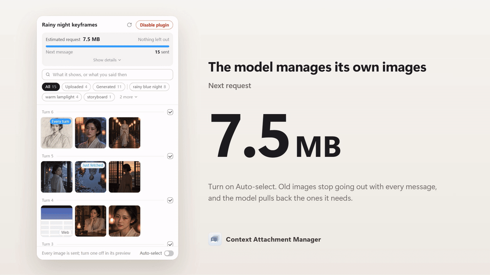
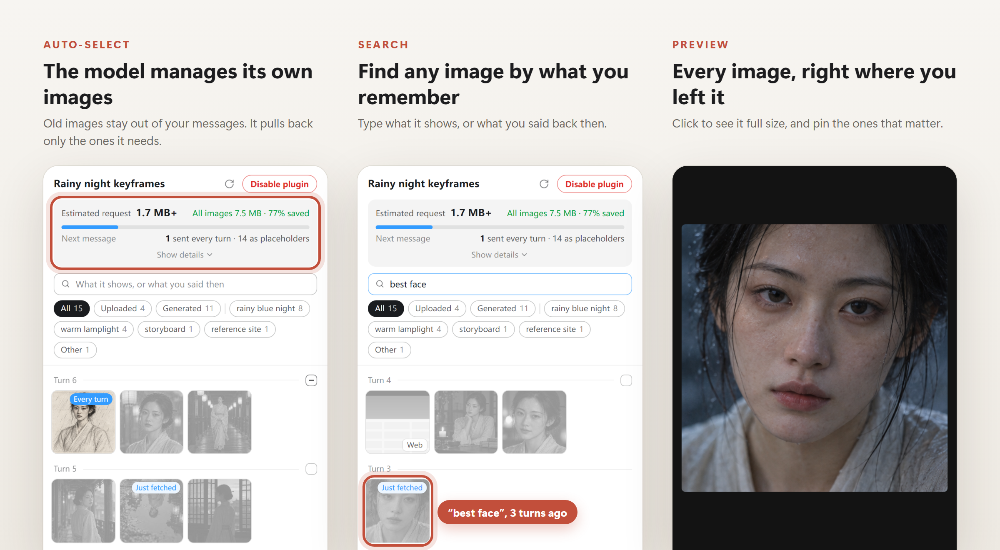

<p align="center">
  
</p>

<h1 align="center">Context Attachment Manager</h1>

<p align="center"><b>Um plugin local para chats com muitas imagens no Codex, no Claude Code e em outros agentes.</b><br>As imagens antigas deixam de ser enviadas em toda mensagem. O modelo busca a que precisa pelo ID, mesmo depois da compactação do chat.</p>

<p align="center">
  <a href="https://github.com/chipfighter/context-attachment-manager/releases"></a>
  
  <a href="LICENSE"></a>
</p>

<p align="center"><b>English</b> · <a href="README_CN.md">简体中文</a> · <a href="README_JA.md">日本語</a> · <a href="README_KO.md">한국어</a> · <a href="README_ES.md">Español</a> · <a href="README_PT_BR.md">Português (Brasil)</a> · <a href="README_FR.md">Français</a> · <a href="README_DE.md">Deutsch</a></p>

<p align="center">
  
</p>

## O que faz

Normalmente, um agente reenvia todas as imagens anteriores a cada mensagem, então uma conversa longa com muitas imagens fica lenta e pode parar de funcionar. Este plugin numera cada imagem (`IMG-001`, `IMG-002`, …) e envia as antigas como marcadores curtos:

- **O modelo busca o que precisa**: quando precisa ver uma imagem antiga novamente, ele recebe a original pelo ID.
- **Ele consegue distinguir as imagens**: o modelo anota uma linha sobre o que cada imagem mostra, além dos seus comentários sobre ela. Isso permanece nos marcadores, inclusive após a compactação do chat.
- **O cache continua funcionando**: um marcador é escrito uma vez e depois permanece igual, então o chat anterior ainda é lido do cache de prompt do modelo. Veja [o projeto](#design-keep-the-cache-working).
- **Nada é excluído**: suas imagens originais e o histórico do chat permanecem como estão.

Ele vem ligado por padrão; você não precisa abrir o painel. Usos típicos: criação de imagens e vídeos, documentos escaneados, uso de computador e de navegador.

## Instalação

Envie isto ao seu agente. Ele identifica a plataforma e instala a configuração correta:

```text
Install Context Attachment Manager for me, following https://github.com/chipfighter/context-attachment-manager/blob/main/INSTALL.md
```

Depois reinicie o agente (no Claude Desktop, inicie uma nova sessão Code). Veja [agentes suportados](#works-with) e [instalação, atualizações e desinstalação](INSTALL.md).

## O painel, quando você quiser controlar

<p align="center">
  
</p>

- **Encontre uma imagem** por um detalhe ou comentário que você lembre, como "noite chuvosa" ou "melhor rosto".
- **Mantenha uma referência à vista**: abra uma imagem e marque **Enviar a cada turno**.
- **Escolha as imagens você mesmo**: desligue a **Seleção automática** e escolha o que vai junto com sua próxima mensagem.

No **Codex**, abra **Context Assets** no painel lateral da tarefa. Na **aba Code do Claude Desktop**, o painel abre automaticamente quando há imagens; digite `/cam` para trazê-lo de volta.

## Privacidade

O plugin roda localmente. Suas imagens originais e o histórico do chat ficam no seu computador; as requisições vão para o serviço que seu agente já usa.

## Como testamos

No Codex, um chat com nove keyframes chegou a 42,4 MB e não podia mais ser enviado após um reinício ou uma compactação; com o plugin, as mesmas requisições tinham 0,12 MB. Veja a [comparação no Codex](eval/README.md) e a [comparação em tarefa longa no Claude Code](eval/long-task/README.md) para os resultados e os passos de reprodução.

## Projeto: manter o cache funcionando

Serviços de modelo armazenam em cache o início de uma conversa. Quando uma requisição começa exatamente como a anterior, aquela parte é lida do cache, o que é mais rápido e muito mais barato. Quando algo no início do chat muda, tudo depois da mudança é processado novamente.

Qualquer forma de encurtar um chat longo precisa mudar alguma coisa. O plugin faz sua mudança o mais tarde possível no chat:

<p align="center">
  
</p>

- **Um marcador é escrito uma vez**: uma imagem vira marcador no turno seguinte ao em que apareceu, então só o restante daquele turno é processado de novo. Depois disso, o marcador permanece igual de uma requisição para outra.
- **Buscar não muda nada antes**: a original é acrescentada ao fim do turno atual, e seu marcador fica onde está. Qualquer imagem que o modelo escolha, e quantas houver no chat, tudo antes do turno atual continua sendo lido do cache.
- **O modelo recebe a original de volta**: não uma cópia menor, nem um resumo dela.

<p align="center">
  
</p>

Isso não é grátis. Depois de um turno com imagens, o restante daquele turno é processado mais uma vez, e o modelo escreve uma linha curta para cada nova imagem. Alterar uma imagem antiga no painel (desmarcá-la, marcá-la de novo, **Enviar a cada turno**) muda o chat naquela imagem, então o que vem depois é processado novamente uma vez. Na nossa [comparação em tarefa longa no Claude Code](eval/long-task/README.md), 87% da entrada foi lida do cache com o plugin e 91% sem ele.

A terceira linha da primeira figura também é o que a compactação própria de um agente faz, e o que limpar resultados antigos de ferramentas no lado da API faz (a edição de contexto da Anthropic, por exemplo): conteúdo inicial é removido e o que vem depois é processado de novo.

## Funciona com

Codex e Claude Code foram testados, e Codex e Claude Desktop também têm o painel. Os outros agentes abaixo são suportados por adaptadores escritos a partir do código e da documentação deles, mas ainda não os testamos ao vivo. Se você usa um deles, [conte como foi](https://github.com/chipfighter/context-attachment-manager/issues), tenha funcionado ou não.

| Agente | O que é | Suporte |
|---|---|---|
| [Codex](https://github.com/openai/codex) | O agente de código da OpenAI, desktop e CLI | Seleção automática + painel, testado |
| [Claude Code](https://github.com/anthropics/claude-code) | O agente de código da Anthropic, desktop e CLI | Seleção automática + painel (desktop), testado |
| [WorkBuddy](https://www.workbuddy.cn) | Assistente de trabalho com IA para desktop da Tencent, com CodeBuddy dentro | Seleção automática, ainda não testado |
| [OpenCode](https://github.com/anomalyco/opencode) | Agente de código de terminal de código aberto para qualquer provedor de modelos | Seleção automática, ainda não testado |
| [Gemini CLI](https://github.com/google-gemini/gemini-cli) | Agente de terminal de código aberto do Google | Seleção automática, ainda não testado |
| [pi](https://github.com/earendil-works/pi) | Agente de código de terminal mínimo e extensível | Seleção automática (extensão pi), ainda não testado |
| [DeepSeek Harness](https://github.com/deepseek-ai/deepseek-harness) | Harness de agente da DeepSeek, em que tudo é um plugin | Seleção automática (plugin dsh), ainda não testado |
| [Qwen Code](https://github.com/QwenLM/qwen-code) | Agente de terminal de código aberto da Qwen | Seleção automática, ainda não testado |
| [Cline](https://github.com/cline/cline) | Agente de código de código aberto para VS Code, JetBrains e terminal | Seleção automática, ainda não testado |
| [Kilo Code](https://github.com/Kilo-Org/kilocode) | Agente de código de código aberto para VS Code, JetBrains e terminal | Seleção automática, ainda não testado |
| [goose](https://github.com/aaif-goose/goose) | Agente de código aberto para desktop e terminal, extensível com MCP | Seleção automática, ainda não testado |
| [Cherry Studio](https://github.com/CherryHQ/cherry-studio) | Cliente de chat desktop de código aberto para vários modelos | Seleção automática, ainda não testado |

Configuração para esses agentes: [INSTALL.md](INSTALL.md#other-agents). Para conectar outro agente, veja [ADAPTERS.md](ADAPTERS.md).

## Perguntas frequentes

### Por que o Codex e o Claude Code ficam lentos em um chat longo com muitas imagens?

O agente reenvia todas as imagens anteriores a cada mensagem, então uma conversa longa com muitas imagens fica lenta e pode parar de funcionar. No Codex, um chat com nove keyframes chegou a 42,4 MB e não podia mais ser enviado após um reinício ou uma compactação; com o Context Attachment Manager, as mesmas requisições tinham 0,12 MB.

### O Context Attachment Manager quebra o cache de prompt?

Só um pouco. Um marcador é escrito uma vez e depois permanece igual, e uma imagem buscada é acrescentada ao fim do turno atual, então os turnos anteriores ainda são lidos do cache. Depois de um turno com imagens, o restante daquele turno é processado mais uma vez. Na nossa comparação em tarefa longa no Claude Code, 87% da entrada foi lida do cache com o plugin e 91% sem ele.

### Qual a diferença em relação à compactação ou a reduzir as imagens?

Compactação e descartar o histórico inicial removem a parte inicial do chat, e reduzir as imagens a altera. De qualquer forma, quase o chat inteiro é processado de novo, e o modelo fica com um resumo ou uma cópia menor. Com o Context Attachment Manager, só o restante do turno anterior é processado de novo, e o modelo recebe a imagem original pelo ID.

### O modelo ainda consegue ver uma imagem antiga?

Sim. Cada imagem tem um ID como `IMG-001`, e o modelo busca a original quando precisa vê-la novamente, inclusive após a compactação do chat.

### Minhas imagens são excluídas ou enviadas para outro lugar?

Não. O plugin roda no seu computador. Suas imagens originais e o histórico do chat permanecem como estão, e as requisições vão para o serviço que seu agente já usa.

### Com quais agentes funciona, e é gratuito?

Codex e Claude Code foram testados. WorkBuddy, OpenCode, Gemini CLI, pi, DeepSeek Harness, Qwen Code, Cline, Kilo Code, goose e Cherry Studio são suportados por adaptadores que ainda não testamos ao vivo. É gratuito e de código aberto sob a licença MIT.

### Como instalo o Context Attachment Manager? Preciso de um terminal?

Não. Envie ao seu agente a frase única da seção [Instalação](#install) acima: ele identifica a plataforma e faz a configuração sozinho, e você só precisa reiniciar o agente depois (no Claude Desktop, inicie uma nova sessão Code). No Codex também é possível instalar pela página de Plugins com alguns cliques. Se preferir fazer manualmente, são um comando no Codex e dois comandos `claude` no Claude Desktop; veja [INSTALL.md](INSTALL.md).

<p align="center"><sub><a href="CHANGELOG.md">Changelog</a> · <a href="CONTRIBUTING.md">Contribuindo</a> · <a href="LICENSE">Licença MIT</a></sub></p>
