<p align="center">
  <picture>
    <source media="(prefers-color-scheme: dark)" srcset="docs/assets/banner-dark.svg">
    
  </picture>
</p>

<p align="center">
  <b>Faça o Claude lembrar do que você ensinou, pegue as escorregadas de sempre,<br>e retome sessões longas quando você voltar.</b>
</p>

<p align="center">
  <a href="https://github.com/cablate/ctx-handoff-mod/releases"></a>
  <a href="https://github.com/cablate/ctx-handoff-mod/actions/workflows/check.yml"></a>
  
  <a href="LICENSE"></a>
</p>

<p align="center">
  <b>English</b> · <a href="README.zh-TW.md">繁體中文</a> · <a href="#install">Instalação</a> · <a href="#whats-inside">Recursos</a> · <a href="docs/guide.md">Guia</a> · <a href="CHANGELOG.md">Changelog</a>
</p>

<p align="center">
  
</p>

## Por quê

Sessões longas do Claude Code esbarram sempre nas mesmas tarefas chatas. O ctx-handoff cuida delas em segundo plano, então no uso normal você não digita nenhum comando.

| Quando… | Sem ele | Com o ctx-handoff |
|---|---|---|
| a conversa está quase cheia | Você escreve um resumo, `/clear` e cola de volta | Um resumo é escrito, a conversa é limpa e uma nova continua |
| você sai por uma hora | Sua próxima mensagem relê tudo a preço cheio | O cache é mantido aquecido por até cerca de 4 horas |
| você repete uma instrução | A próxima conversa esquece | Ela vira uma nota do projeto e, após 3 vezes, uma linha no seu repositório |
| você usa `/clear` ou reabre o Claude Code | A nova conversa começa às cegas | Ela é informada de onde a última parou |
| o Claude repete um comando que falha, ou diz "pronto" sem testar | Você descobre depois | O Claude recebe um lembrete de uma linha na hora |

## Instalação

Requer Claude Code 2.1.287 ou mais recente. Testado até a 2.1.302.

```sh
claude plugin marketplace add cablate/ctx-handoff-mod
claude plugin install ctx-handoff@ctx-handoff-mod
```

Inicie uma nova sessão e digite `/handoff`. Você deve ver:

```
context 12034 / threshold 600000 (window 1000000)
Cache refresh on, refreshed 0/3 this idle period, timer not started
```

É só isso. Atualize com `claude plugin update ctx-handoff@ctx-handoff-mod`, ou ligue a atualização automática em **Marketplaces** em `/plugin`.

> [!NOTE]
> Feito para assinaturas Claude e sessões longas (por exemplo, em um modelo com contexto de 1M). Com chave de API, Bedrock ou Vertex, o cache dura só 5 minutos, então rode `/handoff refresh off`; todo o resto funciona. O ctx-handoff é experimental, porque os mods do Claude Code ainda estão em acesso antecipado.

## O que há dentro

O ctx-handoff é um kit que cresce para sessões longas: novos recursos para trabalhar com o Claude por horas chegam aqui.

### Entregar antes do contexto encher (opcional)

Desligado por padrão, para que a compactação própria do Claude Code assuma. Ative `auto_handoff` na aba Configurações do painel e, em 600k tokens, ele espera o Claude e seus subagentes terminarem, escreve um resumo que separa trabalho verificado de alterações não verificadas, lista o que falhou, os limites que você definiu com suas palavras e o que já se descobriu, termina com um próximo passo, limpa e continua em uma conversa nova. Qualquer coisa que você digite nesse meio tempo é levada junto.

### Mantém o cache aquecido enquanto você está fora

Depois de cerca de 50 minutos inativo, ele envia uma requisição minúscula para que o cache da conversa não expire (ficando à frente da compactação por inatividade de 54 minutos do Claude Code em chats grandes), até 3 vezes (cerca de 3,5 horas); depois disso, salva um resumo de entrega sem limpar, para que, ao voltar, você escolha começar do zero com ele (`/handoff resume`) ou ficar onde estava (`continue`).

Para pausar as atualizações e os resumos de ausência só nesta conversa, clique no botão no topo do painel ou execute `/handoff away pause` (`resume` reinicia o timer). Atualizações de notas continuam rodando, e outras conversas não são afetadas. O painel e `/handoff` também mostram atividade em segundo plano ao vivo e o uso de tokens em segundo plano informado pela sessão desde esta atualização (não é uma fatura; requisições já enviadas não podem ser canceladas).


### Aprende sobre seu projeto e entrega ao seu repositório



Preferências, correções e fatos viram um arquivo de notas Markdown por projeto, carregado em toda nova conversa. Rotinas que você repete viram skills do projeto. Apenas a parte nova da conversa é lida, pelo Sonnet 5.5 com esforço baixo.

Se uma atualização de notas falhar ou gerar algo inútil, aquele trecho da conversa é guardado para a próxima tentativa, sem contar duas vezes a mesma regra ou procedimento. Memórias que você exclui só voltam se você as mencionar novamente em um novo trecho de conversa.

### Lembra onde você parou



### Pega as escorregadas de sempre


### Guardas que você aprova, um painel para tudo

Quando uma regra já está escrita mas continua sendo quebrada, o ctx-handoff rascunha uma guarda: uma verificação das chamadas de ferramenta que lembra ou bloqueia o Claude. O Claude pergunta a você na próxima conversa, e nada é aplicado até você dizer que sim. `/handoff panel` abre um painel acima do prompt para guardas, memórias, regras, a última atualização de notas e todas as configurações.



## Configurações

Tudo está na aba Configurações do painel (`/handoff panel`, depois <kbd>5</kbd>), com a origem de cada valor e um botão de redefinir. Os padrões devem ser deixados como estão. O [guia](docs/guide.md#settings) lista cada configuração.

## Custo e privacidade

- **Nenhum servidor próprio.** Roda no seu login do Claude Code e não envia nada a lugar nenhum além da Anthropic, como a própria conversa.
- **Custos pequenos e previsíveis.** Uma entrega é uma requisição; uma atualização de cache lê do cache a cerca de um décimo do preço de entrada; uma atualização de notas envia só a parte nova da conversa. Os lembretes não custam nada.
- **Arquivos simples que são seus.** Notas são Markdown em `~/.claude/projects/`. Confira o que o mod pode fazer com `claude plugin validate`; o [guia](docs/guide.md#cost-privacy-and-permissions) explica cada entrada.

## Documentação

- [Guia](docs/guide.md): cada recurso em detalhes, configurações, comandos, permissões, ambientes suportados, limitações, solução de problemas e desinstalação.
- [Changelog](CHANGELOG.md): o que mudou em cada versão e por que vale atualizar.
- [Contribuindo](CONTRIBUTING.md): como rodar a partir do código e enviar alterações. Relatórios de bugs e ideias vão nas [issues](https://github.com/cablate/ctx-handoff-mod/issues/new/choose).
- [Segurança](SECURITY.md): como relatar uma vulnerabilidade de forma privada.

## Histórico de estrelas

<a href="https://star-history.com/#cablate/ctx-handoff-mod&Date">
  <picture>
    <source media="(prefers-color-scheme: dark)" srcset="https://api.star-history.com/svg?repos=cablate/ctx-handoff-mod&type=Date&theme=dark" />
    <source media="(prefers-color-scheme: light)" srcset="https://api.star-history.com/svg?repos=cablate/ctx-handoff-mod&type=Date" />
    
  </picture>
</a>

## Licença

[MIT](LICENSE)
