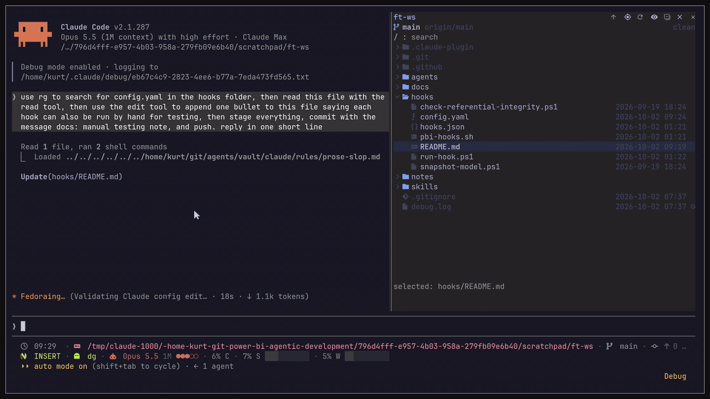

<h1 align="center">Árvore de Arquivos do Claude Code</h1>

<p align="center">
  Uma árvore de arquivos estilo IDE para o Claude Code que mostra o que o Claude está fazendo e onde nos arquivos
</p>

<p align="center">
  
  
  
  
</p>

<details open>
<summary><b>Claude Code CLI</b></summary>

<p align="center">
  
</p>

</details>

<details>
<summary><b>Claude Code no aplicativo desktop</b></summary>

<p align="center">
  
</p>

</details>

**Recursos principais:**

* Mostrar/navegar todos os arquivos de um diretório (com suporte a status do Git, atalhos do nvim)
* Animações mostram onde o Claude está lendo/trabalhando
* Atalhos de teclado:
   * Navegar diretórios com `z` (estilo zoxide)
   * Buscar com `s` ou `i` (na pasta destacada) ou `q` (no conteúdo dos arquivos)
   * Fazer diff de arquivos com `d` ou de todos os arquivos alterados em uma pasta
* Recursos voltados ao terminal: pré-visualização de arquivos, treemap de tamanho de diretório e mais

---

## Instalação

O repositório é seu próprio marketplace de plugins. Execute isto no terminal:

```bash
claude plugin marketplace add data-goblin/claude-code-filetree
claude plugin install filetree@claude-code-filetree
```

Ou dentro de uma sessão do Claude Code:

```text
/plugin marketplace add data-goblin/claude-code-filetree
/plugin install filetree@claude-code-filetree
```

Uma instalação falha com `Unrecognized key: "options"` no Claude Code anterior a 2.1.287: execute `claude update` e instale novamente.

## Recursos

- Árvore de arquivos do cwd ou de uma pasta fixada, com colunas de Git, tamanho, contagem de linhas e data ([tree](docs/tree.md))
- Recolher tudo e expandir tudo até três níveis de profundidade ([tree](docs/tree.md))
- Setas de links simbólicos, um cérebro em arquivos de instrução do agente e glifos Nerd Font, simples ou de texto ([tree](docs/tree.md))
- Buscar por nome em pastas não abertas, por maiúsculas/minúsculas ou expressão regular, restrita a uma pasta ([search](docs/search.md))
- Buscar dentro de arquivos com `git grep` ou `grep -r`, e abrir uma ocorrência na sua linha ([search](docs/search.md))
- Pular para qualquer pasta estilo zoxide com `z` ([search](docs/search.md))
- Status do Git por arquivo e pasta, contagem de linhas em arquivos alterados e a branch com ahead e behind ([git](docs/git.md))
- Comandos do Git e do GitHub que o Claude executa mostrados como uma linha de status ([git](docs/git.md))
- As leituras, escritas e commits do Claude cintilam na árvore e o recolhimento automático fecha as pastas que ele abriu ([activity](docs/activity.md))
- A configuração de cintilação da atividade do Claude desliga a cintilação em todas as sessões; o botão do Clawd no cabeçalho do aplicativo desktop a alterna ([activity](docs/activity.md))
- Referências de arquivos com uma linha nas respostas do Claude viram links para essa linha ([activity](docs/activity.md))
- Seguir o trabalho move a sessão para o repositório em que o Claude trabalha ([activity](docs/activity.md))
- Seleção múltipla estilo IDE; as linhas sombreadas vão para o Claude como contexto: a linha selecionada, ou até 100 linhas marcadas ([context](docs/context.md)):
  - clicar seleciona uma linha e limpa as marcas
  - com linhas marcadas, j / k movem apenas o cursor, e `v` marca ou desmarca a linha sob ele
  - shift+clique marca o intervalo da última clique ou movimento j / k, na ordem da árvore
  - ctrl+clique marca ou desmarca uma linha sem abrir; alt+clique no macOS
  - duplo clique ou Enter abre um arquivo
  - o botão de limpar seleção limpa todas as linhas marcadas e selecionadas
  - linhas marcadas mostram o fundo da seleção; `y`, `Y` e `u` copiam as linhas sombreadas
  - com linhas marcadas, a linha sob o cursor mostra um tom de destaque no aplicativo desktop e a marca do cursor de destaque no terminal
- Pré-visualização dividida de código, Markdown, imagens, quadros de vídeo, páginas de PDF e Word ([preview and treemap](docs/preview-treemap.md))
- Treemap de uma pasta por bytes ou linhas, com a atividade do Claude acesa ([preview and treemap](docs/preview-treemap.md))
- Diff de um arquivo ou de todos os arquivos alterados em uma pasta, no painel ou na sua ferramenta de diff ([diff](docs/diff.md))
- Abrir arquivos no aplicativo padrão, um editor em um painel tmux ou herdr, ou qualquer comando ([open](docs/open.md))
- Proteger arquivos e pastas das edições do Claude e ver arquivos escritos fora do repositório ([guards](docs/guards.md))
- Dirigido por teclado: movimentos estilo vim, uma sobreposição de atalhos e alt+l / alt+h no terminal ([keys](docs/keys.md))
- Comandos `/filetree` e onde o painel aparece no terminal e no aplicativo desktop ([sidebar](docs/sidebar.md))


## Configurações

Todas as configurações ficam em `/config` sob filetree, cada uma com sua própria descrição lá.

```yaml
Atividade do Claude:  leituras e escritas | escritas | leituras | nenhuma
Cintilação da atividade: ligada | desligada
Seguir o Claude:      ligado | desligado
Pular move o Claude:  árvore e Claude | árvore
Clique com o botão direito copia: relativo | absoluto
Seguir o trabalho:    ligado | desligado
Abrir ao iniciar:     ligado | desligado
Focar ao abrir:       ligado | desligado
Coluna da direita:    data | idade | tamanho | loc | arquivos
Formato da data:      ano-mês-dia | dia-mês | mês-dia
Relógio:              24h | 12h
Arquivo longo:        500 | uma contagem de linhas | desligado
Branch remota:        desligado | ligado
Dicas:                ligado | desligado
Espaçamento da busca: ligado | desligado
Cabeçalhos de coluna: ligado | desligado
Recolhimento automático: desligado | ligado
Atalhos:              automático | sempre | desligado
Abrir com:            vazio | editor | pré-visualização | um comando com {path} e {dir}
Arquivos binários:    Abrir com | aplicativo padrão
Editar com:           vazio | um comando com {path} e {line}
Fazer diff com:       vazio | um comando como "hunk diff --" ou "lazygit -f"
Grupos de diff:       pasta | tipo | desligado
Alvo do terminal:     automático | painel à direita | painel abaixo | aba | espaço de trabalho
Ignorar:              nomes a ocultar, como ".cache .tmp"
Painel de pré-visualização: inferior | superior
Treemap:              automático | imagem | células | desligado
Paleta:               pares chave=#hex sobre as cores do terminal
Glifos:               automático | nerd | simples | texto
```

No terminal, as cores de destaque tingem pastas, a raiz, o cursor, as ocorrências da busca e as caixas de nível superior do treemap de células. É o azul claro do terminal com um tema escuro do Claude e seu azul com um tema claro. `accent=#hex` em Paleta define outra cor para todos eles.

Seguir o trabalho está descrito em [Atividade do Claude](docs/activity.md).

Abrir ao iniciar se aplica a toda nova sessão, incluindo `/clear`. Quando você abre ou fecha a árvore com `/filetree`, essa escolha dura até o próximo `/clear`. Depois do `/clear`, a árvore fica aberta ou fechada conforme diz Abrir ao iniciar.

## Requisitos

```yaml
necessário:  Claude Code 2.1.306 ou mais recente, git
opcional:
  inotifywait:            atualizações ao vivo no Linux (inotify-tools)
  magick ou ffmpeg:       imagens que não sejam PNG, quadros de vídeo
  pdftoppm ou gs:         páginas de PDF
  soffice:                páginas de Word e de office
  pandoc, pdftotext:      texto de documentos em tmux, herdr e outros terminais
  tmux ou herdr:          um editor ou ferramenta de diff em um novo painel
  Nerd Fonts 3.2+:        ícones para Glifos automático, que desenha Unicode simples sem uma fonte mais recente
imagens:  Ghostty ou kitty, fora do tmux e do herdr, no Linux e no macOS
```

## Considerações

- O aplicativo desktop não tem pré-visualização dividida nem treemap
- O aplicativo desktop cintila no máximo quatro linhas por vez; mais linhas acesas aparecem na sua cor sem cintilação, enquanto o terminal as cintila todas. Se o painel ainda sobrecarregar, o botão do Clawd no cabeçalho ou a configuração de cintilação da atividade desliga a cintilação
- O aplicativo desktop desenha no máximo 150 linhas ao redor do cursor, e menos quando as linhas são profundas, têm caminhos longos ou mostram alterações do git; uma nota conta as linhas que ele deixa de fora
- GIFs e vídeos mostram um único quadro estático
- O Windows mede o tamanho de pastas por listagem de arquivos, e o treemap desenha um nível
- Cliques em linhas precisam do herdr 0.9.1 ou mais recente; execute `herdr update`

## Contribuindo

Abra pull requests contra um branch de release, não `main`:

- Correções: o branch de patch, como `release/0.8.2`
- Recursos: o branch minor, como `release/0.9.0`

Mantenha a versão desse branch.

Ative os hooks do git uma vez por clone. O hook de pré-commit roda as verificações rápidas em segundos: regras de grep, tipos, oxlint e `claude plugin validate` quando os manifests mudam. O hook de pré-push verifica a versão contra o branch de release e roda os testes do plugin:

```bash
git config core.hooksPath .githooks
```

As mesmas verificações rodam no macOS, no Windows e no Linux no CI em todo push que toca o plugin.

## Licença

[MIT](LICENSE). As legendas do treemap usam glifos da [Terminus Font](https://terminus-font.sourceforge.net/) de Dimitar Zhekov (Lat2-Terminus16, SIL Open Font License 1.1).

*Este projeto é inspirado no meu aplicativo Omarchy [FileBlade](https://github.com/data-goblin/fileblade)*
