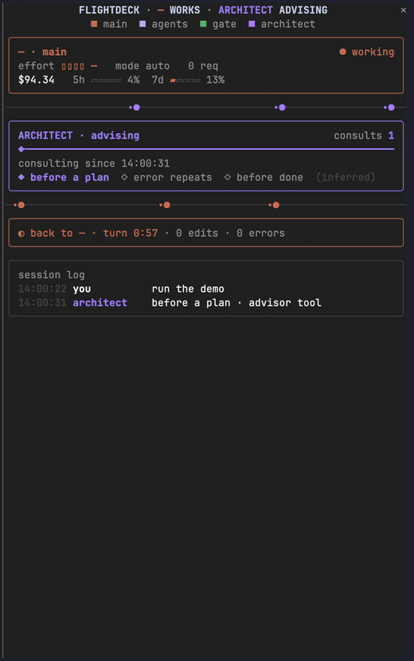

# Flightdeck

[](https://github.com/scasella/claude-flightdeck/releases/latest)
[](LICENSE)
[](https://claude.com/blog/claude-code-mods)
[](https://statuslin.es/mods/flightdeck)

**Um mod do Claude Code que coloca um painel ao vivo de agentes no seu terminal**: contexto e custo, uma linha do tempo do advisor, toda verificação de permissão e seus subagentes como cartões ou faixas. Todo número vem de um evento real da sessão, e nada sai da sua máquina.

<p align="center">
  
</p>

<p align="center">
  <a href="#install">Instalação</a> · <a href="#what-you-see">O que você vê</a> · <a href="#what-it-can-reach">O que ele pode alcançar</a> · <a href="#configure">Configuração</a> · <a href="#troubleshooting">Solução de problemas</a> · <a href="CHANGELOG.md">Novidades</a>
</p>

## Instalação

Dentro do Claude Code (2.1.289 ou mais recente):

```
/plugin marketplace add scasella/claude-flightdeck
/plugin install flightdeck@claude-flightdeck
/reload-plugins
/flightdeck
```

<details>
<summary><strong>Do terminal, ou de um clone</strong></summary>

```sh
claude plugin marketplace add scasella/claude-flightdeck
claude plugin install flightdeck@claude-flightdeck
```

Ou carregue diretamente de um clone, para uma sessão:

```sh
git clone https://github.com/scasella/claude-flightdeck
claude --plugin-dir ./claude-flightdeck
```

</details>

O instalador pode dizer que opções de configuração não estão definidas; os padrões são suficientes, e `/config` as altera.

Mods são um recurso do Claude Code em acesso antecipado e sua API pode mudar entre releases. Se algo quebrar, veja [Solução de problemas](#solução-de-problemas).

## O que você vê

https://github.com/user-attachments/assets/9ad0fcc3-c81c-427a-a743-f7b6c49f5885

<p align="center">
  
</p>

| Acoplado ao lado da transcrição | Inline acima do prompt |
| --- | --- |
|  | <br><br>Na tela principal, sem tela cheia, o painel é um resumo de no máximo 8 linhas; até 3 agentes se juntam a ele quando a sessão tem subagentes. |

| Painel | Mostra | De |
| --- | --- | --- |
| **main** | modelo, esforço, modo de permissão, contagem de requisições; um medidor de contexto com compactações (⟲, ou ⟲~ quando [estimada](#o-que-é-inferido-não-medido)), medido contra a janela de compactação quando a sessão compacta em uma janela menor que a do modelo (`autoCompactWindow`, ou a própria do Claude Code); custo e as duas primeiras janelas de limite de taxa quando seu plano as informa, com o tempo até cada reinício (↻) a partir de 56 colunas; o tempo até o primeiro token da última requisição do loop principal | `turn.step`, `session.measure`, `session.compact`, `$.session.usage()` (a cada requisição do loop principal, e seu detalhamento `summary` local, uma vez por modelo, para a janela de compactação); o modo de permissão de `classic.UserPromptSubmit` e `agent.spawn` |
| **architect** | consultas em uma linha do tempo, se uma está rodando, quanto a última levou; opcionalmente o momento de cada consulta; a primeira linha do conselho de um subagente arquiteto | um spawn de um tipo de agente correspondente, ou uma ferramenta de servidor correspondente nas linhas do assistente |
| **gate** | uma célula por verificação de permissão: verde permitido sem perguntar, azul decidido pelo classificador do modo automático ou por você e então executado, âmbar pendente, vermelho ✗ negado, esmaecido se feito dentro de um subagente. Totais, e um detalhamento por família de ferramentas com credenciais mascaradas | `tool.check`, resolvido pelo `tool.call` ao redor |
| **agents** | cartões lado a lado enquanto couberem: a tarefa, o tipo, tokens de contexto e saída ao vivo, passos, um relógio em execução, `max_tokens` em vermelho. Além disso, faixas em um eixo de tempo | `agent.spawn`, `turn.step`, `tool.call`, `turn.complete` |
| **loops** | loops de modelo que não correspondem a nenhum cartão: agentes de workflow, compactações, forks de memória | ids de `turn.step` que nenhum cartão reivindica |
| **receipt** | o turno em execução ou o último: duração, agentes, edições, erros, custo acrescentado | `turn.start`, `turn.complete` |
| **log** | prompts, spawns, conclusões, consultas, edições, erros e negações; filtrado para um agente enquanto você vê sua transcrição | tudo acima |

Os conectores animam só enquanto o trabalho flui: um turno rodando, um agente rodando ou uma consulta aberta. Painéis sem nada a mostrar não ocupam espaço, então uma sessão sem subagentes mostra só a caixa principal e o log.

## Uso

| Comando | Faz |
| --- | --- |
| `/flightdeck` | abre o painel |
| `/flightdeck close` | fecha-o |
| `/flightdeck reset` | limpa agentes, verificações, consultas, log e o turno (custo, limites de taxa e compactações ficam) |
| `/flightdeck layout auto\|compact\|wide\|mini` | sobrepõe o layout para esta sessão |

Foque o painel com `ctrl+x tab` e então:

| Tecla | Faz |
| --- | --- |
| `1`, `2`, … | expande um cartão ou faixa de agente: sua tarefa completa, as últimas 3 chamadas de ferramenta, o início de sua resposta |
| `f` `s` `o` | abre o detalhamento de arquivos / shell / outros do portão: as últimas 5 verificações e seus vereditos |

`/clear` reinicia o painel junto com a conversa.

## Onde roda

- **Terminal em tela cheia:** acoplado ao lado da transcrição; duas colunas a partir de 110 colunas de largura.
- **Terminal na tela principal:** inline acima do prompt, como o resumo de 8 linhas.
- **Aplicativo desktop, VS Code, mobile:** os mesmos painéis, mais os agentes desenhados como um eixo de tempo SVG. VS Code e mobile não conseguem animar, então conectores e relógios são estáticos lá. (A extensão do VS Code pode não mostrar nenhum painel ainda: veja [Solução de problemas](#solução-de-problemas).)

Com `openOnStart`, o painel se abre sozinho quando uma sessão começa, em terminais de pelo menos 144 colunas; abaixo disso, `/flightdeck` o abre. As cores vêm do seu tema do Claude Code, então temas claro, escuro e para daltonismo leem bem.

## O que ele pode alcançar

O Flightdeck só observa. Todo hook repassa seu evento sem alteração: ele nunca nega, reescreve ou atrasa uma chamada de ferramenta, um prompt ou um subagente.

| Ele vê | Através de |
| --- | --- |
| o nome e a entrada de toda chamada de ferramenta, e se falhou | `tool.call` |
| todo veredito de permissão | `tool.check` |
| spawns de subagentes, suas requisições ao modelo e uso de tokens, e suas respostas finais | `agent.spawn`, `turn.step`, `turn.complete` |
| os primeiros 70 caracteres dos seus prompts, para o log | `turn.start` |
| leituras de contexto, custo e limites de taxa | `session.measure`, `$.session.usage()` |
| o detalhamento de contexto que `/context` mostra (suas categorias, caminhos de arquivos de memória, ferramentas MCP, agentes e skills), estimado localmente uma vez por modelo; ele mantém só a janela de compactação disso | `$.session.usage({ breakdown: 'summary' })` |
| chamadas de ferramenta do advisor nas respostas do assistente (o conteúdo é criptografado) | `session.append` |

O que ele mantém: resumos curtos (um nome de ferramenta mais um caminho ou comando, o início de cada prompt, a tarefa e a resposta de um agente, o conselho do arquiteto, todos com credenciais mascaradas) no estado da sessão, que termina com a sessão. Ele **não** faz requisições de rede, não roda processos, não lê nem escreve arquivos, não armazena nada entre sessões e não chama nenhum modelo. `claude plugin validate .` imprime exatamente o que ele hooka e chama.

## O que é inferido, não medido

- **Momentos do arquiteto.** "Antes de um plano" significa nenhuma edição ainda neste turno, "erro se repete" significa 2+ erros no loop principal seguidos, "antes de pronto" significa que edições foram feitas. São rotulados `(inferido)`; desligue com `moments: false`.
- **Compactações sob a guarda embutida.** Onde a guarda do Claude Code impede o `session.compact` do Flightdeck (veja [Solução de problemas](#solução-de-problemas)), a contagem é estimada. O Claude Code não informa preenchimento de contexto até a primeira resposta após uma nova sessão, um `/clear` ou uma compactação. Então uma requisição do loop principal que não encontra preenchimento após uma resposta ter voltado conta como compactação. A caixa principal mostra `⟲~1`, com `(estimado)` quando há espaço, e o log diz `context compacted (estimated)`. Um rewind ao seu primeiro prompt lê da mesma forma, então também conta. Onde quer que `session.compact` rode, sua contagem substitui a estimativa.
- **O conselho do lado do servidor é criptografado.** Para uma ferramenta de servidor como o `advisor` do Claude Code, o painel conta e cronometra a consulta mas não pode mostrar o que ela disse.
- **O contexto por agente é a entrada inteira da última requisição** (não cacheada + leitura de cache + escrita de cache). É rotulado `ctx`, não custo: a API não tem custo por agente.
- **Outros loops** não distinguem um agente de workflow de um fork de compactação; ambos são loops de modelo que nenhum cartão reivindica.
- **O primeiro passo de um agente em segundo plano** pode chegar antes de seu cartão existir, então seu uso pode aparecer um passo atrasado.
- **Contexto contra a janela de compactação.** Quando a sessão compacta em uma janela menor que a do modelo, o medidor, `tokens/window` e o `ctx N%` da linha de status medem contra essa janela, então leem mais alto que a porcentagem da linha de status do próprio Claude Code (e da claude-hud), que mede contra a janela do modelo. A compactação automática roda um pouco antes de 100%, no seu limite dentro daquela janela.
- **Tempo até o primeiro token.** `ttft` é cronometrado no próprio hook `turn.step` do Flightdeck, então inclui tudo abaixo dele: hooks de outros plugins, o engine, a rede e qualquer retry. Quando o pensamento do modelo não é transmitido, o primeiro pedaço chega depois dele, então `ttft` inclui o pensamento. Medido, não inferido, mas não é a figura própria da API. Não há taxa de saída: os tokens informados incluem o pensamento, então uma taxa sobre o stream visível não é uma velocidade real.

## Configuração

Em `/config`, ou sob `pluginConfigs[<id>].options` no seu `settings.json` de usuário, onde `<id>` é como o Claude Code carregou o plugin: `flightdeck@claude-flightdeck` quando instalado do marketplace, `flightdeck` (ou `flightdeck@inline`) com `--plugin-dir`. Uma entrada sob outra chave, ou em configurações de projeto (`.claude/settings.json`), é ignorada sem aviso. De um terminal, `claude plugin configure flightdeck@claude-flightdeck` lista as opções e quais não estão definidas, e as salva com `--values-stdin`.

| Opção | Padrão | Significado |
| --- | --- | --- |
| `architectPattern` | `advisor\|architect` | regex insensível a maiúsculas para tipos de agente e ferramentas de servidor que contam como arquiteto |
| `matchDescriptions` | `false` | também corresponder descrições de agentes, não só nomes de tipo |
| `architectLabel` | `ARCHITECT` | o nome do arquiteto no painel |
| `gateLabel` | `GATE` | o nome do painel de permissão |
| `panels` | `main,architect,gate,agents,loops,receipt,log` | quais painéis mostram, em ordem |
| `layout` | `auto` | `mini`, `compact`, `wide` ou `auto` (mini inline, wide a partir de 110 colunas acoplado) |
| `maxCards` | `3` | cartões lado a lado antes de faixas (1–6); menos se o painel for estreito demais |
| `paneColumns` | `66` | colunas que o painel acoplado pede, 40 ou mais. O Claude Code limita o dock a 45% do terminal, e uma largura para a qual você o arrastou, nesta sessão ou em uma anterior, prevalece. O layout wide começa em 110, então precisa de um terminal de cerca de 245 colunas, ou `layout: wide` |
| `motion` | `while-active` | `off` mantém os conectores parados |
| `moments` | `true` | mostra os momentos inferidos de consulta |
| `palette` | `theme` | `pastel` usa cores fixas ajustadas para terminais escuros |
| `openOnStart` | `true` | pede para abrir o painel quando uma sessão começa |
| `statusLine` | `true` | contexto, agentes rodando, consultas e negações na linha de status |

## Solução de problemas

**O painel não aparece.**
- Verifique se `claude --version` é 2.1.289 ou mais recente, depois execute `/reload-plugins` e `/flightdeck`. Em versão mais antiga, a transcrição diz `flightdeck: hooks module did not load: …`.
- Abaixo de 144 colunas, o Claude Code não acomoda um painel que ninguém pediu; `/flightdeck` o abre em qualquer largura.
- Procure na transcrição uma linha esmaecida começando com `flightdeck:`. Ela nomeia o hook que falhou ou o motivo pelo qual o painel foi recusado. Por favor [abra uma issue](https://github.com/scasella/claude-flightdeck/issues) com ela.
- Se o painel mostrar só `draw failed (…)`, seu hook de desenho lançou erro; inclua essa linha na issue também.

**Nada aparece na extensão do VS Code.** Em um relato, a build 2.1.296 dela rodou os hooks do Flightdeck mas não mostrou painel, nem de outro mod ([#5](https://github.com/scasella/claude-flightdeck/issues/5)). Execute `claude` no terminal integrado do VS Code e depois `/flightdeck`: um terminal integrado costuma ser mais estreito que as 144 colunas que o painel precisa para se abrir sozinho.

**Sob login Team ou Enterprise, o modo de permissão está ausente ou desatualizado, e as compactações são estimadas.** Em uma máquina com configurações gerenciadas, ou em uma sessão com `/login` Team ou Enterprise, o Claude Code carrega uma guarda embutida, `cc-plugin-sec-default`, que nunca executa os hooks dos plugins instalados pelo usuário nos eventos `classic.*` ou em `session.compact` (veja "Know which hooks of a user's mod don't run" em [Manage mods for your organization](https://code.claude.com/docs/en/plugins/mods/admin)). Nenhum outro evento que um plugin do usuário possa hookar carrega o modo de permissão, exceto o início de um subagente. Então a caixa principal não mostra modo até um subagente começar, e então o modo como estava naquele início. Até lá, no modo automático o portão credita as chamadas que o classificador liberou a `you`. As compactações são contadas a partir do contexto que o Claude Code informa a cada requisição, então a caixa principal as marca `⟲~` e o log diz `context compacted (estimated)` (veja [O que é inferido, não medido](#o-que-é-inferido-não-medido)). No 2.1.299 ou mais recente, `/plugin` mostra uma nota nomeando esses dois hooks. O resto do painel funciona. Um administrador pode deixar os hooks rodarem instalando o Flightdeck como um dos mods da organização ([#23](https://github.com/scasella/claude-flightdeck/issues/23)).

**Opções parecem ignoradas.** Verifique a chave no seu `settings.json` de usuário: `pluginConfigs["flightdeck@claude-flightdeck"]` quando instalado, `pluginConfigs["flightdeck"]` com `--plugin-dir`. Veja [Configuração](#configuração).

**Cores parecem erradas.** Defina `palette` como `pastel` em `/config`.

**Movimento demais.** Defina `motion` como `off`.

**Contadores parecem desatualizados após uma atualização.** Execute `/flightdeck reset`.

## Como funciona

| Arquivo | Guarda |
| --- | --- |
| [`hooks/register.tsx`](hooks/register.tsx) | os hooks de evento, acesso ao estado e uma função por painel |
| [`hooks/core.ts`](hooks/core.ts) | todo reducer, formatador e regra de layout como funções puras, para que o comportamento seja testável diretamente |
| [`hooks/rail.tsx`](hooks/rail.tsx), [`hooks/elapsed.tsx`](hooks/elapsed.tsx) | módulos de superfície: conectores animados e relógios ao vivo que redesenham só a si mesmos, no frame clock próprio da superfície |
| [`types/index.d.ts`](types/index.d.ts) | o contrato de estado |
| [`tests/`](tests) | 65 testes: comportamento puro, mais desenhos montados em toda superfície de 24 a 120 colunas, com cada largura de 24 a 40 verificada para qualquer coisa que vaze da caixa |

O estado vive nos átomos de `$.state`. Toda leitura é mesclada sobre os padrões, então um campo ausente ou mais antigo nunca quebra o painel; uma atualização que muda a forma do estado pode ainda reiniciar seus contadores uma vez. Novo em mods? Comece com [Mods do Claude Code](https://claude.com/blog/claude-code-mods) e [Começando com mods do Claude Code](https://claude.dev/blog/getting-started-with-claude-code-mods/).

## Projetos relacionados

O Flightdeck trabalha junto com estes e deve ideias a eles:

- [claude-hud](https://github.com/jarrodwatts/claude-hud): contexto, limites, ferramentas e agentes na sua linha de status. Use os dois: aquela é a linha de status, este é o painel.
- [zoetrope](https://github.com/furkankly/zoetrope): uma sessão do Claude Code ou do Codex como um grafo de fluxo ao vivo.
- [ccusage](https://github.com/ccusage/ccusage): relatórios de custo a partir dos logs da sessão.
- [awesome-claude-code-mods](https://github.com/karanb192/awesome-claude-code-mods): o índice de mods do Claude Code.

## Desenvolvimento

```sh
claude --plugin-dir .            # carrega; edições recarregam a quente
claude plugin validate .
claude plugin test .
npx -p typescript tsc -p .       # após a primeira carga, que escreve .claude-plugin/types/
```

Veja [CONTRIBUTING.md](CONTRIBUTING.md). As mudanças estão em [CHANGELOG.md](CHANGELOG.md).

## Licença

[MIT](LICENSE)
