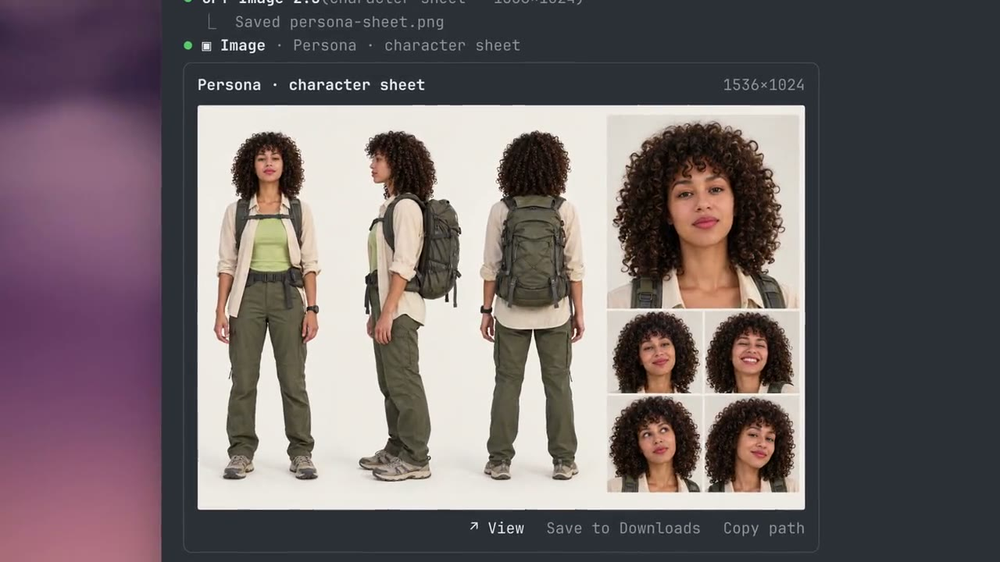

<p align="center">
  
</p>

<h1 align="center">claude-show-your-work</h1>

<p align="center">Veja, revise e itere sobre o trabalho do seu agente sem sair do terminal.<br>Imagens, vídeos e QA visual para o Claude Code.</p>

<p align="center">
  <a href="https://github.com/iamumeransari/claude-show-your-work/stargazers"></a>
  <a href="#install"></a>
  <a href="#install"></a>
  <a href="LICENSE"></a>
</p>

## Instalação

Execute estes dois comandos no Claude Code:

```
/plugin marketplace add https://github.com/iamumeransari/claude-show-your-work.git#releases
/plugin install show-your-work@iamumeransari
```

Funciona no Ghostty e no kitty, no macOS e no Linux, com Claude Code 2.1.286 ou mais recente. Vídeos e áudio também precisam do ffmpeg: instale com seu gerenciador de pacotes (`brew install ffmpeg` no macOS) ou peça ao Claude para instalar. Páginas HTML precisam do Chrome, Chromium ou do navegador do Playwright, e PDFs precisam do poppler (`brew install poppler`).

Quando a instalação termina, uma breve introdução mostra os recursos. Execute `/show-your-work` quando quiser alterar as configurações.

## Uso

O Claude mostra seu trabalho no chat sempre que cria ou altera algo visual. Você também pode pedir diretamente:

- "Me dê quatro direções para o hero da página inicial e mostre lado a lado."
- "Crie o formulário de cadastro, teste-o e me mostre a gravação."
- "Corrija o botão de cobrança e me mostre antes e depois."

### QA visual com gravações de antes e depois

<p align="center"></p>

Quando o Claude cria um recurso ou corrige um bug, ele testa a alteração com o Playwright, grava a execução e reproduz a gravação no chat, com tudo que você precisa para revisar o trabalho em um só lugar:

- **Antes e Depois:** para qualquer mudança, de um novo recurso a uma correção, o Claude grava as mesmas etapas na versão antiga e na nova. O Compare reproduz ambas lado a lado, sincronizadas.
- **Marcadores de mudança:** cada alteração que o Claude fez é listada ao lado do vídeo com seu timestamp, e clicar nela vai direto ao momento em que aparece.
- **Verificações ao vivo:** cada verificação de teste fica verde ou vermelha conforme o vídeo chega a ela, então você vê exatamente onde a correção funciona e onde algo ainda falha.
- **Um só lugar para revisar:** você não precisa abrir o navegador, rodar os testes de novo ou ler logs, porque a gravação e seus resultados estão ali no chat.

### Imagens

<p align="center">
  
  
</p>

O que quer que o Claude desenhe, você vê bem no chat: landing pages, telas de app, componentes, conceitos de design, slides, gráficos e imagens geradas. Peça algumas direções e elas aparecem lado a lado; depois continue iterando a que você gostou.

- **Compare direções:** vários conceitos aparecem juntos, então você escolhe de relance em vez de abrir arquivos um a um.
- **Toda versão guardada:** cada nova versão entra no mesmo player, e o Histórico permite voltar por todos os rascunhos anteriores.
- **Antes e depois:** alterne entre o design antigo e o novo, ou coloque-os lado a lado, para ver exatamente o que mudou.

### Vídeo

<p align="center">
  
  
</p>

Além do QA de produto, o Claude pode mostrar um vídeo de quase qualquer coisa em que esteja trabalhando. Criando um site e quer ver como é rolar do topo até o fim? É só pedir, e a gravação toca no chat, animações e tudo.

Criando um anúncio, uma animação ou um vídeo de lançamento? Cada corte toca bem no chat, em um player completo:

- **Controles de vídeo:** reproduza, pause, navegue pela linha do tempo e avance ou retroceda ao momento desejado. Um vídeo com som toca com seu som; Mudo desliga o som para a sessão.
- **Timestamps:** a barra lateral percorre o que acontece no vídeo, passo a passo. Cada passo tem timestamp, então um clique leva direto àquele momento.
- **Compare versões:** quando o Claude faz uma nova versão de um vídeo, ela abre no mesmo player. Você pode alternar entre rascunhos no Histórico ou reproduzir as versões antiga e nova lado a lado, sincronizadas.
- **Funções rápidas:** abra o vídeo no QuickTime Player para uma visão maior ou salve-o diretamente na pasta Downloads com um clique.

## Terminais

O show-your-work funciona no Ghostty e no kitty, no macOS e no Linux. Imagens funcionam neles imediatamente.

- **Rex e o aplicativo Herdr:** imagens e vídeos são desenhados, mas o Claude Code só os liga lá quando começa com `CLAUDE_CODE_FORCE_TERMINAL_IMAGES=1`. O botão Ativar imagens do aviso acrescenta uma linha ao seu perfil de shell que define isso só naquele terminal, e copia um comando para reabrir o chat.
- **Warp, WezTerm e Konsole:** suportam o protocolo gráfico do kitty, mas não os placeholders Unicode com que o Claude Code desenha imagens, então imagens ainda não podem aparecer neles.
- **Outros terminais baseados em Ghostty ou kitty:** o Claude Code não os reconhece e deixa as imagens desligadas. Inicie-o com `CLAUDE_CODE_FORCE_TERMINAL_IMAGES=1` (o aviso copia um comando que faz isso) ou adicione `export CLAUDE_CODE_FORCE_TERMINAL_IMAGES=1` ao seu perfil de shell.
- **tmux:** funciona dentro do Ghostty ou do kitty. O Claude Code deixa imagens desligadas no tmux, a menos que comece com `CLAUDE_CODE_FORCE_TERMINAL_IMAGES=1`, então na primeira vez o plugin liga isso para novos painéis tmux e o aviso copia um comando que reabre o chat com isso. O plugin também liga `allow-passthrough` para seu próprio painel e faz as imagens passarem. Nada na sua config do tmux é alterado.

As versões 0.6.7 a 0.6.9 ofereciam um botão Ativar imagens no Warp, WezTerm e Konsole, que acrescentava uma linha ao perfil do shell. Isso fazia as imagens aparecerem como uma grade de caixas, então o plugin agora remove essa linha sozinho.

## Perguntas frequentes

<details>
<summary><b>O Claude Code pode mostrar imagens no terminal?</b></summary>

Sim, o Claude Code pode mostrar imagens no terminal com o plugin show-your-work. Uma vez instalado, o Claude mostra capturas de tela, designs, gráficos e outras imagens bem no chat. Funciona no Ghostty e no kitty.

</details>

<details>
<summary><b>O Claude Code pode reproduzir vídeos no terminal?</b></summary>

Sim, o Claude Code pode reproduzir vídeos no terminal com o plugin show-your-work. Ele reproduz gravações de tela, animações, anúncios e vídeos de lançamento dentro do chat do Claude Code. Vem com um player de vídeo completo, com navegação, controles de salto, timestamps clicáveis e comparações lado a lado.

</details>

<details>
<summary><b>Como vejo o que o Claude Code criou sem abrir um navegador?</b></summary>

Você vê o que o Claude Code criou instalando o plugin show-your-work. Sempre que o Claude cria ou altera algo visual, ele tira uma captura ou grava e mostra o resultado no chat. Você não precisa mudar para o navegador e encontrar a página por conta própria.

</details>

<details>
<summary><b>O Claude Code pode testar meu app e me mostrar uma gravação?</b></summary>

Sim, o Claude Code pode testar seu app e mostrar uma gravação com o plugin show-your-work. O Claude testa os recursos que cria com o Playwright, grava cada execução e reproduz a gravação no chat. As etapas são listadas ao lado do vídeo com timestamps. Cada verificação fica verde ou vermelha conforme o vídeo chega a ela.

</details>

<details>
<summary><b>O Claude Code pode me mostrar antes e depois de uma alteração ou correção?</b></summary>

Sim, o Claude Code pode mostrar antes e depois de uma alteração ou correção com o plugin show-your-work. O Claude grava as mesmas etapas do Playwright na versão antiga e na nova. O Compare reproduz ambas as gravações lado a lado, sincronizadas. Cada verificação fica verde ou vermelha conforme o vídeo chega a ela.

</details>

<details>
<summary><b>Existe um plugin do Claude Code para QA visual?</b></summary>

Sim, o show-your-work é um plugin do Claude Code para QA visual. Ele grava as execuções de teste do Claude com Playwright e as reproduz no chat. Cada gravação vem com marcadores de mudança clicáveis e verificações que ficam verdes ou vermelhas durante o vídeo. Para uma alteração ou correção, reproduz o antes e o depois lado a lado, sincronizados.

</details>

<details>
<summary><b>Como verifico se o Claude Code realmente corrigiu um bug?</b></summary>

O jeito mais fácil de verificar se o Claude Code realmente corrigiu um bug é fazer com que ele grave a correção com o show-your-work. Peça ao Claude para corrigir o bug e mostrar o antes e o depois. As versões antiga e nova tocam lado a lado, sincronizadas, com as verificações que agora passam marcadas em verde.

</details>

<details>
<summary><b>Como o show-your-work difere de apenas ver imagens no terminal?</b></summary>

O show-your-work vai além de ver imagens no terminal. Sua maior força é o QA visual. Ele reproduz gravações sincronizadas do Playwright de antes e depois, lista as mudanças que você pode clicar para ir até elas e faz cada verificação ficar verde ou vermelha durante o vídeo. Você pode revisar um recurso ou uma correção sem sair do Claude Code.

</details>

<details>
<summary><b>Mostrar imagens e vídeos gasta tokens?</b></summary>

Não, o show-your-work gasta quase nenhum token extra, porque foi construído desde o início para ser eficiente em tokens e memória. Imagens e vídeos são desenhados diretamente no seu terminal com o protocolo gráfico do kitty, sem usar tokens. Os vídeos também são decodificados e transmitidos de forma eficiente, então usam pouquíssima memória.

</details>

<details>
<summary><b>Em quais terminais funciona?</b></summary>

O plugin show-your-work funciona no Ghostty e no kitty, no macOS e no Linux.

</details>

<details>
<summary><b>É gratuito?</b></summary>

Sim, o show-your-work é gratuito e de código aberto sob a licença MIT.

</details>

<details>
<summary><b>Preciso atualizar o plugin eu mesmo quando saem recursos e correções?</b></summary>

Não, você não precisa atualizar sozinho. O plugin se atualiza, então você nunca fica para trás. Escolha entre as versões Estável e Mais recente na introdução, ou a qualquer momento com `/show-your-work`.

</details>

<details>
<summary><b>Como vejo a introdução de novo?</b></summary>

Você vê a introdução de novo executando `/show-your-work tour`. Ela cobre gravações, antes e depois, histórico de versões e configurações.

</details>

<details>
<summary><b>Ocupa muito espaço?</b></summary>

Não, não ocupa muito espaço. Guarda imagens e vídeos recentes para você voltar a eles e limpa os mais antigos quando chegam a cerca de 1 GB.

</details>

<details>
<summary><b>Ele coleta algum dado?</b></summary>

Você escolhe se quer compartilhar dados de uso anônimos. Pode fazer essa escolha na introdução ou alterá-la a qualquer momento com `/show-your-work`. Nunca coleta nenhum dado sensível. Os detalhes estão na [Política de privacidade](PRIVACY.md).

</details>

<details>
<summary><b>O que ele executa, guarda e conecta no meu computador?</b></summary>

Aqui está tudo que o plugin faz no seu computador, para você saber exatamente o que está instalando. Suas imagens e vídeos nunca saem da sua máquina.

Para preparar imagens e vídeos, ele usa `ffmpeg` e `ffprobe` (transformar um vídeo em quadros e ler sua duração) e, no macOS, `sips` (converter uma imagem em PNG). Quando você reproduz um vídeo com som, `ffplay` (parte do ffmpeg) toca o som e, no macOS, `osascript` lê quanto tempo suas caixas de som ou fones levam para reproduzi-lo, de modo que a imagem espera o som. Quando você pressiona Ver, Mostrar no Finder ou Salvar em Downloads, ele abre o arquivo com `open` no macOS ou `xdg-open` no Linux. No macOS, `mdfind` ajuda `/img` a encontrar uma imagem que você colou. Para mostrar uma página HTML ou um documento Markdown ou Mermaid, ele o renderiza em um Chrome ou Chromium oculto com um perfil descartável (nunca seus logins); para PDFs, usa `pdftoppm` e `pdfinfo` do poppler.

Alguns scripts curtos rodam com `sh` e `perl`. Eles encontram o `ffmpeg` e sua pasta home, leem o tamanho da célula do terminal para que as imagens caibam, arrumam a pasta temporária do plugin, abrem um visualizador no Linux e alternam entre os canais Estável e Mais recente. Ele também usa `cp`, `mkdir`, `rm`, `cat` e `touch` para seus próprios arquivos temporários, e `claude plugin` para instalar suas próprias atualizações a partir deste repositório, no máximo uma vez por dia. Você pode desligar as atualizações. O atualizador será desligado depois que o plugin migrar para o diretório de plugins do Claude Code, que o mantém atualizado.

Ele guarda estes arquivos:

- Quadros de vídeo e imagens convertidas vão em uma pasta temporária (`$TMPDIR/claude-show-your-work-<seu id de usuário>`), e qualquer coisa com mais de uma semana é limpa.
- Uma cópia de cada arquivo que o Claude mostra a você vai em `.show-your-work/` no seu projeto, para você rever versões.
- Salvar em Downloads coloca uma cópia em `~/Downloads`.
- Se o perfil do seu shell tiver a linha que uma versão antiga acrescentou com Ativar imagens (veja [Terminais](#terminais)), ele remove aquela linha.
- Com `SHOW_YOUR_WORK_DEBUG=1`, ele grava um `debug.log` na pasta temporária.

Uma vez por dia, ele lê o número da versão mais recente do plugin em `raw.githubusercontent.com`.

Se Dados de uso estiver definido como compartilhar em `/show-your-work`, ele envia contagens de uso anônimas para `us.i.posthog.com`. São nomes e contagens de eventos, mais as versões do plugin e do Claude Code, seu terminal, seu sistema operacional e se o ffmpeg está instalado, sob um id de instalação aleatório. Nunca incluem nomes de arquivos, caminhos, prompts, nada que você digite ou seu endereço IP. A chave no código é a chave pública do PostHog, que só pode enviar eventos.

Dentro do Claude Code, ele usa estes hooks:

- `prompt.submit` envia uma linha curta com sua mensagem, dizendo ao Claude que este terminal pode mostrar imagens (ou por que não pode). Envia uma vez por sessão, de novo após uma compactação e quando isso muda.
- `prompt.submit` fecha as configurações quando você envia uma mensagem e lembra os nomes das imagens que você cola, para que `/img` as encontre. Sua mensagem não é alterada.
- `tool.call` cuida das próprias ferramentas `show_image`, `show_video`, `show_html`, `show_audio` e `show_document` do plugin. Nunca toca outras ferramentas.
- `command.run` executa `/img`, `/page`, `/audio`, `/doc` e `/show-your-work`. Logo após a instalação, executa `/show-your-work tour` uma vez para mostrar os recursos.
- `ui.render` desenha o player, os avisos, as configurações e a introdução do plugin.
- `session.start` e `session.end` preparam a pasta temporária e o terminal no início e enviam contagens de uso pendentes no fim. Dentro do tmux, também iniciam e param a passagem de imagens do painel do plugin (veja [Terminais](#terminais)).

</details>

## Comentários

Para relatar um bug ou sugerir uma mudança, [abra uma issue](https://github.com/iamumeransari/claude-show-your-work/issues).

## Para desenvolvedores

<details>
<summary>Ferramentas, configurações e desenvolvimento local</summary>

O plugin dá ao Claude cinco ferramentas: `show_image`, `show_video`, `show_html` (um snapshot de uma página HTML), `show_audio` (MP3 e WAV, com forma de onda) e `show_document` (PDF, Markdown e Mermaid, página por página). Uma chamada básica precisa só de um caminho. Para antes e depois, o Claude também passa o arquivo antigo e os resultados dos testes:

```jsonc
{
  "path": "qa/after.webm",          // a execução na versão corrigida
  "compare": "qa/before.webm",      // as mesmas etapas na versão antiga
  "title": "Pricing page",
  "url": "http://localhost:3000/pricing",
  "changes": [                      // o que mudou, e o segundo em que aparece
    { "title": "Annual toggle sets prices", "at": 3.2 },
    { "title": "Plan buttons line up", "at": 5.4 }
  ],
  "summary": [                      // os resultados dos testes, no máximo três linhas
    { "label": "Billing: toggle works", "ok": true, "passed": 1, "total": 1 },
    { "label": "Layout: plans, buttons", "ok": true, "passed": 3, "total": 3 }
  ]
}
```

Os vídeos são cortados em quadros a até 12 por segundo, na largura com que a janela os mostra (no máximo 2400 px), com teto de 3.600 quadros (cinco minutos em taxa cheia). Para abrir um arquivo você mesmo, execute `/img caminho/para/arquivo.png`.

Para trabalhar no plugin, edite os módulos em `hooks/` (`register.tsx` é a entrada) e execute `/reload-plugins` para carregar suas mudanças. Antes de enviar uma alteração, execute `claude plugin validate .` e `claude plugin test .`.

</details>

## Situação

O show-your-work é mantido ativamente. É o primeiro plugin a trazer imagens, vídeos e QA visual automatizado com gravações do Playwright para o terminal do Claude Code. Seu vídeo de lançamento passou de 275.000 visualizações. Desde então, tornou-se a escolha popular entre desenvolvedores que querem ver o que o Claude cria sem sair do terminal. Está listado em alguns dos maiores catálogos de plugins do Claude Code e atualmente figura entre os plugins em maior alta.

Se você quer que o Claude Code mostre capturas de tela, gravações de tela ou comparações de antes e depois de seu trabalho sem sair do terminal, este plugin foi feito exatamente para isso.

## Licença

[MIT](LICENSE). A fotografia dos exemplos é do [Unsplash](https://unsplash.com), usada sob a Licença Unsplash. [Privacidade](PRIVACY.md).

<p align="center"><a href="#install"></a></p>
