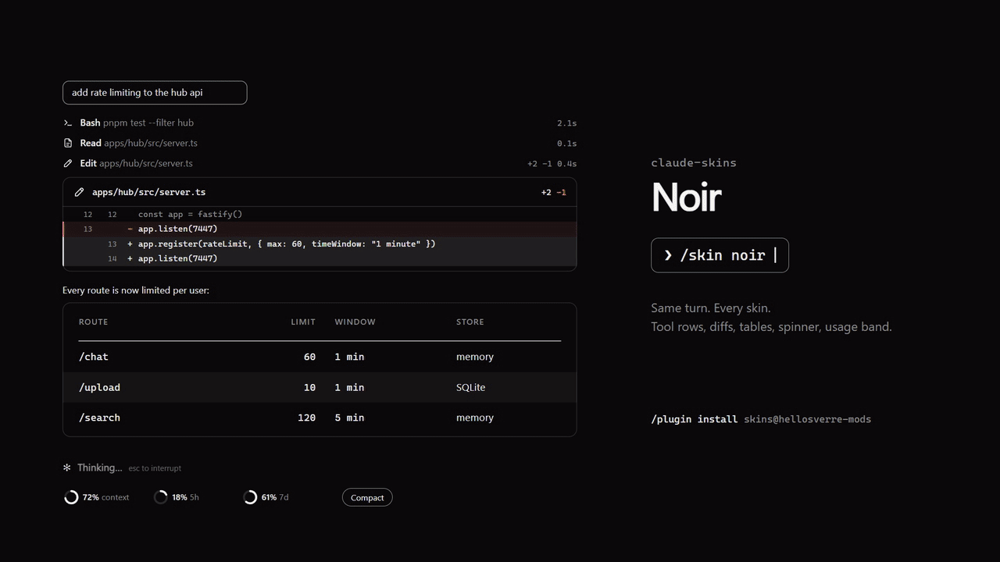

<h1 align="center">
  <picture>
    <source media="(prefers-color-scheme: light)" srcset="docs/brand/banner-light.svg">
    
  </picture>
</h1>

<p align="center">
  <a href="https://github.com/hellosverre/claude-skins/releases/latest"></a>
  <a href="LICENSE"></a>
  
</p>

<p align="center">Chamadas de ferramentas com ícones e tempos, edições como cards de diff, tabelas, código e gráficos Mermaid como cards,<br>uma faixa de uso ao vivo e dezesseis skins que você pode repintar ou ter o Claude desenhando para você.</p>



## Instalação

Precisa do Claude Code **2.1.287** ou mais recente, em um terminal ou na aba Code do aplicativo desktop. Rode os dois dentro do Claude Code:

```
/plugin marketplace add hellosverre/claude-skins
```

```
/plugin install skins@hellosverre-mods
```

Reinicie o Claude Code. A skin **noir** está ativa; digite `/skin` para mudá-la.

Procurando mais mods? `/plugin install mod-store@hellosverre-mods`, depois `/mods` navega e instala cerca de 2.700 deles a partir de um painel, mostrando antes o que cada um pode acessar.

## Atualização

O skins verifica se há uma nova release uma vez por dia e mostra um aviso quando você está atrasado. Para atualizar:

```bash
claude plugin marketplace update hellosverre-mods
```

```bash
claude plugin update skins@hellosverre-mods
```

Depois reinicie o Claude Code. Sessões abertas mantêm a versão com que começaram.

## Desinstalação

```bash
claude plugin uninstall skins@hellosverre-mods
```

Para mantê-lo instalado mas voltar ao desenho próprio do Claude Code, execute `/skin off`.

## Uso

`/skin help` lista todos os comandos no Claude Code; `/skin list` mostra todas as skins e configurações.

**Skins**

| Comando | O que faz |
|---|---|
| `/skin` | Configurações: escolha uma skin com pré-visualização ao vivo, alterne partes, repinte qualquer cor |
| `/skin <nome>` | Troca de skin (nomes abaixo) |
| `/skin list` | Todas as skins, inclusive as suas, e todas as configurações |
| `/skin help` | Todos os comandos, em tabela |
| `/skin off` · `on` | Volta ao desenho próprio do Claude Code, ou liga as skins de volta |
| `/skin gallery` | Todos os elementos que a skin desenha, numerados, para apontar |
| `/skin pin` · `unpin` · `share` | Dá a esta pasta sua própria aparência, remove ou torna o padrão |
| `/skin copy` · `copy code` | Copia a última resposta do Claude, ou só seu último bloco de código |
| `/skin calm` · `calm off` | Sem movimento, uma linha por linha de ferramenta, saída somente leitura dobrada, falhas sempre inteiras; `calm off` restaura o que você tinha |

Skins embutidas: `noir`, `tokyo-night`, `dracula`, `catppuccin`, `rose-pine`, `nord`, `gruvbox`, `kanagawa`, `everforest`, `one-dark`, `solarized`, `night-owl`, `ayu`, `github`, `mono`, `terminal`.

**Opções**

| Comando | O que faz |
|---|---|
| `/skin tables on/text/off` | Tabelas como cards, como texto selecionável no desktop, ou as próprias do Claude Code |
| `/skin prompt left/right/plain` | No terminal, de qual lado fica o contorno do seu prompt, ou um marcador inicial simples. O desktop mantém as mensagens próprias do Claude Code, com copiar e retroceder |
| `/skin words claude/skin` | De quem são as palavras do spinner e do rodapé do turno: as do próprio Claude Code, ou as da skin (o padrão) |
| `/skin icons unicode/ascii` | O conjunto de ícones, e diagramas somente ASCII no terminal |

**Partes**, cada uma alternada com `/skin <parte> on` ou `off`:

| Parte | O que faz |
|---|---|
| `rail` | A faixa colorida ao lado das linhas de ferramenta |
| `shimmer` | A banda de luz sobre a palavra do spinner |
| `band` | Os medidores de uso acima do prompt |
| `countdown` | Tempo restante de cada limite na faixa |
| `compact` | O botão Compact na faixa, com um toque a partir de 70% de contexto (ligado por padrão) |
| `clip` | Corta a própria saída de shell do Claude Code na cabeça e na cauda |
| `markdown` | Alertas e listas de tarefas desenhados |
| `quiet` | Leituras, buscas e comandos somente leitura dobrados em uma linha |
| `charts` | Cercas Mermaid como gráficos |
| `math` | Matemática tipografada |
| `commands` | Saída de comandos slash como tabelas e cards |
| `shell` | Saída de shell como um card |
| `highlight` | Blocos de código destacados nas cores da skin |
| `hints` | Avisa o Claude de que gráficos são desenhados aqui |
| `links` | URLs e caminhos como links |
| `copy` | Botões de copiar nos cards |
| `fold` | Blocos longos dobram atrás de `▾ N more` |
| `expand` | Toda execução de leituras e buscas aberta, em vez da linha única `Read 3 · Search 2 ▸`; desligado por padrão |

**Desenhe uma com o Claude.** Peça "faça uma skin que pareça um pôr do sol". O skins dá ao Claude uma ferramenta `design`, então ele constrói a skin e a aplica enquanto você assiste. Repintar uma skin embutida a salva como sua própria `my-<skin>`. As escolhas são lembradas entre sessões.

## Pré-visualização

Desenhada pelo próprio código de cards do mod (`scripts/previews.ts`), não por capturas de tela.

<picture>
  <source media="(prefers-color-scheme: light)" srcset="docs/previews/hero-light.svg">
  
</picture>

<picture>
  <source media="(prefers-color-scheme: light)" srcset="docs/previews/spinners-light.svg">
  
</picture>

<picture>
  <source media="(prefers-color-scheme: light)" srcset="docs/previews/terminal-light.svg">
  
</picture>

<picture>
  <source media="(prefers-color-scheme: light)" srcset="docs/previews/code-light.svg">
  
</picture>

<picture>
  <source media="(prefers-color-scheme: light)" srcset="docs/previews/usage-light.svg">
  
</picture>

## O que ele redesenha

| Parte | Aplicativo desktop | Terminal |
|---|---|---|
| Chamadas de ferramenta | Ícone por tipo, spinner enquanto roda, linhas alteradas, tempo gasto. `▸` abre a linha: a entrada completa da chamada e sua resposta (o texto de uma leitura com números de linha, as ocorrências de uma busca, o card de shell, o diff); uma chamada que falhou abre sozinha | Um nó no trilho do turno, com o mesmo `▸` |
| Edições | Card de diff com `+N −M` e linhas numeradas | O próprio diff do Claude Code |
| Comandos de shell | Card de terminal com status, stderr à parte, saída longa dobrada; caminhos, números e palavras de erro, aviso e sucesso coloridos | Card com o comando, a saída colorida do mesmo modo, `✓` ou `✗ exit N`, stderr em vermelho sob seu próprio rótulo, cada stream dobrado para 8 + 4 linhas (`/skin shell off` para o próprio do Claude Code) |
| Saída silenciosa (desligada por padrão) | Leituras, buscas e comandos somente leitura dobram em uma linha; uma falha mantém sua linha de erro | O mesmo |
| Tabelas | Card com regra de cabeçalho, linhas zebradas, amostras de cor | Grade de células com banda de cabeçalho |
| Gráficos | ` ```mermaid ` como card: flowchart, xy, pie, gantt, timeline, journey, kanban, mindmap, quadrant, radar, sankey, gitGraph, treemap, packet, block, architecture, C4 | Os mesmos dezessete desenhados em células, ASCII com `/skin icons ascii` |
| Matemática | `$$…$$`, `\[…\]` e ` ```math ` como card tipografado: frações, raízes, somas e integrais com limites, matrizes, linhas alinhadas; `$…$` inline vira Unicode | Frações e limites empilhados em células, `$…$` inline como Unicode |
| Saída de comandos | `/cost`, `/context` e saída de plugins: tabelas, código e execuções `chave: valor` como cards | Os mesmos como grades de células |
| Alertas e listas de tarefas | `> [!NOTE]` como caixa com título, `- [ ]` com marcações e contagem de concluídos | O mesmo |
| Blocos de código | Card com linguagem, números de linha, destaque; blocos de shell mantêm o botão Run | Emoldurado, a linguagem na moldura, destacado nas cores da skin: TS/JS, JSON, shells, PowerShell, Python, Rust, Go, C/C++, C#, F#, Java, YAML, TOML, HTML/XML, CSS, SQL, diff, Markdown, Lua (`/skin highlight off` para o próprio do Claude Code) |
| Spinner | Ícone animado por fase | A palavra da skin com uma banda de luz |
| Acima do prompt | Anéis de contexto e de limite do plano, botão Compact, toque a 70% | Medidores em bloco, mesmo botão |
| Seus prompts | Os próprios do Claude Code, então copiar, retroceder e selecionar permanecem | Contorno arredondado, ou um marcador simples |
| Links e arquivos | URLs são os próprios links do app; linhas de ferramenta coloram arquivos criados neste turno (`ok`) ou editados (`warn`) | URLs em prosa são links OSC 8 onde o terminal os desenha (`FORCE_HYPERLINK=1` ou `0` sobrepõe a verificação), texto simples em outros lugares; caminhos com `:linha`, números e versões coloridos, arquivos deste turno em `ok` ou `warn` em linhas e prosa |
| Cercas de diff | ` ```diff ` como card de diff, com Copy e `new only` (o código depois da mudança) | Linhas antigas e novas numeradas, `+` e `-` nas cores da skin e o código destacado na linguagem que o caminho do `+++` ou uma tag ` ```diff-fsharp ` nomeia, as mesmas duas cópias |
| Lado a lado | Duas ou mais tabelas ou gráficos em uma linha compartilham-na quando cada um recebe 75 colunas; caso contrário empilham | Tabelas e diagramas em uma linha ficam lado a lado enquanto suas larguras naturais couberem; caso contrário empilham |
| Blocos longos | Cards de código além de 24 linhas cortam lá, com `▾ N more` | Código além de 24 linhas, tabelas além de 14 linhas e saída de shell além de 8 + 4 linhas dobram atrás de `▾ N more` / `▴ less` |

Todo card tem um botão Copy (tabelas também `as text`, a tabela como desenhada; uma resposta de vários blocos termina em `copy reply`) e anima uma vez, no primeiro desenho, respeitando movimento reduzido. Só o desenho muda: a conversa armazenada e o que o modelo lê não são tocados. Agentes, modo de plano e o prompt de permissão mantêm o desenho próprio do Claude Code.

**Dicas de gráficos.** Com gráficos ligados, o Claude recebe uma nota só para o modelo (cerca de 130 tokens, estimados a partir de seus 458 caracteres) dizendo que cercas ` ```mermaid ` são desenhadas aqui, então ele recorre a um gráfico quando um lê melhor. Nunca para execuções headless `claude -p`. `/skin hints off` descarta isso e mantém os gráficos desenhando.

**Claro e escuro.** Toda skin tem os dois e segue o tema do Claude Code. Em `auto` segue seu terminal (`COLORFGBG`) ou o sistema. Force um com `SKINS_THEME=light` ou `SKINS_THEME=dark`.

**As cores do seu terminal.** A skin `terminal` pinta o terminal na sua própria paleta de 16 cores (`ansi256(0)` a `ansi256(15)`), então segue qualquer tema que o terminal tenha, claro ou escuro. Texto do corpo e bandas de tabela usam as cores de tema próprias do Claude Code; escolha um tema ANSI em `/config` para que esses sigam o terminal também. O aplicativo desktop não tem paleta de terminal e o desenha como `noir`.

## Para outros mods

O skins adiciona `$.skins.markdown` a `$`. Ele desenha markdown do jeito que o skins desenha uma resposta, na skin da pessoa. Responde uma árvore, ou `undefined` quando o skins está desligado ou o texto não contém nada que ele desenha, e lança em argumento malformado. Não desenha controles de cópia ou dobragem, porque um pressionar não pode cruzar de uma árvore de um mod para a de outro. Liste `skins` sob `dependencies` no seu `plugin.json` e o Claude Code deposita seus tipos em `.claude-plugin/types/`.

```tsx
let drawn
try {
  drawn = await $.skins.markdown({ surface: e.surface, text, columns: e.props.bodyColumns })
} catch {}
return drawn ?? <Markdown text={text} />
```

## Compatibilidade

Verificado à mão no Windows (terminal e aplicativo desktop, 0.3.0) e rodado no Linux (terminal, 0.5.0, Claude Code 2.1.288, 168 testes do engine). O [CI](.github/workflows/ci.yml) roda os testes, as verificações de manifest e a verificação de tipos no Linux, Windows e macOS. macOS, VS Code e mobile não foram olhados à mão. A matriz superfície × SO e os tempos de renderização por linha estão em [docs/compat.md](docs/compat.md). Para medir na sua máquina:

```bash
scripts/bench.sh
```

## Limitações conhecidas

| O quê | O que você recebe em vez disso | Onde |
|---|---|---|
| Uma linha aberta para uma leitura de imagem, PDF ou notebook, um comando em segundo plano ou uma resposta que não pode ser lida | A própria linha do Claude Code, desenhada na linha aberta | `bodyOf` em [`hooks/detail.ts`](hooks/detail.ts); teste "an opened image Read is Claude Code's own drawing…" |
| Agentes, modo de plano, tarefas, o prompt de permissão | As próprias linhas e diálogos do Claude Code | `kindOf` em [`hooks/tools.ts`](hooks/tools.ts); teste "tools a skin cannot redraw faithfully keep their own row" |
| Edições no terminal, edições que falharam em todo lugar | O próprio diff do Claude Code | [`hooks/register.tsx`](hooks/register.tsx) `ToolResult`; teste "on the desktop an edit is a diff card…" |
| Blocos de código no terminal em uma linguagem que o destacador não conhece | O próprio markdown do Claude Code | `languageOf` em [`hooks/highlight.ts`](hooks/highlight.ts); teste "a fence in a language it does not know keeps Claude Code's markdown" |
| Cercas de shell (` ```bash `) no desktop | O próprio bloco do app, para que seu botão Run permaneça | teste "on the desktop a shell fence keeps the app's own block" |
| Diagramas de sequência, estado, classe e ER no desktop | Um card de código: só o layout vendored do terminal os desenha | `artKind` em [`hooks/mermaid-art.ts`](hooks/mermaid-art.ts), `parseMermaid` em [`hooks/mermaid.ts`](hooks/mermaid.ts) |
| Caracteres coreanos, chineses, japoneses ou outros largos no id de nó de um diagrama de terminal ou no nome de estado (`A[開始] --> 請求`) | O código: o layout vendored descarta tais nós. Legendas largas desenham como arte | `drawsWide` em [`hooks/mermaid-art.ts`](hooks/mermaid-art.ts); teste "a diagram the renderer cannot lay out with wide characters falls back to code" |
| Um diagrama largo demais ou longo demais (mais de 80 linhas ou 8.000 caracteres no terminal) | Linhas para flowchart, xy e pie, senão o código | teste "a diagram too wide for the terminal falls back to rows…" |
| Um bloco de resposta acima de 9.000 caracteres, um prompt acima de 4.000 | O próprio desenho do Claude Code da mensagem inteira | `MAX_MARKDOWN`, `MAX_PROMPT` em [`hooks/register.tsx`](hooks/register.tsx) |
| Cards de código além de 80 linhas | As primeiras 80 e uma nota `N more lines`; Copy pega tudo | `MAX_LINES` em [`hooks/svg-code.ts`](hooks/svg-code.ts) |
| Comandos TeX que o parser não conhece | Desenhados como escritos, `\name` | [`hooks/math.ts`](hooks/math.ts) |
| Saída de shell no terminal vs no desktop | O card do terminal nomeia o comando e dobra cada stream para 8 + 4 linhas; o card do desktop diz `Output` e dobra ambos os streams juntos para 6 + 6 | [`hooks/shell-rows.tsx`](hooks/shell-rows.tsx), [`hooks/svg-terminal.ts`](hooks/svg-terminal.ts) |
| Uma chamada de shell que falhou e entrega texto de erro, não seu registro | stdout e stderr chegam mesclados, então todo o texto é desenhado como stderr | `shellResultOf` em [`hooks/shell.ts`](hooks/shell.ts) |
| Um comando enviado ao segundo plano, ou saída que é uma imagem | A própria linha do Claude Code, que diz para onde foi ou desenha a imagem | `keepsOwnRow` em [`hooks/shell.ts`](hooks/shell.ts); teste "/skin shell off gives shell output back…" |
| Cards de shell e tempos de ferramentas após `/resume` | Sem comando no cabeçalho e sem tempo: ambos são gravados enquanto a chamada roda | `commandAtom`, `durationAtom` em [`hooks/register.tsx`](hooks/register.tsx) |
| Erros de comandos slash e a própria saída do `/skin` | A própria linha do Claude Code | teste "slash-command output with key: value lines is a table, prose keeps its row" |
| `/skin calm` e o spinner do Claude Code | O calm entrega o spinner de volta ao Claude Code, cujo spinner próprio ainda se move | `Spinner` em [`hooks/register.tsx`](hooks/register.tsx) |
| O painel de configurações no mobile | Uma linha dizendo para usar o terminal ou o aplicativo desktop | `Pane` em [`hooks/register.tsx`](hooks/register.tsx) |
| Caminhos de arquivo como links | Coloridos, não clicáveis: o `Link` do engine aceita apenas `https:` e `http://localhost` | `safeHref` em [`hooks/links.ts`](hooks/links.ts) |
| Dobragem no desktop | Cards de código dobram; cards de tabela e o card de shell mantêm sua altura total ou sua própria dobragem 6 + 6 | [`hooks/fold.tsx`](hooks/fold.tsx) |
| Ícones e a faixa | Ícones apenas no desktop (o terminal não desenha `Svg`); a faixa apenas no terminal | `lookOf` em [`hooks/register.tsx`](hooks/register.tsx) |

## Comparado com

Outros mods que mudam a aparência da transcrição, a partir de seus READMEs em 2026-10-10. Em branco significa que o README não diz.

| | skins | [Prismantis](https://github.com/NahumLitvin/prismantis) | [glint](https://github.com/manikosto/glint) | [tweakcc](https://github.com/Piebald-AI/tweakcc) | [claude-gfm-render](https://github.com/briangtn/claude-gfm-render) | [ccstatusline](https://github.com/sirmalloc/ccstatusline) |
|---|---|---|---|---|---|---|
| Como | Plugin de function hooks | Plugin de function hooks | Plugin de function hooks, um fork do Prismantis | Faz patch no JavaScript do Claude Code; reaplique após cada atualização | Mod de function hooks | Comando de linha de status |
| Claude Code | 2.1.287+ | 2.1.287+ | 2.1.289+ | Verificado em 2.1.162 | 2.1.286+ | |
| Plataformas nomeadas | Windows à mão, Linux por testes; CI no Linux, Windows, macOS ([compat](docs/compat.md)) | Terminal macOS à mão; CI no macOS, Linux, Windows | | Windows, macOS, Linux | Terminal e aplicativo desktop | Guia do Windows nos docs |
| Temas | 16, repinte qualquer cor ou tenha o Claude desenhando um | 15 e `mono`, 20 slots de cor | 15 | Os seus, para toda a interface do Claude Code | | Temas Powerline |
| Recolore a própria interface do Claude Code | Não | Não | Não | **Sim** | Não | Não |
| Linhas de ferramenta | Ícones, tempos, faixa; **abre para a entrada e a resposta** | 4 estilos | | | Não | Não |
| Saída somente leitura oculta | `/skin quiet` | `toolOutput: quiet` | | | Não | Não |
| Diffs de edição | Card no desktop; o diff do engine em uma linha aberta no terminal | O próprio do Claude Code | | | Não | Não |
| Cercas ` ```diff ` | Card de diff ou linhas numeradas, cópia `new only` | | Numeradas, `⧉ new only` | | | Não |
| Saída de shell | Card em ambas as superfícies, caminhos, números e erros coloridos | Em caixas em grupos expandidos | | | Não | Não |
| Destaque de código no terminal | 20 famílias de linguagem nas cores da skin | Prism, duas dezenas de linguagens | 20+ linguagens | | | Não |
| Tabelas | Card ou grade de células, lado a lado com diagramas | 4 estilos, lado a lado com diagramas | | 4 formatos | Não | Não |
| Mermaid | 17 tipos; sequência, estado, classe, ER apenas no terminal | Flowchart, sequência, estado, classe, ER, xy; sem pie | Flowchart, sequência, xy | | Flowchart, sequência, estado, classe, ER, xy; SVG no desktop | Não |
| Matemática | Card no desktop, células empilhadas no terminal | Imagem tipografada em kitty e Ghostty via RaTeX, texto em outros lugares | | | Não tratado | Não |
| Links | URLs como links OSC 8; arquivos deste turno coloridos | Links e URLs soltas clicáveis | **URLs e caminhos de arquivo clicáveis**; arquivos alterados coloridos; banda de links | | | Não |
| Blocos longos dobrados | Código, tabelas, saída de shell (`/skin fold`) | | Código, listas, tabelas | | | Não |
| Texto da direita para a esquerda | Não | **Hebraico e árabe** | Hebraico e árabe | | | Não |
| Medidores de uso | Contexto e limites do plano acima do prompt | | | | Não | **Muitos widgets**, Powerline |
| Palavras do spinner | As da skin, com cintilação | | | **Seus próprios verbos e animações** | Não | Não |
| Copiar | Cards, tabelas como markdown ou como desenhadas, `copy reply`, `/skin copy` | Botões, `/prismantis copy`, tabelas HTML | Código, tabelas, diagramas, listas, citações | | | Não |
| API para outros mods | `$.skins.markdown` | `$.prismantis.markdown` | | | | Não |

Onde eles são melhores: **tweakcc** recolore toda a interface do Claude Code, não apenas o que um hook pode redesenhar, ao custo de fazer patch no binário. **Prismantis** trata texto da direita para a esquerda, copia tabelas como HTML e tipografa matemática como imagens. **glint** torna caminhos de arquivo clicáveis e mantém uma banda dos links da última resposta. **ccstatusline** tem uma linha de status muito mais profunda. **claude-gfm-render** desenha sequência e outros diagramas como SVG no desktop, onde o skins recorre a um card de código. O que o skins planeja a seguir está em [ROADMAP.md](ROADMAP.md).

## Privacidade

O skins desenha e lembra, nada mais. Ele lê o diretório da sessão, seu contexto e uso do plano, a configuração de tema e `SKINS_THEME` / `COLORFGBG`, e mantém suas configurações no mod store. Sua única chamada de rede é a verificação diária de versão: um GET do [`plugin.json`](.claude-plugin/plugin.json) deste repositório em `raw.githubusercontent.com`, sem enviar nada. Em `auto` ele pede ao SO o modo claro ou escuro (`defaults` no macOS, `gsettings` no GNOME). Ele compacta ou copia apenas quando você pressiona o botão. Confira você mesmo com `claude plugin validate .`.

## Código vendored

Diagramas de terminal são dispostos por [beautiful-mermaid](https://github.com/lukilabs/beautiful-mermaid) (MIT), empacotado em `hooks/vendor/mermaid-ascii.js` com sua licença no cabeçalho. Para reconstruí-lo:

```bash
cd scripts/vendor && npm install && npm run build
```

## Desenvolvimento

```bash
git clone https://github.com/hellosverre/claude-skins && cd claude-skins
```

```bash
claude --plugin-dir .
```

Salvar um arquivo recarrega o mod na sessão em execução. Testes: `claude plugin test .`. Pré-visualizações: `npx tsx scripts/previews.ts`. Uma nova skin embutida é um único arquivo: copie `hooks/themes/nord.ts`, mude as cores e palavras, adicione uma linha em `hooks/themes/index.ts`.

## Mais mods

- [redgreen](https://github.com/hellosverre/redgreen): resultados de testes em um painel ao lado do chat
- [smart-compact](https://github.com/hellosverre/smart-compact): compacta após um commit, testes verdes, antes do cache do prompt expirar ou quando o Claude pede
- [mod-store](https://github.com/hellosverre/mod-store): navegue, busque e instale 2.700 mods a partir de um painel

## Licença

MIT
