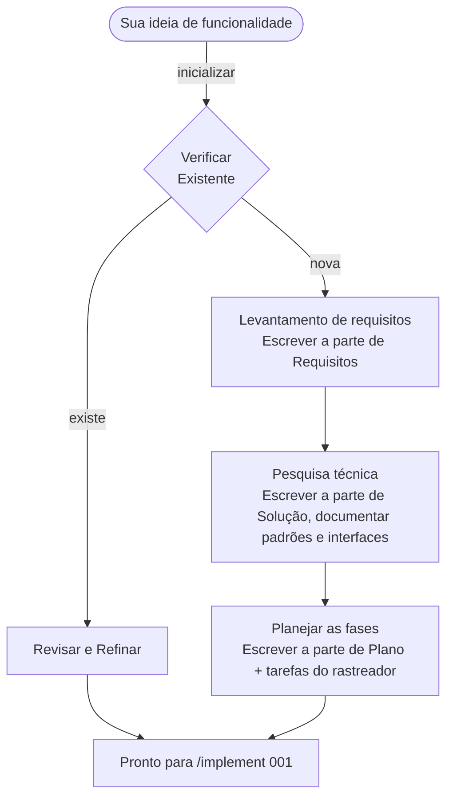
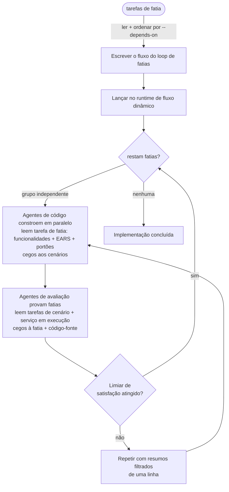
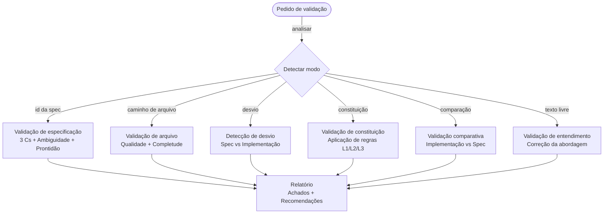
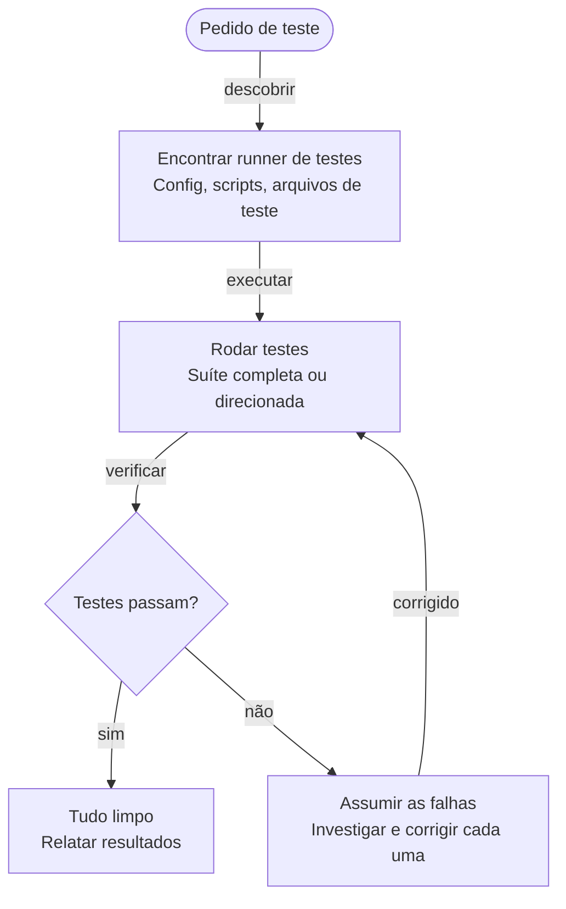
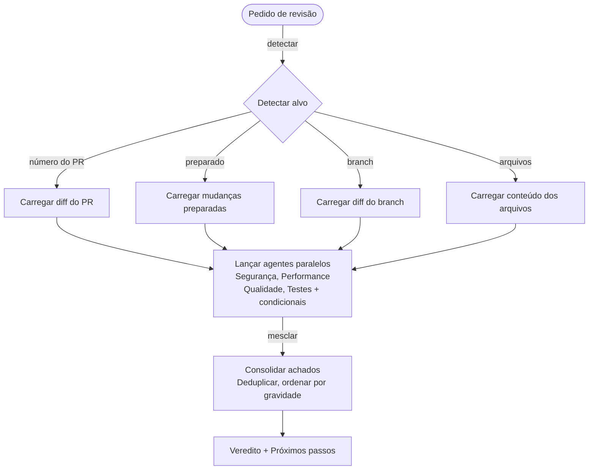
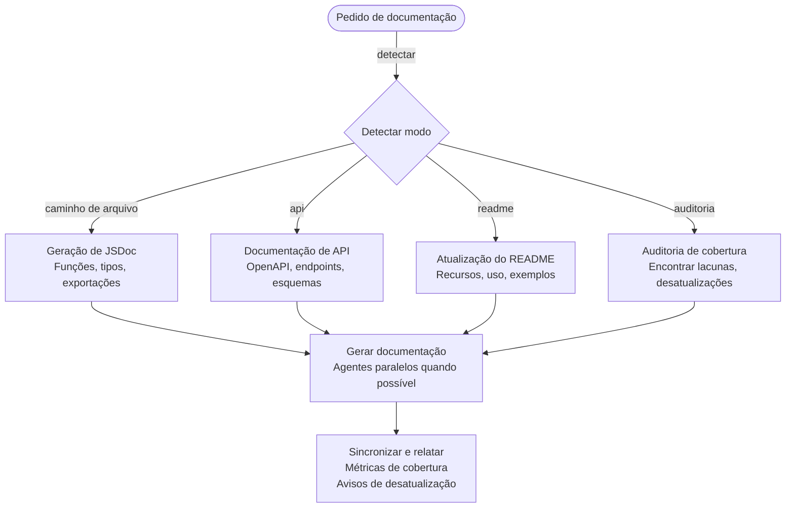
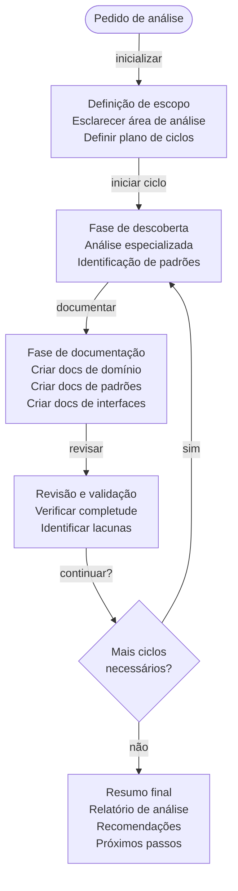
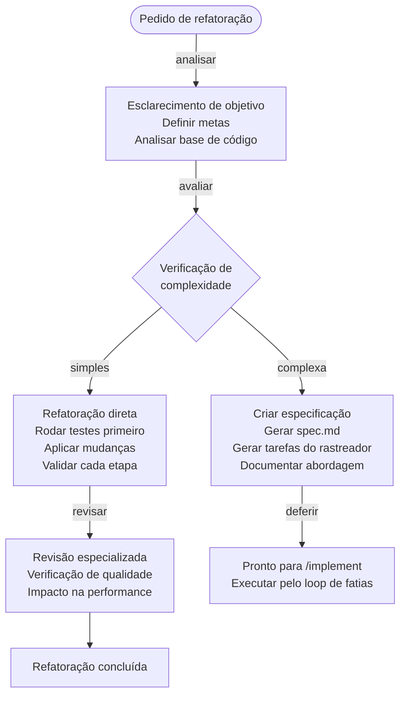
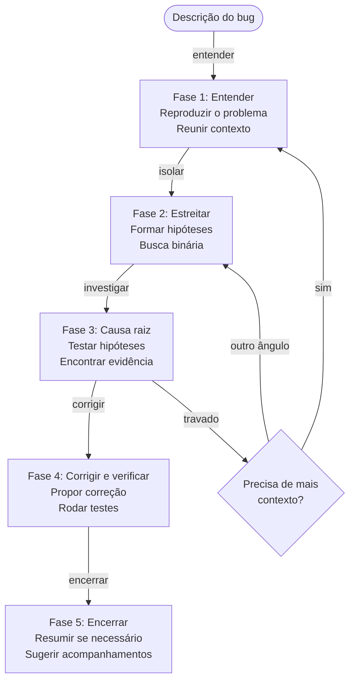
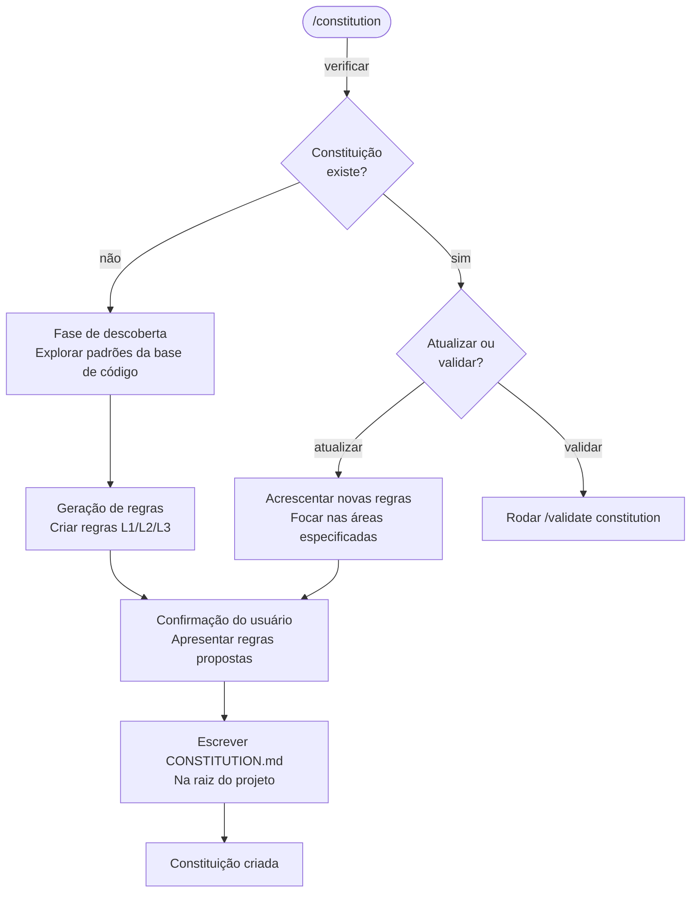

# Plugin Start — A Startup Agêntica

**Plugin de orquestração de fluxo de trabalho para desenvolvimento orientado por especificações no Claude Code.**

O plugin `start` oferece dez skills de fluxo invocáveis pelo usuário, cinco skills autônomas e três estilos de saída para transformar a forma como você constrói software com o Claude Code.

**Para início rápido, guia do fluxo e escolha de skills, veja o [README principal](../../README.md).**

---

## Índice

- [Skills invocáveis pelo usuário](#skills-invocáveis-pelo-usuário) — specify, implement, validate, test, review, document, analyze, refactor, debug, constitution
- [Skills autônomas](#skills-autônomas) — 5 skills ativadas por contexto
- [Estrutura da documentação](#estrutura-da-documentação) — specs, domínio, padrões, interfaces
- [Estilos de saída](#estilos-de-saída) — The Garage, The Startup, The ScaleUp
- [Fluxo de desenvolvimento típico](#fluxo-de-desenvolvimento-típico) — fluxos principais e de manutenção
- [Skills em ação](#skills-em-ação) — exemplos do mundo real
- [Modelos](#modelos) — PRD, SDD, Plan, Scenario
- [Filosofia](#filosofia) — princípios de desenvolvimento orientado por especificações

---

## Skills invocáveis pelo usuário

Estas skills são invocadas pelo usuário por comandos slash (por exemplo, `/specify`). Diferente das skills autônomas, que são ativadas automaticamente pelo contexto, as skills invocáveis esperam uma chamada explícita.

### `/specify <descrição>`

Crie especificações abrangentes a partir de descrições breves, com pesquisa profunda e coordenação de agentes especialistas, produzindo um plano narrativo mais as tarefas de fatia que `/implement` executa.

**Objetivo:** Transformar ideias em especificações prontas para implementação, com requisitos de produto, design da solução e um plano — um `spec.md` mais as tarefas de implementação no rastreador

**Uso:**
```bash
/specify Build a real-time notification system with WebSocket support
/specify 001  # Retomar trabalho de especificação existente
```

**Recursos principais:**
- **IDs de spec incrementais automáticos** — cria diretórios numerados automaticamente (001, 002, etc.)
- **Capacidade de retomada** — pode retomar trabalho em especificações existentes pelo ID
- **Plano em fatias** — divide o trabalho em tarefas de fatia autocontidas, cada uma correlacionando funcionalidades (ACs), comportamento EARS e portões de qualidade, com cenários de reserva como tarefas filhas separadas
- **Ordenado por dependência** — as fatias declaram `--depends-on` entre si; esse grafo é o contrato de paralelização usado por `/implement`
- **Documentação de padrões** — documenta automaticamente os padrões descobertos em `docs/patterns/`
- **Documentação de interfaces** — captura contratos de serviços externos em `docs/interfaces/`
- **Documentação de domínio** — registra regras de negócio em `docs/domain/`
- **Portões de qualidade** — exige aprovação do usuário entre fases principais

**O briefing de código de cada fatia correlaciona três facetas:**

| Facet | Fonte | Papel |
|-------|--------|------|
| **Funcionalidades** (critérios de aceitação) | Parte de requisitos | o que a fatia entrega |
| **Comportamento** (EARS) | Parte de solução | como deve se comportar |
| **Portões de qualidade** | derivado | condições verificáveis |

Seus **cenários de aceitação** são tarefas filhas separadas (evidência de reserva) — como isso é provado.

<details>
<summary><strong>Ver detalhes</strong></summary>

**O que você recebe:** um documento, `.start/specs/[NNN]-[nome]/spec.md`, em três partes, cada uma fechada por seu próprio portão de aprovação:

- **Requisitos** — histórias de usuário, especificações de funcionalidades, critérios de sucesso, requisitos não funcionais
- **Solução** — arquitetura técnica, componentes do sistema, modelos de dados, stack tecnológica
- **Plano** — o estado-alvo e as fases com seus resultados; as tarefas de implementação (fases → fatias → tarefas filhas de cenário) vivem em **.tracker/**

A parte de Razão guarda as perguntas em aberto, suposições, registro de decisões e compensações de revisão aceitas.



</details>

---

### `/implement <id-da-spec>`

Executa uma especificação rodando suas tarefas de fatia no runtime de fluxo de trabalho dinâmico do Claude Code.

**Objetivo:** Transformar especificações validadas em código funcionário por meio de um único loop — cada fatia construída por um agente de código e provada por um agente de avaliação, com uma barreira de informação entre eles e repetição até um limiar de satisfação.

**Uso:**
```bash
/implement 001
/implement path/to/custom/spec/
```

**Como funciona:**

`/implement` lê as tarefas de fatia da spec no rastreador e as ordena topologicamente por `--depends-on`. Depois cria e executa um único fluxo de trabalho dinâmico:

| Etapa | O que acontece |
|------|--------------|
| **Ler** | Lê as tarefas de fatia (`task.js graph`); cada uma traz um briefing de código (funcionalidades + EARS + portões) com seus cenários de reserva como tarefas filhas |
| **Lançar** | Escreve o script do fluxo a partir do contrato de loop da skill e o executa pela ferramenta Workflow; fatias independentes rodam em paralelo |
| **Loop** | Por fase: agentes de código constroem suas fatias — um agente para uma fase cujas fatias dependem umas das outras em cadeia, um por fatia para fatias que podem rodar em paralelo (leem as tarefas de fatia, cegas aos cenários) → um agente de avaliação prova a fase com um script de reserva mantido fora do projeto (lê as tarefas de cenário, cego às fatias + código-fonte) → repetição com resumos filtrados até o limiar ou o máximo de iterações |

**Recursos principais:**
- **Um loop, escala emergente** — um plano de 1 fatia é um loop curto; um plano de 40 fatias se espalha. Não há camada ou estratégia para escolher
- **Barreira estrutural de informação** — a barreira é qual tarefa cada agente lê: agente de código → tarefa de fatia; agente de avaliação → tarefas filhas de cenário
- **Retomabilidade** — o runtime de fluxo dinâmico retoma agentes concluídos do cache dentro de uma sessão
- **Detecção de desvio** — roda verificações de desvio de `Skill(start:validate)`
- **Aplicação da constituição** — violações L1/L2 bloqueiam a conclusão
- **Atualizações em tempo real** — `/workflows` mostra progresso ao vivo por fatia

<details>
<summary><strong>Ver detalhes — o loop de fatias</strong></summary>

Lê as tarefas de fatia da spec no rastreador e as ordena topologicamente por `--depends-on`. Executa um fluxo dinâmico escrito a partir do contrato de loop da skill. Cada fase passa por um loop código→avaliação com barreira: agentes de código constroem suas fatias (lendo as funcionalidades + EARS + portões das tarefas de fatia e o AGENTS.md, mas nunca suas tarefas filhas de cenário), um agente de avaliação prova a fase contra essas tarefas de cenário com um script de reserva que mantém fora do projeto (acessando o serviço em execução e, para cenários de UI, um navegador real, mas nunca as fatias ou o código-fonte), e resumos filtrados de falha de uma linha alimentam a próxima repetição até o limiar de satisfação ou o máximo de iterações. Uma fase cujas fatias formam uma cadeia de dependências é construída por um agente de código; fatias que podem rodar em paralelo recebem um agente cada, simultaneamente.



</details>

---

### `/validate <alvo>`

Valida especificações, implementações ou entendimento por detecção inteligente de contexto e o framework dos 3 Cs (Completude, Consistência, Correção).

**Objetivo:** Portão de qualidade que funciona em qualquer estágio do ciclo de vida — durante a especificação, antes da implementação ou após a conclusão

**Uso:**
```bash
/validate 001                                          # Validar spec por ID
/validate .start/specs/001/spec.md                      # Validar arquivo específico
/validate Check the auth implementation against SDD    # Comparar implementação à spec
/validate drift                                        # Verificar desvio spec-implementação
/validate constitution                                 # Validar conformidade com a constituição
/validate Is my caching approach correct?              # Validar entendimento
```

**Recursos principais:**
- **Detecção inteligente de modo** — determina automaticamente o tipo de validação pela entrada
- **Framework dos 3 Cs** — verifica Completude, Consistência e Correção
- **Detecção de ambiguidade** — procura linguagem vaga ("deveria", "vários", "etc.")
- **Rastreabilidade entre documentos** — verifica alinhamento de requisitos → solução → manifesto
- **Detecção de desvio** — verifica alinhamento spec-implementação
- **Aplicação da constituição** — valida regras de governança L1/L2/L3
- **Apenas consultivo** — oferece recomendações sem bloquear
- **Validação por comparação** — compara implementações com especificações

<details>
<summary><strong>Ver detalhes</strong></summary>

**Seis modos de validação** detectados automaticamente pela entrada:

| Tipo de entrada | Modo | O que é validado |
|------------|------|---------------------|
| ID de spec (`005`) | Especificação | Qualidade e prontidão completas da spec |
| Caminho de arquivo (`src/auth.ts`) | Arquivo | Qualidade de um arquivo individual |
| `drift` ou `check drift` | Detecção de desvio | Alinhamento spec-implementação |
| `constitution` | Constituição | Conformidade com regras de governança |
| "Check X against Y" | Comparação | Implementação versus especificação |
| Texto livre | Entendimento | Correção da abordagem |

**O framework dos 3 Cs:**

1. **Completude** — todas as seções preenchidas, nenhum marcador `[NEEDS CLARIFICATION]`, checklists completas
2. **Consistência** — rastreabilidade entre documentos, alinhamento terminológico, sem contradições
3. **Correção** — ADRs confirmados, dependências válidas, critérios de aceitação testáveis



</details>

---

### `/test [alvo]`

Roda testes com aplicação rigorosa de propriedade de código — sem desculpas de "falhas pré-existentes".

**Objetivo:** Descobrir e executar testes, garantir que a base de código fique num estado de sucesso e aplicar a propriedade de quaisquer falhas encontradas

**Uso:**
```bash
/test                            # Rodar a suíte completa
/test all                        # Rodar a suíte completa (explícito)
/test src/auth/                  # Rodar testes de um caminho específico
/test baseline                   # Capturar estado atual dos testes
```

**Recursos principais:**
- **Descoberta de testes** — encontra automaticamente o runner, a config e os arquivos de teste
- **Propriedade de código** — se os testes falham, a correção é sua — sem culpar problemas prévios
- **Captura de baseline** — registra o estado atual de sucesso/falha antes das mudanças
- **Paralelismo multiagente** — pode distribuir suítes de teste entre agentes paralelos
- **Execução direcionada** — roda arquivos, diretórios específicos ou a suíte completa

<details>
<summary><strong>Ver detalhes</strong></summary>

**O mandato de propriedade:**

Quando os testes falham, a skill aplica propriedade rigorosa:
- Nada de "essas falhas já existiam"
- Nada de "não foi causado pelas minhas mudanças"
- Não deixar testes falhando para o usuário

**Modos de teste:**

| Entrada | Modo | O que acontece |
|-------|------|--------------|
| (vazio) ou `all` | Suíte completa | Descobre e roda todos os testes |
| Caminho de arquivo/diretório | Direcionado | Roda testes de um escopo específico |
| `baseline` | Captura | Registra o estado atual dos testes para comparação |



</details>

---

### `/review [alvo]`

Revisão de código multiagente com perspectivas especializadas rodando em paralelo.

**Objetivo:** Revisão abrangente antes do merge, com agentes especializados examinando diferentes questões simultaneamente

**Uso:**
```bash
/review                          # Revisar mudanças preparadas
/review 123                      # Revisar número do PR
/review feature/auth             # Revisar mudanças do branch
/review src/auth/ src/users/     # Revisar arquivos/diretórios específicos
/review staged                   # Revisar explicitamente mudanças preparadas
```

**Recursos principais:**
- **Especialistas paralelos** — agentes de Segurança, Performance, Qualidade e Testes revisam ao mesmo tempo
- **Perspectivas condicionais** — Concorrência, Dependências, Compatibilidade e Acessibilidade ativam quando relevantes
- **Detecção automática de alvo** — detecta número de PR, mudanças preparadas, caminho de arquivo ou diffs de branch
- **Pontuação de confiança** — cada achado traz nível de confiança (ALTO/MÉDIO/BAIXO)
- **Classificação de gravidade** — achados CRÍTICO, ALTO, MÉDIO, BAIXO
- **Modo padrão ou de equipe** — subagentes disparo-e-esqueça ou colegas persistentes com coordenação

<details>
<summary><strong>Ver detalhes</strong></summary>

**Perspectivas centrais de revisão (sempre ativas):**

| Perspectiva | Focos |
|-------------|-------------|
| **Segurança** | injeção SQL, XSS, segredos no código, bypass de autenticação, validação de entrada |
| **Performance** | consultas N+1, índices ausentes, vazamentos de memória, algoritmos ineficientes |
| **Qualidade** | complexidade do código, nomenclatura, princípios SOLID, tratamento de erros, duplicação |
| **Testes** | lacunas de cobertura, casos de borda ausentes, qualidade dos testes, completude das asserções |

**Perspectivas condicionais (ativadas quando relevantes):**

| Perspectiva | Gatilho |
|-------------|---------|
| **Concorrência** | async/await, Promise, threads detectados |
| **Dependências** | mudanças em arquivos de dependência |
| **Compatibilidade** | mudanças em API pública ou esquema |
| **Acessibilidade** | mudanças em componentes de front-end |
| **Constituição** | CONSTITUTION.md existe no projeto |



</details>

---

### `/document [alvo]`

Gera e sincroniza documentação, incluindo docs de API, READMEs, comentários JSDoc e auditorias de documentação.

**Objetivo:** Manter a documentação atualizada com o código, gerar documentos ausentes e identificar desatualizações

**Uso:**
```bash
/document src/api/               # Gerar documentação de API
/document readme                 # Atualizar README do projeto
/document src/utils/             # Acrescentar JSDoc aos arquivos de código
/document audit                  # Auditar cobertura da documentação
```

**Recursos principais:**
- **Múltiplos modos de documentação** — Código, API, README, Auditoria, Módulo
- **Detecção de desatualização** — identifica documentação obsoleta
- **Métricas de cobertura** — informa porcentagem de completude da documentação
- **Geração de OpenAPI** — cria especificações OpenAPI/Swagger a partir do código da API
- **Paralelismo multiagente** — vários agentes de documentação trabalham simultaneamente

<details>
<summary><strong>Ver detalhes</strong></summary>

**Modos de documentação:**

| Entrada | Modo | Saída |
|-------|------|--------|
| Caminho de arquivo/diretório | Código | Comentários JSDoc/TSDoc |
| `api` | API | Especificação OpenAPI, docs de endpoints |
| `readme` | README | Atualizações do README.md |
| `audit` | Auditoria | Relatório de cobertura |

**Detecção de desatualização:**

A skill detecta automaticamente quando a documentação está desatualizada por:
- Comparar timestamps dos docs com mudanças no código
- Verificar se as APIs documentadas ainda correspondem à implementação
- Identificar novas exportações sem documentação



</details>

---

### `/analyze <área>`

Descubra e documente regras de negócio, padrões técnicos e interfaces do sistema por exploração iterativa.

**Objetivo:** Extrair conhecimento organizacional da base de código existente e criar documentação reutilizável

**Uso:**
```bash
/analyze security patterns in authentication
/analyze business rules for user permissions
/analyze technical patterns in our microservices architecture
```

<details>
<summary><strong>Ver detalhes</strong></summary>

Usa um fluxo cíclico de descoberta-documentação-revisão para extrair conhecimento organizacional. Agentes especialistas exploram a base de código para identificar padrões, regras e interfaces nas áreas de negócio, técnica, segurança, performance, integração, dados, testes e deploy. A documentação é organizada automaticamente em `docs/domain/`, `docs/patterns/` e `docs/interfaces/`.



</details>

---

### `/refactor <descrição>`

Melhore a qualidade do código preservando rigorosamente todo o comportamento existente por mudanças incrementais validadas por testes.

**Objetivo:** Refatoração segura e sistemática com rollback automático em falhas de teste

**Uso:**
```bash
/refactor Simplify the authentication middleware for better testability
/refactor Improve the WebSocket connection manager
```

<details>
<summary><strong>Ver detalhes</strong></summary>

Preserva rigorosamente o comportamento por mudanças incrementais validadas por testes. Todos os testes devem passar antes de a refatoração começar e após cada mudança. Rollback automático em falhas de teste. Para refatorações simples, aplica mudanças diretamente com validação contínua. Para refatorações complexas, cria documentos de especificação e defere a execução planejada para `/implement`.



</details>

---

### `/debug <descrição>`

Diagnostique e resolva bugs por investigação conversacional com análise sistemática da causa raiz.

**Objetivo:** Parceiro de depuração em linguagem natural que ajuda a identificar e corrigir problemas por diálogo, não por procedimentos rígidos

**Uso:**
```bash
/debug The API returns 500 errors when uploading large files
/debug Tests are failing intermittently on CI but pass locally
/debug Users report slow page loads after the latest deployment
```

**Recursos principais:**
- **Fluxo conversacional** — diálogo natural, não checklists ou procedimentos rígidos
- **Divulgação progressiva** — começa com um resumo, revela detalhes quando pedido
- **Apenas ações observáveis** — informa só o que foi realmente verificado e encontrado
- **Dirigido pelo usuário** — propõe próximos passos e deixa o usuário guiar a direção
- **Rastreamento de hipóteses** — formula e testa hipóteses ordenadas sistematicamente
- **Baseado em evidências** — nunca inventa raciocínio; todas as conclusões têm evidência

<details>
<summary><strong>Ver detalhes</strong></summary>

Usa uma abordagem conversacional em cinco fases naturais: entender o problema, estreitá-lo, encontrar a causa raiz, corrigir e verificar e encerrar. O depurador informa só ações observáveis ("verifiquei X e encontrei Y") e nunca inventa raciocínio. Os usuários podem perguntar "o que você verificou?" a qualquer momento e receber respostas honestas e verificáveis.



**Os quatro mandamentos:**
1. **Conversacional, não processual** — é um diálogo, não uma checklist
2. **Apenas observável** — "olhei X e encontrei Y", não "isso provavelmente é..."
3. **Divulgação progressiva** — comece breve, expanda quando pedido
4. **Usuário no controle** — "quer que eu...?", não "agora vou..."

</details>

---

### `/constitution [áreas-de-foco]`

Crie ou atualize uma constituição de projeto com regras de governança por análise de padrões baseada em descoberta.

**Objetivo:** Estabelecer regras de projeto verificáveis que são aplicadas durante implementação, revisão e validação

**Uso:**
```bash
/constitution                                    # Criar nova constituição por descoberta na base de código
/constitution security and testing               # Focar em áreas específicas
/constitution Add API patterns                   # Atualizar constituição existente
```

**Recursos principais:**
- **Regras baseadas em descoberta** — analisa padrões reais da base de código, nunca assume frameworks
- **Sistema de níveis L1/L2/L3** — L1 (bloqueante + autocorreção), L2 (bloqueante, manual), L3 (consultivo)
- **Aplicação em três camadas** — verificada em specify (SDD), implement e review
- **Regras de padrão + verificação** — aceita padrões regex e verificações semânticas interpretadas por LLM
- **Degradação suave** — o sistema funciona normalmente se não houver constituição

<details>
<summary><strong>Ver detalhes</strong></summary>

Cria `CONSTITUTION.md` na raiz do projeto (como README, LICENSE, CODE_OF_CONDUCT). A constituição define guardrails verificáveis que detectam violações durante o desenvolvimento.

**Distinção fundamental:**
- **CLAUDE.md** = descrição do projeto, orientações para a IA ("Use React com TypeScript")
- **CONSTITUTION.md** = regras verificáveis que pegam violações ("Sem barrel exports")

**Definições de nível:**

| Nível | Nome | Bloqueante | Autocorreção | Caso de uso |
|-------|------|----------|---------|----------|
| **L1** | Must (deve) | Sim | IA corrige automaticamente | Segurança, correção, arquitetura crítica |
| **L2** | Should (deveria) | Sim | Não | Regras importantes que exigem julgamento humano |
| **L3** | May (pode) | Não | Não | Preferências de estilo, sugestões |

**Exemplo de formato de regra:**

```markdown
### No Hardcoded Secrets

\```yaml
level: L1
pattern: "(api_key|secret|password)\\s*[:=]\\s*['\"][^'\"]{8,}['\"]"
scope: "**/*.{ts,js}"
exclude: "**/*.test.*, .env.example"
message: Hardcoded secret detected. Use environment variables.
\```

Secrets must never be committed to source control.
```

**Aplicação em três camadas:**

| Fase | Comando | Aplicação |
|-------|---------|-------------|
| **Planejamento** | `/specify` (SDD) | O SDD não deve violar princípios constitucionais |
| **Tarefa** | `/implement` | A ordenação das tarefas respeita prioridades constitucionais |
| **Implementação** | `/implement` | Código gerado verificado; violações L1/L2 bloqueiam a conclusão |



</details>

---

### Instalação

Instale o framework The Agentic Startup com o instalador interativo:

```bash
npx the-startup
```

**O que ele faz:**
- Aceita tanto instalações no marketplace do Claude quanto instalações baseadas em arquivos para outros harnesses
- Pede seleção múltipla de plugins
- Pede harness + caminho de instalação ao usar modo de instalação por arquivo
- Copia os artefatos de instalação por arquivo do repositório remoto do GitHub

**Flags:**
- `--help` — mostra informações de uso

**Nota:** Os estilos de saída são selecionados via `/config` — veja [Estilos de saída](#estilos-de-saída).

---

## Skills autônomas

O plugin `start` inclui cinco skills autônomas que são ativadas automaticamente pelo contexto. Você nunca precisa invocá-las explicitamente — elas trabalham quando necessário.

### Skills de especificação

| Skill | Objetivo |
|-------|---------|
| `specify-meta` | Criação do diretório de spec, rastreamento do README, transições de fase |
| `specify-requirements` | Modelo de requisitos de produto, validação, levantamento de requisitos |
| `specify-solution` | Modelo de design da solução, arquitetura, gestão de ADRs |
| `specify-plan` | Escreve o plano narrativo + as tarefas de fatia e cenário no rastreador |

### Skills de implementação

| Skill | Objetivo |
|-------|---------|
| `implement` | Roda o loop de fatias como fluxo dinâmico — repetição código→avaliação com barreira por fatia |

---

## Estrutura da documentação

O plugin incentiva gestão estruturada do conhecimento:

```
.start/
└── specs/
    └── [numero-de-3-digitos]-[nome-da-funcionalidade]/
        ├── spec.md                          # Partes Requisitos, Solução, Plano + Razão
        ├── review.md                        # Relatório de revisão da solução
        ├── events.jsonl                     # Log de eventos que o painel reproduz
        └── .tracker/                        # Tarefas de implementação (fase → fatias → cenários)

docs/
├── domain/                                  # Regras de negócio
│   ├── user-permissions.md
│   ├── order-workflow.md
│   └── pricing-rules.md
│
├── patterns/                                # Padrões técnicos
│   ├── authentication-flow.md
│   ├── caching-strategy.md
│   └── error-handling.md
│
└── interfaces/                              # Integrações externas
    ├── stripe-payments.md
    ├── sendgrid-webhooks.md
    └── oauth-providers.md
```

### Documentação automática

A perspectiva Capture da skill `document` cria automaticamente arquivos no local correto quando padrões, interfaces ou regras de domínio são descobertos durante:
- Criação de especificações (`/specify`)
- Implementação (`/implement`)
- Análise (`/analyze`)

### Deduplicação

O fluxo de captura sempre verifica a documentação existente antes de criar novos arquivos, evitando duplicatas.

---

## Estilos de saída

O plugin `start` traz três estilos de saída — um registro por estágio da empresa. Um estilo muda como o Claude se comunica e quanto processo ele aplica, não o que ele sabe. Todos os três mantêm as instruções de engenharia embutidas do Claude Code (`keep-coding-instructions: true`), e um estilo molda só a conversa principal — subagentes e os fluxos do plugin não são afetados.

Escolha o registro que combina com quem o trabalho é destinado:

| Estilo | Registro | Quando usar |
|-------|----------|-------------------|
| **The Garage** | Pré-startup — construa o menor negócio que funciona, fale o mínimo sobre isso | Protótipos e spikes; nada é estrutural ainda, você está descobrindo se a coisa funciona |
| **The Startup** | Solo — um engenheiro, um agente, sem cerimônia | É só você; sem delegação, sem teatro de plano para aprovação, sem status para terceiros |
| **The ScaleUp** | Coordenado — trabalho que passa por outras pessoas | Alguém que não estava na conversa vai ler o que você escreve e tocar no que você muda; delegue e deixe rastro |

### Ativando um estilo

O comando `/output-style` foi removido no Claude Code v2.1.91. Formas atuais de selecionar:

- **Interativo:** `/config` → Output style.
- **Direto:** `/config outputStyle=The Startup` (Claude Code v2.1.181+).
- **Fixado para um projeto** (compartilhado com o time via git) em `.claude/settings.json`:

  ```json
  { "outputStyle": "The Garage" }
  ```

  Use `.claude/settings.local.json` para uma escolha pessoal por projeto ou `~/.claude/settings.json` para todos os projetos. Precedência: local > projeto > usuário. Uma mudança entra em vigor na próxima sessão (ou após `/clear`).

Este plugin deliberadamente **não** força um estilo (`force-for-plugin` não está definido nos três): o estágio é decisão sua, e um estilo forçado substituiria tanto sua escolha em `/config` quanto qualquer configuração fixada enquanto o plugin estiver habilitado.

---

## Fluxo de desenvolvimento típico

### Configuração (opcional)

```
/constitution ──> Criar regras de governança do projeto
                  Regras L1/L2/L3 aplicadas automaticamente no fluxo BUILD
                  CONSTITUTION.md na raiz do projeto
```

### Fluxo principal: Specify > Validate > Implement > Review

```
/specify ──> /validate ──> /implement ──> /review
   |              |              |              |
Criar specs  Verificar qualidade  loop de fatias  Revisão de código
PRD+SDD+Plan  framework dos 3 Cs  código↔avaliação  Segurança+Perf
   |              |              |              |
Constituição  Constituição   Constituição   Constituição
verificada    modo disponível + desvio aplicada  conformidade
no SDD

Opcional: /document após a implementação para sincronizar a documentação
```

*Se `CONSTITUTION.md` existir, as regras são verificadas automaticamente em cada etapa.*

**1. Criar a especificação**

```bash
/specify Add real-time notification system with WebSocket support
```

**O que acontece:**
- Cria `.start/specs/001-notification-system/`
- Gera spec.md e as tarefas do rastreador
- Documenta padrões/interfaces descobertos
- Opcional: cria o branch git `spec/001-notification-system`

**2. Validar antes da implementação (recomendado)**

```bash
/validate 001
```

**O que acontece:**
- Verifica completude, consistência e correção (os 3 Cs)
- Detecta ambiguidades e linguagem vaga
- Faz varredura de segurança para vulnerabilidades comuns
- Verifica rastreabilidade entre documentos

**3. Executar a implementação**

```bash
/implement 001
```

**O que acontece:**
- Opcional: cria o branch git `feature/001-notification-system`
- Roda o loop de fatias como fluxo dinâmico
- Por fatia: um agente de código a constrói, um agente de avaliação a prova contra tarefas de cenário de reserva
- Repete com resumos filtrados de falha até atingir o limiar de satisfação
- Opcional: cria PR ao concluir

**4. Revisar antes do merge**

```bash
/review
```

**O que acontece:**
- Especialistas paralelos revisam (Segurança, Performance, Qualidade, Testes + condicionais)
- Gera relatório consolidado com ordenação por gravidade

**5. Gerar documentação (opcional)**

```bash
/document src/notifications/
```

**O que acontece:**
- Acrescenta comentários JSDoc/TSDoc
- Atualiza o README se necessário
- Informa cobertura da documentação

---

### Fluxos de manutenção

**Entender código existente**

```bash
/analyze security patterns in authentication
```

Documenta os achados em `docs/patterns/`, `docs/domain/`, `docs/interfaces/`

**Refatoração**

```bash
/refactor Restructure the authentication module for better testability
```

Para mudanças arquiteturais — cria specs, planeja a migração e lida com mudanças que quebram compatibilidade.

**Corrigir bugs**

```bash
/debug The notification system stops working after 100 concurrent users
```

Investigação conversacional com evidências observáveis e direção dada pelo usuário.

**Auditar documentação**

```bash
/document audit
```

Informa cobertura da documentação e identifica documentos obsoletos ou ausentes.

---

## Skills em ação

### Exemplo: captura de conhecimento pela skill Document

**Cenário:** durante a implementação, um agente descobre um padrão

```
Saída do agente: "I implemented a retry mechanism with exponential backoff for API calls"
```

**O que acontece automaticamente:**
1. A perspectiva Capture da skill Document é ativada
2. Verifica `docs/patterns/` por padrões de retry existentes
3. Não encontra — cria `docs/patterns/api-retry-strategy.md`
4. Usa o modelo de padrão
5. Informa: "Created docs/patterns/api-retry-strategy.md"

**Você não precisou:** pedir documentação manualmente nem especificar o caminho

---

## Modelos

Modelos ricos para documentação estruturada, junto de suas skills:

```
plugins/start/skills/
├── specify-meta/template.md             # estrutura de spec.md: Requisitos, Solução, Plano, Razão
├── specify-plan/templates/scenario.md   # Modelo do corpo da tarefa de cenário de reserva
└── document/templates/                  # Modelos de captura de conhecimento
    ├── domain-template.md               # Regras de negócio
    ├── pattern-template.md              # Padrões técnicos
    └── interface-template.md            # Integrações externas
```

**Uso:** usados automaticamente por `/specify` e `/document` ao criar documentação

---

## Filosofia

### Desenvolvimento orientado por especificações

**O problema:** funcionalidades construídas sem requisitos claros levam a dívida técnica, retrabalho e inconsistência.

**Nossa abordagem:**

1. **Especificar primeiro** — especificações abrangentes antes do código
2. **Revisar e refinar** — validar com as partes interessadas
3. **Implementar com confiança** — executar planos validados
4. **Documentar e aprender** — capturar padrões para reutilização

### Princípios centrais

- **Medir duas vezes, cortar uma** — planejamento inicial economiza tempo
- **Documentação como código** — specs evoluem com sua base de código
- **Execução paralela** — vários especialistas, limites claros
- **Portões de qualidade** — DOR/DOD aplicam padrões
- **Divulgação progressiva** — carregue detalhes só quando necessário

---

## Leitura adicional

- **[README principal](../../README.md)** — visão geral do projeto e instalação
